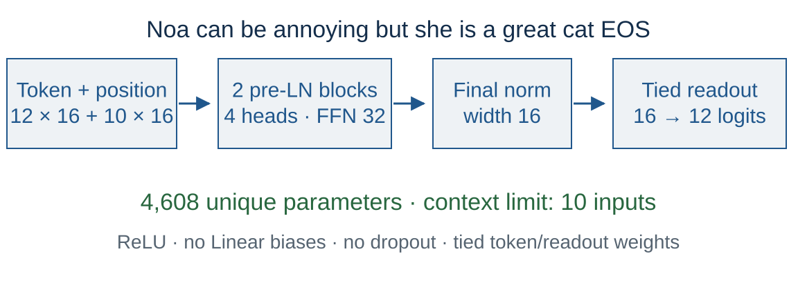
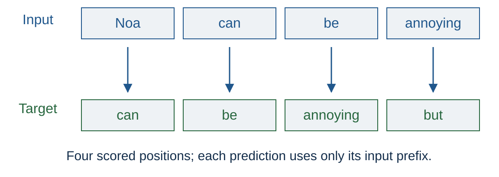
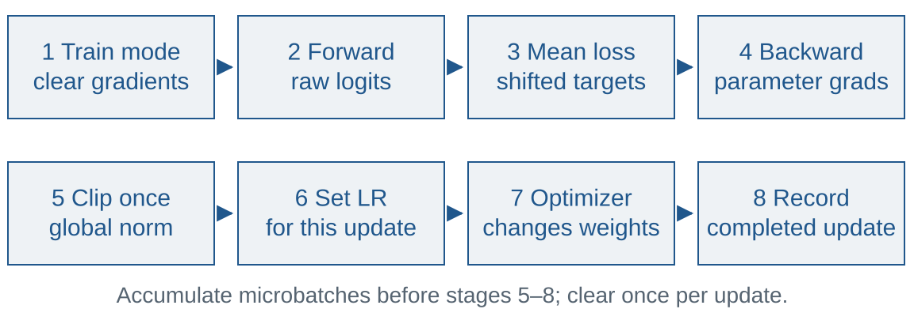
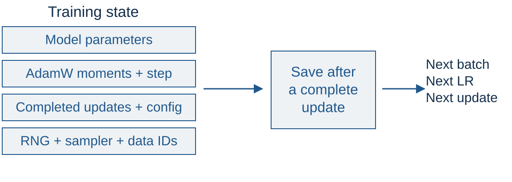
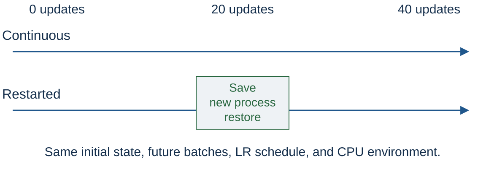
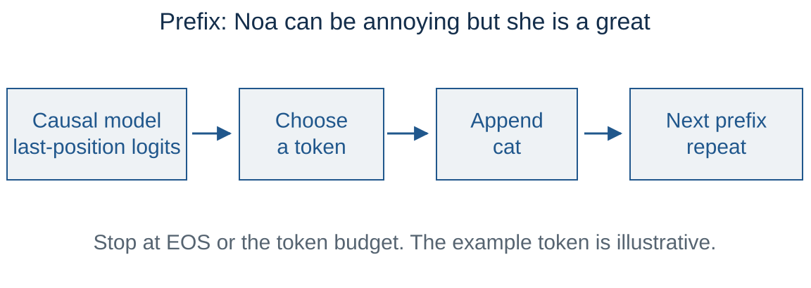
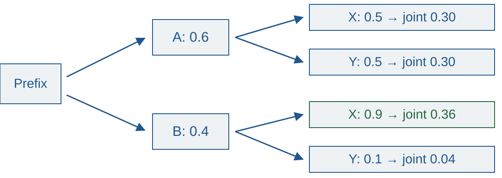

<!-- .slide: class="title-slide" id="title" -->

<p class="eyebrow">CS40008.01</p>

# Pretraining and decoding in practice

<p class="subtitle">Lecture 06 – NLP and LLMs</p>

<p class="byline">Baojian Zhou<br>School of Data Science<br>Fudan University<br>October 14, 2026</p>

Note:
Period 1, opening six-minute group (slides 1–6). Three 45-minute periods, including six ungraded exercises; no quiz today. Students will trace one optimizer update, interpret loss and gradient records, restart a run, and compare decoding policies. Default Notebook opens the single companion practice.ipynb; E01–E06 appear in slide order. All required examples run on CPU with supplied toy data. The 52-slide bank has five optional appendix slides (47–51); after the exit check jump to references. Adapted from the instructor's April 16, 2026 GPT deck, source SHA and page map in teaching-plan.md. All practices have the same expectations for all students.

---

<!-- .slide: id="learning-objectives" -->

## What you will be able to do

**What evidence shows that a training run is working?**

- Build shifted batches and trace an optimizer update.
- Interpret loss curves, learning rates, and gradient norms.
- Check that a restarted run reproduces the next updates.
- Compare greedy, temperature, and top-p decoding.

Note:
Allow 30 seconds within the six-minute opening group. Follow Lecture 05's objectives layout: the central question precedes four concrete outcomes. E01–E06 in the default notebook check these outcomes in order. All exercises are ungraded and use the supplied CPU examples.

---

<!-- .slide: class="outline-slide" id="outline-training" -->

## Outline

<ul class="outline-topics">
<li aria-current="step">Batches and optimizer updates</li>
<li>Training evidence and checkpoints</li>
<li>Generation and decoding</li>
</ul>

<p class="caption">Period 1 · shifted targets, AdamW, and accumulation</p>

Note:
Allow 30 seconds within the six-minute opening group. Reuse this outline at each period boundary and highlight only the current topic. E01 builds the batch; E02 counts tokens and optimizer updates.

---

<!-- .slide: id="pretraining-and-use" -->

## When do the parameters change?

| Activity | Model receives | Parameters updated? |
| --- | --- | --- |
| Pretraining | Corpus examples and targets | Yes |
| Fine-tuning | Task or instruction examples | Yes |
| In-context use | Examples inside the prompt | No |

**Today:** train a small causal LM, save it, and generate from it.

Note:
Continue the opening group. Ask students where the gradient computation occurs. For ordinary in-context inference, the examples affect activations and predictions while weights remain fixed. Pretraining and fine-tuning can share a next-token objective but use different data and purposes. Compress GPT history here: GPT-1 investigated generative pretraining followed by supervised fine-tuning; GPT-2 examined task behavior through language-model prompting; GPT-3 emphasized few-shot in-context evaluation. This is historical motivation, not a ranking of current models. Source Spring slides 11–18 and 43–63. GPT-1 §§3.1–3.2: https://cdn.openai.com/research-covers/language-unsupervised/language_understanding_paper.pdf. GPT-3 §2.1: https://arxiv.org/abs/2005.14165. See the optional history slide for reading.

---

<!-- .slide: id="noa-model" -->

## Continue our Noa decoder



<p class="caption">Same teaching architecture as Lecture 05; each displayed word is one toy token.</p>

Note:
Retrieve the previous lecture without rederiving attention. Vocabulary IDs 0–11 are Noa, can, be, annoying, but, she, is, a, great, cat, friend, EOS. Inputs have at most ten positions. Width 16, four heads of width four, two pre-LN blocks, ReLU FFN width 32, affine LayerNorm epsilon 1e-5, final LayerNorm, and no Linear biases or dropout. Two blocks contribute 4224 parameters; token embeddings 192, positions 160, final norm 32: total 4608. The output reuses the token embedding Parameter. This small architecture deliberately differs from GPT-2's GELU and fourfold FFN. Source: ../lecture-05/teaching-plan.md and its decoder-model notebook cell. The diagram is newly drawn for this lecture.

---

<!-- .slide: id="train-and-generate" -->

## Same model, different loop

| Training | Generation |
| --- | --- |
| Observed sequence supplies targets | Generated tokens extend the prefix |
| Score many positions in one pass | Use the final position's logits |
| Backpropagate and update weights | Select a token; keep weights fixed |

Both use the causal rule: position $t$ sees inputs through $t$.

Note:
Finish the six-minute opening group. Training computes many conditional predictions in parallel, but these predictions are not statistically independent. Each target follows the corresponding input position. Teacher forcing supplies observed earlier tokens; generation uses earlier selected tokens. A correct causal mask alone does not create the shifted targets. Source: Spring slides 11–12, 20–24; GPT-2 report §2.1, https://cdn.openai.com/better-language-models/language_models_are_unsupervised_multitask_learners.pdf. The generation loop will be revisited after we have a checkpoint.

---

<!-- .slide: id="shifted-batches" -->

## Which token is the target?



<p class="caption">A $(B,T+1)$ window produces input and target arrays of shape $(B,T)$.</p>

Note:
Slides 7–8 occupy seven minutes: about three minutes of explanation and four for E01. The arrows identify prediction targets, not attention edges. Input annoying at position 3 may use Noa, can, be, and annoying; it cannot use its target but. Redrawn from the mechanism in Spring slide 12 with the Lecture 05 Noa convention. We score four transitions from five tokens. EOS, when present as a target, is an ordinary scored token. In this toy demonstration windows remain inside a document; the A2 released protocol specifies its own data stream convention.

---

<!-- .slide: class="exercise" id="exercise-01" -->

<p class="exercise-meta">Exercise E01 · 4 minutes · Notebook E01</p>

## Build the batch

```python
windows = [[0, 1, 2, 3, 4],
           [4, 5, 6, 7, 8]]
```

Every target is scored. Write the input array, target array, and number of loss terms.

<div class="answer fragment">
<p>Inputs: <code>[[0,1,2,3], [4,5,6,7]]</code><br>Targets: <code>[[1,2,3,4], [5,6,7,8]]</code></p>
<p>$B=2$, $T=4$: <strong>eight</strong> predicted tokens.</p>
</div>

Note:
Expected response is the two arrays and eight positions. Common mistakes: use the same array twice; count five predictions per window; multiply by vocabulary size. The last target in each row has no input column of its own in that row. The windows are fragments of the Noa vocabulary, not a new dataset. The notebook shows the vocabulary IDs and the slicing operation after students make their prediction. Check tensor contiguity when flattening sliced arrays in executable code. This exercise is ungraded.

---

<!-- .slide: id="mean-token-loss" -->

## Average over predicted tokens

$$L=-\frac{1}{BT}\sum_{b=1}^{B}\sum_{t=1}^{T}
\log p_\theta(y_{b,t}\mid x_{b,1:t})$$

- Feed **raw logits** to cross-entropy.
- Average the losses of the scored target positions.
- Report the convention: here, **nats per token**.

<p class="caption">This batch has no padding. With ignored targets, divide by the number actually scored.</p>

Note:
Slides 9–11 use seven minutes. This equation uses one-based t for readability; array indices remain zero-based in code. PyTorch cross_entropy performs the log-softmax and target lookup; applying softmax first changes the computation. Vocabulary size determines the logits axis, not the number of observations being averaged. We assume every B×T target is valid on this slide. Different tokenizations or scored positions change the interpretation of the number. This retrieves Lecture 03's raw-logit loss and Lecture 05's shifted targets. Formula and toy batch are course-authored.

---

<!-- .slide: id="one-update" -->

## Follow one optimizer update



<p class="caption">The optimizer changes parameters after gradients have been computed.</p>

Note:
Walk left to right across the first row, then the second. Clearing gradients prevents unintended accumulation. The learning rate is chosen for this update before optimizer.step. Record completed updates after the step succeeds. In the supplied CPU float32 toy, there is no gradient scaler. A scaler would require unscaling before clipping; see the optional appendix. The short training utility is supplied for this ungraded lecture and uses its own data and interface. Source: PyTorch AdamW API, https://docs.pytorch.org/docs/2.14/generated/torch.optim.AdamW.html; clipping API, https://docs.pytorch.org/docs/2.14/generated/torch.nn.utils.clip_grad_norm_.html.

---

<!-- .slide: id="update-checks" -->

## Did the computation reach the parameters?

```python
loss.backward()
print(torch.isfinite(loss).item())
print(model.token_embedding.weight.grad.norm())
before = model.token_embedding.weight.detach().clone()
optimizer.step()
print((model.token_embedding.weight - before).abs().max())
```

`model.eval()` changes module behavior; `no_grad()` disables gradient recording.

Note:
Finish the seven-minute group. These checks provide local evidence, not a complete proof of training correctness. Inspect gradients only after backward; some parameters can legitimately have no gradient if unused. A nonzero parameter change alone can include optimizer decay. Do not detach the loss before backward. eval() matters for dropout or batch normalization; this particular Noa model has neither, but train/eval behavior should still be handled correctly in reusable code. The supplied helper checks finite loss and raises on nonfinite gradient norm. Model state and optimizer state are separate objects.

---

<!-- .slide: id="adamw-state" -->

## Why does the optimizer remember?

$$m_t=\beta_1m_{t-1}+(1-\beta_1)g_t$$

$$v_t=\beta_2v_{t-1}+(1-\beta_2)g_t^2$$

| State | Role |
| --- | --- |
| $m_t$ | Smoothed gradient direction |
| $v_t$ | Smoothed squared-gradient scale |

Note:
Slides 12–13 use ten minutes. These are elementwise recurrences; t here counts optimizer updates. The full update uses bias-corrected moments and epsilon, shown in optional adamw-equations. Unlike plain SGD without momentum, the next AdamW update depends on history as well as the current gradient. This motivates saving optimizer state later. A scalar sequence +1,+1,-1 can be used orally: with beta1=0.9 and zero initial m, m evolves 0.1,0.19,0.071. The last smoothed direction remains positive. These are teaching values, not the run's measured gradients. Source: https://docs.pytorch.org/docs/2.14/generated/torch.optim.AdamW.html and Loshchilov & Hutter, https://arxiv.org/abs/1711.05101.

---

<!-- .slide: id="weight-decay" -->

## Separate decay from the adaptive update

$$\theta_t=(1-\eta_t\lambda)\theta_{t-1}
-\eta_t\frac{\widehat m_t}{\sqrt{\widehat v_t}+\epsilon}$$

| Run | Weight-decay setting |
| --- | --- |
| Today's Noa experiments | $\lambda=0$ for all parameters |
| An experiment with decay | Record which parameters receive it |

<p class="caption">For Adam, adding an L2 term to the loss generally produces a different update.</p>

Note:
Finish the ten-minute optimizer group. The two contributions use the same learning rate here. Decoupled decay does not enter the moment estimates through a regularization gradient. The toy uses zero decay so it can preserve the Lecture 05 fitting fixture and isolate checkpoint behavior; calling AdamW does not imply a nonzero decay coefficient. Biases, normalization parameters, and embeddings need an explicit policy in a real run. Tied weights are one Parameter and must not be included twice. Do not present a parameter-group convention as a universal optimum. Source: Loshchilov & Hutter, §2, https://arxiv.org/abs/1711.05101; PyTorch AdamW algorithm.

---

<!-- .slide: id="accumulation" -->

## How many tokens precede one step?

$$\text{tokens per update}=B\times T\times K$$

```python
optimizer.zero_grad(set_to_none=True)
for microbatch in two_equal_microbatches:
    loss = mean_loss(microbatch)
    (loss / 2).backward()
clip_grad_norm_(model.parameters(), max_norm=1.0)
optimizer.step()
```

<p class="caption">One process; $K=2$ equal-size microbatches; every position is scored.</p>

Note:
Slides 14–15 use nine minutes, including E02's four minutes. This is illustrative pseudocode: mean_loss and the microbatch collection denote supplied data operations. The independent test compares accumulated gradients with a full-batch linear model. Dividing by K is correct for equally weighted microbatch means with equal scored-token counts. For unequal counts, weight by actual target counts. Clip after all microbatches, and advance the learning-rate schedule once per optimizer update. No optimizer state change occurs at an intermediate backward call. Distributed world size would add another factor under a specified protocol; it is outside today's single-process calculation.

---

<!-- .slide: class="exercise" id="exercise-02" -->

<p class="exercise-meta">Exercise E02 · 4 minutes · Notebook E02</p>

## Count tokens and updates

Microbatch size $B=4$, length $T=8$, accumulation $K=2$.

A single process completes **32 optimizer updates**, with no padding.

1. How many tokens contribute to one update?
2. How many microbatches and tokens are processed in total?

<div class="answer fragment">
<p>$4\times8\times2=64$ tokens/update.<br>$32\times2=64$ microbatches; $32\times64=2{,}048$ tokens.</p>
</div>

Note:
Check the units in each product. A microbatch is not an optimizer update, and repeated sampling does not mean these are 2048 unique corpus tokens. Epoch counts need a defined traversal through data; our later random-document toy is specified in updates and processed tokens. All students answer the same ungraded calculation. Notebook E02 repeats the calculation and checks a full-batch versus accumulated gradient.

---

<!-- .slide: id="run-record" -->

## Make the run inspectable

| Record | Example or unit |
| --- | --- |
| Configuration and inputs | Code revision, data/tokenizer hashes, seed |
| Work completed | Optimizer updates, processed tokens |
| Optimization signals | LR, loss in nats/token, pre-clip norm |
| Cost | Elapsed seconds, peak process memory |

**Keep the settings and measurements together.**

Note:
Last six minutes of Period 1, including questions and transition buffer. Demonstrate a concise record in assets/evidence-summary.json without reading its entire contents. The restart runs use fixed-length documents, while the development run samples variable-length documents uniformly: report its actual token count. State whether timings include imports, checkpoint I/O, and subprocess startup. A single throughput number without batch size, context, device, and measurement boundary is hard to interpret. The course pretraining issues #272 and #279 extend this discipline to larger experiments. Break after this slide.

---

<!-- .slide: class="outline-slide" id="outline-evidence" -->

## Outline

<ul class="outline-topics">
<li>Batches and optimizer updates</li>
<li aria-current="step">Training evidence and checkpoints</li>
<li>Generation and decoding</li>
</ul>

<p class="caption">Period 2 · schedules, clipping, validation, and restart</p>

Note:
Allow 30 seconds within Period 2's seven-minute opening group. E03 checks learning-rate endpoints and clipping. E04 compares a continuous run with a fresh-process restart and a reset-optimizer control. The outline uses the same topic order as Periods 1 and 3.

---

<!-- .slide: id="lr-schedule" -->

## Change the step size over training

<div class="plot" data-plotly="assets/learning-rate.json" role="img" aria-label="Forty-update learning-rate schedule: four linear warmup updates followed by cosine decay from 0.02 to 0.002."></div>

<p class="caption">Restart demo: 40 updates, four warmup updates, maximum 0.02, minimum 0.002.</p>

Note:
Period 2 opens with seven minutes for the outline and schedule on slides 17–19. Linear warmup increases the early step size; cosine decay reduces it smoothly later. These choices are experiment settings, not a guarantee of stable optimization. This figure is calculated from the stated schedule, not fitted to an observed curve. A restart should continue at the next schedule position. Read the horizontal axis carefully: it is the zero-based index of the update that will use this rate. Current A2 convention: https://github.com/baojian/llm-26-fall/blob/main/assignments/a2-build-a-small-lm/README.md#3-part-2--what-evidence-shows-training-works-30-points.

---

<!-- .slide: id="schedule-indexing" -->

## Which update gets which LR?

$$\eta_s=\eta_{\max}\frac{s+1}{w}\quad(s<w)$$

$$q=\frac{s-w+1}{N-w},\qquad
\eta_s=\eta_{\min}+\frac{\eta_{\max}-\eta_{\min}}{2}(1+\cos\pi q)$$

| Update index | Meaning |
| --- | --- |
| $w-1$ | Warmup maximum |
| $N-1$ | Last update, minimum LR |

Note:
Finish the seven-minute opening group. The cosine formula applies for s>=w. We require 0<w<N here. This convention intentionally reaches the minimum on the last applied update; other libraries may define endpoints differently. Save completed updates, so a checkpoint after k steps next applies rate eta_k. The old Spring dynamic-LR script uses a different endpoint convention and should not be copied unchanged into this protocol. The exercise next uses smaller numbers. Allow students to substitute s=N-1 before doing any arithmetic.

---

<!-- .slide: id="gradient-clipping" -->

## Limit one global gradient norm

$$r=\sqrt{\sum_j\|g_j\|_2^2},\qquad
g_j\leftarrow g_j\min\left(1,\frac{c}{r}\right)$$

- Combine gradients across parameters into one norm.
- Record $r$ **before** clipping.
- Clip after backward and before the optimizer step.

<p class="caption">This ideal formula assumes $r>0$. Numerical implementations handle zero and use an epsilon.</p>

Note:
Three minutes. Clipping rescales all participating gradients together, preserving their relative direction. It does not clip each coordinate separately and does not directly bound the norm of an AdamW parameter update, which also depends on moments and decay. PyTorch clip_grad_norm_ returns the pre-clipping total norm. Its error_if_nonfinite option is enabled in our helper. Clipping is not a repair for a wrong loss or leaked targets. API source: https://docs.pytorch.org/docs/2.14/generated/torch.nn.utils.clip_grad_norm_.html. For scaled gradients, unscale first; optional precision-preview.

---

<!-- .slide: class="exercise" id="exercise-03" -->

<p class="exercise-meta">Exercise E03 · 5 minutes · Notebook E03</p>

## Learning rate and clipping

$N=8$, $w=2$, $\eta_{\max}=0.001$, $\eta_{\min}=0.0001$.

Find the LR at zero-based updates **0, 1, and 7**.

Then clip gradient $(3,4)$ to global norm **1**.

<div class="answer fragment">
<p>LRs: <strong>0.0005, 0.001, 0.0001</strong>.<br>Original norm $5$; clipped vector $(0.6,0.8)$.</p>
</div>

Note:
Expected arithmetic follows the preceding formulas. The clipping answer uses the ideal formula without a numerical epsilon. Common mistakes: start warmup at zero instead of eta_max/w; reach the cosine minimum one update too late; clip each coordinate independently to one. Notebook cells evaluate the schedule and compare the clipped norm numerically. This is ungraded. The independent tests also check the full descending segment, invalid limits, and that the training utility reports the norm before modifying gradients.

---

<!-- .slide: id="tiny-fit" -->

## First fit a tiny known problem

<div class="plot" data-plotly="assets/tiny-fit.json" role="img" aria-label="Measured mean NLL of the two-document Noa fitting run over 200 updates, compared with the analytic floor log(2)/10."></div>

<p class="caption">Measured final NLL: 0.069822. The two-document floor is $\ln(2)/10\approx0.069315$.</p>

Note:
Slides 22–24 use seven minutes. This reproduces the Lecture 05 pre-LN fitting fixture: the two documents differ only in cat/friend after great. Two ambiguous targets among twenty contribute 2 ln(2)/20; all other deterministic targets can approach zero loss. The floor is an infimum, not a finite-weight promise. CPU float32, seed 7, B=2,T=10, 200 full-batch updates, AdamW lr=.02, betas .9/.999, epsilon 1e-8, zero decay, no clipping, no schedule, no dropout. 4000 processed target tokens. These settings deliberately differ from the 40-update restart run. There is no development set here. A2's tiny fixture has a different floor. Provenance: assets/README.md and evidence-summary.json. The y-axis is logarithmic and includes every recorded update.

---

<!-- .slide: id="held-out-data" -->

## Evaluate unseen documents

| Toy split | Documents | Scored targets per evaluation |
| --- | ---: | ---: |
| Training | 16 | 82 |
| Development | 8 | 48 |

Split documents **before** creating windows. Freeze the tokenizer and split.

Use evaluation mode and disable gradient recording; restore training mode afterward.

Note:
This is a separate instructor-written toy corpus with the same 12-token vocabulary and context limit. Exact document strings are disjoint across splits. Words and some prefixes deliberately overlap: disjoint documents do not imply no shared language. Each document is used whole, with EOS, no BOS, no padding, no cross-document windows. Training samples one document uniformly per update, so the stochastic objective weights documents equally; the reported full-split evaluation weights target tokens equally. The model and optimization settings are recorded in the provenance. Conclusions are limited to these templates; they do not establish general language ability. This slide introduces split discipline; broader data contamination belongs to Lecture 07.

---

<!-- .slide: id="validation-loss" -->

## Weight each scored token equally

| Evaluation chunk | Targets | Mean NLL |
| --- | ---: | ---: |
| A | 8 | 1.0 |
| B | 2 | 3.0 |

$$L_{\mathrm{dev}}=\frac{8(1)+2(3)}{10}=1.4,\qquad
\mathrm{PPL}=e^{L_{\mathrm{dev}}}$$

<p class="caption">Compare perplexity only under compatible tokenization and target-scoring conventions.</p>

Note:
Finish the seven-minute fitting/evaluation group. These two chunks are a hand calculation, not measurements from the Noa run. Averaging 1 and 3 equally would give 2 and overweight the small chunk. Sum token losses and divide by the total number scored. Natural logarithms yield exp(NLL); with base-2 logs use 2 to the cross-entropy. Lower held-out loss means a better score on that particular evaluation distribution, not proof of accuracy on every downstream task. Source: Spring slide 74 and Lecture 02's perplexity definition. Ask for the 1.4 prediction before revealing the equation orally; this adds no notebook exercise ID.

---

<!-- .slide: id="training-curves" -->

## Read training and development together

<div class="plot" data-plotly="assets/development-loss.json" role="img" aria-label="Measured token-weighted training and development NLL on the separate 16-document and 8-document toy splits over 200 updates."></div>

<p class="caption">At 200 updates: train 0.5153, dev 1.4027 nats/token. Full-split evaluations every 10 updates.</p>

Note:
Slides 25–26 use six minutes. These are measurements, not schematic overfitting curves. Uniform document sampling, B=1 with variable lengths; 200 updates process 1021 tokens in this seeded run. Same small architecture, AdamW with maximum LR .02, 20 warmup updates, minimum ratio .1, clip 1, zero decay, sampler seed 17. The plot displays the complete recorded interval, including fluctuations. At each checkpoint both curves are token-weighted full-split evaluation, not a smoothed minibatch training loss. The companion notebook puts loss, learning rate, and pre-clipping norm on aligned update axes. The separate gradient-norm figure is linked in optional reading. A train/dev gap suggests questions about fitting and distribution; it does not identify one cause by itself.

---

<!-- .slide: id="diagnostic-controls" -->

## Choose the next check

| Observation | A useful check |
| --- | --- |
| Tiny fixture does not fit | Inspect targets, mask, gradients, and update |
| Loss becomes nonfinite | Inspect the first bad batch, LR, and norm |
| Development score looks implausibly good | Audit split IDs and preprocessing |
| Training improves; development worsens | Repeat fixed evaluation; compare checkpoints |

Note:
Finish the six-minute curve-reading group. Each row gives a check, not a diagnosis established by the curve alone. Change one factor at a time when comparing runs. Reducing LR may help instability but cannot repair target leakage. Check the very first nonfinite value before assuming it originates in gradients. A repeated full-split evaluation should be deterministic in this toy, and evaluation should not draw from the training sampler. The notebook gives three labeled schematic cases for E05; preserve that label in discussion. Checkpoint recovery is the next way to make a comparison trustworthy.

---

<!-- .slide: id="checkpoint-state" -->

## What must survive a restart?



<p class="caption">Weights support prediction. Continuing the same run also needs its training state.</p>

Note:
Slides 27–29 use seven minutes. The experiment records model weights, optimizer moments and counters, completed updates and token count, config, data/vocabulary hashes, Python and CPU torch RNG, and the dedicated sampler RNG. Our toy has no dropout, but randomized document sampling makes RNG restoration observable. There are no active accelerator RNG states in this CPU-only protocol. A GPU extension must save the states it uses. A serialized checkpoint is written after a completed update, with no partially accumulated gradients. PyTorch general-checkpoint tutorial: https://docs.pytorch.org/tutorials/beginner/saving_loading_models.html#saving-loading-a-general-checkpoint-for-inference-and-or-resuming-training. RNG/data identity checks are additional course protocol.

---

<!-- .slide: id="restart-order" -->

## Resume the next update

1. Construct compatible model and optimizer objects.
2. Validate config, data identity, and software/device assumptions.
3. Load model, optimizer, and completed-update count.
4. Restore RNG states **before the next batch draw**.
5. Use the next update's LR and continue.

<p class="caption">A checkpoint after 20 completed updates resumes at zero-based update 20.</p>

Note:
Constructors can consume random numbers, so restore RNG after construction and loading, immediately before continuing. The sampler has its own torch.Generator and state. Our checkpoint identity checks torch version, CPU float32, two threads, model identifier, config, and data/vocabulary hashes. Safe state-dictionary loading uses weights_only=True. This tutorial is a same-environment continuation test; it does not promise bitwise equality across devices, PyTorch versions, or changed data order. The code rejects incompatible identities before applying model state. The teaching implementation is separate from the graded A2 interface.

---

<!-- .slide: id="resume-comparison" -->

## Compare continuous and resumed runs



<p class="caption">Control: restore weights, batch order, and schedule, but reset AdamW's state.</p>

Note:
Finish the seven-minute checkpoint explanation. Both paths use the same initialization and a dedicated sampler seeded 17. Batch size 1, ten scored positions, 40 updates, 400 target tokens; model seed 7. Maximum LR .02, warmup 4, minimum ratio .1, clip 1, decay zero. Every segment runs in a fresh OS process. Compare batch IDs, learning rates, next losses, and all final state-dictionary tensors. The weights-only control retains future batches, completed-update count, and schedule, isolating the optimizer history. It does not reset the entire experiment. Its first forward loss can still agree because the changed optimizer has not yet taken a step.

---

<!-- .slide: class="exercise" id="exercise-04" -->

<p class="exercise-meta">Exercise E04 · 6 minutes · Notebook E04</p>

## Check the restart

```python
from resume_demo import run_comparison
report = run_comparison()
report["comparisons"]
```

Which fields must agree? Predict what happens when only AdamW's history is reset.

<div class="answer fragment">
<p>Check future batches, LR, losses, and final parameters.<br>The first forward loss can agree before the next update diverges.</p>
</div>

Note:
Notebook setup imports the assets directory, so the displayed command runs there. Students inspect rather than implement the checkpoint system. The runner creates temporary local files, launches four child processes, compares their results, and removes its temporary directory. A prepared summary is supplied if installation or process startup would consume the activity. Expect identical batches and LR for both comparisons. Full restoration reproduces the trajectory. Resetting optimizer state changes the next update; therefore inspect the second forward loss and final parameters, not only the immediate first forward loss. The independent test runs the same control. Runtime measurements and their boundary are in assets/README.md; platform timing varies.

---

<!-- .slide: id="resume-evidence" -->

## What does agreement establish?

| Comparison with continuous run | Full restart | Reset AdamW |
| --- | ---: | ---: |
| Future batches and LR | Same | Same |
| First forward-loss difference | 0 | 0 |
| Second forward-loss difference | 0 | 0.02846 |
| Largest final parameter difference | 0 | 0.12780 |

<p class="caption">Measured CPU float32 run; parameter tolerance $10^{-7}$ absolute, zero relative.</p>

Note:
Final four minutes of Period 2, including questions and transition buffer. The full restart comparison passed exactly on this tested environment. The control's first loss agrees because both models begin with the same restored weights; AdamW history matters when the next update is applied. These are maximum absolute differences across stored parameter tensors, not loss differences. All future batches and rates were checked, not only the first. Reported zero does not establish cross-hardware equality. Provenance and versions are in assets/evidence-summary.json. Ask which other settings could invalidate a claimed equivalence, such as changed data, a different model, or altered schedule indexing. Break after this slide.

---

<!-- .slide: class="outline-slide" id="outline-decoding" -->

## Outline

<ul class="outline-topics">
<li>Batches and optimizer updates</li>
<li>Training evidence and checkpoints</li>
<li aria-current="step">Generation and decoding</li>
</ul>

<p class="caption">Period 3 · diagnostics, greedy choice, and sampling</p>

Note:
Give a brief transition before E05. The outline and E05 debrief share one minute; preserve five minutes for the exercise. Then freeze the model and change the decoding policy. E06 checks top-p before the interactive demonstration.

---

<!-- .slide: class="exercise" id="exercise-05" -->

<p class="exercise-meta">Exercise E05 · 5 minutes · Notebook E05</p>

## Diagnose the evidence

<p class="caption">Schematic diagnostic cases</p>

| Record | Observation |
| --- | --- |
| A | Train loss falls; fixed dev loss rises |
| B | A gradient-norm spike precedes nonfinite loss |
| C | Dev loss is tiny; train/dev document IDs overlap |

For each, name **one hypothesis and one next check**.

Note:
This five-minute retrieval exercise follows the outline. The outline and the next slide's debrief share one minute. A: overfitting or a train/dev mismatch; repeat the fixed evaluation and inspect examples/checkpoints. B: optimization or numerical instability; inspect the first bad batch and LR/norm, then test a controlled lower-LR run. C: leakage is directly suggested by overlapping IDs; audit the split and reconstruct a disjoint evaluation before claiming generalization. Other well-supported hypotheses are acceptable. The notebook plots the labeled schematic A/B curves, marks the nonfinite point rather than replacing it with zero, and lists C's overlapping IDs. These curves are invented teaching data. Detailed answers appear after the notebook prompt.

---

<!-- .slide: id="evidence-limits" -->

## Separate three kinds of evidence

| Evidence | What it supports |
| --- | --- |
| Tiny known fixture fits | A useful implementation sanity check |
| Held-out NLL improves | Better prediction on that evaluation set |
| Controlled generations | Observed behavior under stated settings |

Low training loss alone does not establish the other two.

Note:
Brief debrief within the opening six-minute group. None of these is a complete guarantee: a fitting test can miss bugs, the held-out set may have limited coverage, and a few samples can be unrepresentative. Keep the evidence proportional to the claim. We now freeze a checkpoint and change only its decoding policy. The same model can produce different sequences without any additional training. This connects the second and third periods without introducing a new model or dataset.

---

<!-- .slide: id="generation-loop" -->

## Append one selected token



<p class="caption">Use the final input position's logits; the model weights remain fixed.</p>

Note:
Slides 35–37 use eight minutes. The prefix has nine words ending at great. The next token can be cat or friend in the fitting fixture; the illustrated cat is a schematic example. All earlier context is observed or previously generated. For each iteration, crop if necessary, assign learned positions from zero under our stated policy, obtain the final logits, choose one token, append it, and check stopping. The CPU notebook runs this loop on the fitted model. KV caching is intentionally left to Lecture 13. Source mechanism: Spring slides 20–24.

---

<!-- .slide: id="greedy" -->

## Select the largest probability

| Token | A | B | C | D |
| --- | ---: | ---: | ---: | ---: |
| Probability | 0.4 | 0.3 | 0.2 | 0.1 |

$$\text{greedy token}=\arg\max_i z_i=A$$

Use a fixed tie rule: choose the smallest token ID.

<p class="caption">Greedy selects an argmax. Sampling draws from a probability distribution.</p>

Note:
The logits argmax and softmax-probability argmax agree. This toy example has no tie, but a deterministic implementation should specify ties. Correct the wording in Spring slide 21, which labels the method greedy while describing a draw. Greedy has no sampling randomness, though model execution itself still needs a specified evaluation environment. Maximizing the next-token probability is a local decision. The next slide supplies a complete two-step counterexample to a global sequence-probability claim.

---

<!-- .slide: id="greedy-sequence" -->

## Local choices can miss the best sequence



<p class="caption">Exactly two generated tokens: greedy gets 0.30; the B→X sequence has probability 0.36.</p>

Note:
Finish the eight-minute greedy group. Branch labels after the first token are conditional probabilities, so multiply along each complete path. Every branching distribution sums to one and the four joint probabilities sum to one. Greedy picks A at the first step because .6>.4. Either tied continuation after A has joint .30. B followed by X yields .36. This example concerns sequence probability at a fixed length and contains no EOS; text quality is a separate criterion. It is newly calculated, inspired by Spring slide 24's search-tree teaching device. Optional beam-search discusses keeping several partial sequences without claiming a universal quality guarantee.

---

<!-- .slide: id="temperature" -->

## Change the distribution's concentration

<div class="plot" data-plotly="assets/temperature.json" role="img" aria-label="Toy token probabilities at temperatures 0.5, 1, and 2 using fixed logits log(0.4,0.3,0.2,0.1)."></div>

<p class="caption">$p_i=\operatorname{softmax}(z/\tau)_i$, with $\tau>0$. Positive temperature preserves argmax.</p>

Note:
Slides 38–39 use five minutes. Smaller positive tau concentrates mass, larger tau spreads it. These calculated bars use natural logs of [.4,.3,.2,.1] as fixed logits; no model is trained for this figure. Temperature changes sampling probabilities but not which finite logit is largest. Greedy is implemented separately: do not divide by zero and hope to obtain it. The limit as tau approaches zero can still involve tied maxima, whereas our greedy rule picks the lowest ID. Hold the logits fixed when comparing temperatures.

---

<!-- .slide: id="top-k-and-top-p" -->

## Fix a count or retain probability mass

| Sorted distribution | Top-k, $k=2$ | Top-p, $p=0.6$ |
| --- | --- | --- |
| $(0.80,0.10,0.06,0.04)$ | First two tokens | First token |
| $(0.40,0.30,0.20,0.10)$ | First two tokens | First two tokens |

Top-p adapts the candidate count to the current distribution.

Note:
Finish the five-minute temperature/filtering group. Top-k retains a fixed number; top-p keeps the smallest sorted prefix that reaches the requested cumulative probability. Both require renormalization before interpreting the retained probabilities. Apply temperature first so the threshold acts on the distribution being sampled. These are invented normalized examples for a hand comparison. We include top-k only as a bridge from the Spring slides; students implement the released top-p protocol in A2. Source: Spring slides 32–39; Holtzman et al., nucleus sampling, https://arxiv.org/abs/1904.09751.

---

<!-- .slide: id="nucleus-sampling" -->

## Keep the smallest prefix reaching p

| Token | Probability | Cumulative mass |
| --- | ---: | ---: |
| A | 0.40 | 0.40 |
| B | 0.30 | **0.70** |
| C | 0.20 | 0.90 |
| D | 0.10 | 1.00 |

At $p=0.6$, include **B**, the token that crosses the threshold.

Note:
Slides 40–41 use eight minutes, including five-minute E06. Sort decreasing probability, with smaller token ID first on ties. Find the first cumulative mass at least p; include that entry and every earlier entry. Renormalize their original probabilities. Retain all tokens when p=1. Use the threshold on probabilities after temperature adjustment. A frequent bug is removing the crossing token, which would retain only A here and make the actual retained mass .4 rather than reaching .6. At an exact boundary such as cumulative .5 with p=.5, the first reaching prefix suffices. These semantics match the current public A2 handout. Source: Holtzman et al. and the released course contract.

---

<!-- .slide: class="exercise" id="exercise-06" -->

<p class="exercise-meta">Exercise E06 · 5 minutes · Notebook E06</p>

## Compute the nucleus

After temperature adjustment, probabilities are $(0.4,0.3,0.2,0.1)$. Use top-p $=0.6$.

1. Which tokens remain?
2. What are their renormalized probabilities?
3. Which token would greedy choose?

<div class="answer fragment">
<p>Keep A and B; retained mass $0.7$.<br>New distribution: $(4/7,3/7,0,0)$. Greedy chooses A.</p>
</div>

Note:
The denominator is the retained mass .7, not the threshold .6. Sampling can now choose A or B; greedy chooses A deterministically under the stated rule. The notebook verifies crossing-token inclusion, exact ties, p=1, a tiny positive p, and invalid temperatures. Answers are ungraded. Keep the next interactive demonstration ready so students can test their prediction without waiting for a training run.

---

<!-- .slide: id="sampling-demo" -->

## Change one sampling setting

<div id="sampling-plot" class="plot" data-plotly="assets/sampling.json" role="img" aria-label="Interactive toy probability comparison before and after temperature and top-p filtering."></div>

<div class="demo-form">
<button id="temperature-button" type="button">τ = 1</button>
<button id="nucleus-button" type="button">p = 0.6</button>
<button id="draw-button" type="button">Draw token</button>
<button id="reset-button" type="button">Reset seed 29</button>
</div>

<p id="sampling-status" class="caption" aria-live="polite">Toy logits fixed; A and B retained. Reset reproduces the browser draw sequence.</p>

Note:
Slides 42–43 use seven minutes. Initial state is tau=1, p=.6 and seed29. Click temperature to cycle 1, .7, 1.5; top-p cycles .6,.9,1. Controls recompute the distribution while keeping the logits fixed. Draw token advances a small seeded browser generator; Reset restores all settings and the seed. This probability mechanism uses four invented token logits. It is distinct from the PyTorch model and its RNG; do not compare browser token identities with torch.multinomial as if their algorithms were the same. The prepared Noa generations appear on generation-comparison. Print includes the initial probability chart and a static interpretation. Source algorithm: Holtzman et al., https://arxiv.org/abs/1904.09751. No external runtime asset is loaded.

---

<!-- .slide: id="generation-stopping" -->

## Stop and manage the context

| Event | Our toy policy |
| --- | --- |
| EOS is generated | Return it and stop with `eos` |
| Token budget is exhausted | Stop with `length` |
| Prefix exceeds ten tokens | Keep the last ten; restart positions at zero |
| Generation finishes | Restore the caller's train/eval mode |

Note:
Finish the seven-minute demonstration group. This learned-position crop/reset rule is explicit and matches the public A2 context policy; it is not a universal description of every LM's inference system. A zero budget returns no new tokens and a length stopping reason. The notebook tests EOS, zero/full budget, a cropped prompt, deterministic greedy ties, and mode restoration. Record the stopping reason when judging repetition: a sample cut off at the budget differs from one that generated EOS. Sampling runs use a supplied CPU torch.Generator. Memory reuse and KV cache implementation are reserved for Lecture 13.

---

<!-- .slide: id="generation-comparison" -->

## Same checkpoint, different policy

Prefix: **Noa can be annoying but she is a great**

| Policy | New tokens | Stop |
| --- | --- | --- |
| Greedy | friend EOS | eos |
| $\tau=0.7$, $p=0.9$ | cat EOS | eos |
| $\tau=1$, $p=1$ | cat EOS | eos |

<p class="caption">Measured 200-update fitting checkpoint; sampling seed 29; budget 12 new tokens.</p>

Note:
Slides 44–45 use six minutes. These strings are actual recorded CPU generations, including the EOS marker. The checkpoint comes from the two-document full-batch fitting experiment, not the separate development run. The model learns an almost equal cat/friend branch, so the deterministic argmax can depend on a tiny difference. Sampling seed29 chooses cat in both shown settings; different policies need not produce different text on every draw. Two-token completions provide little evidence about repetition, long-form coherence, or real language quality. Keep checkpoint identity, prompt, seed, and budget in the record. The purpose is a controlled comparison, not a claim that one policy is best. Provenance: assets/evidence-summary.json.

---

<!-- .slide: id="a2-connection" -->

## Apply these checks in A2

| Today's evidence | A2 connection |
| --- | --- |
| Shift, update, LR, and clipping | Part 2: training |
| Restart comparison | Part 2: checkpoint evidence |
| Fixed-checkpoint decoding | Part 3: generation |

**A2:** October 31, 23:59 · submit privately through eLearning.

<p class="caption">Next: Lecture 07 data quality. Project proposals: October 21, 23:59. All times Asia/Shanghai.</p>

Note:
Finish the six-minute handoff group. Point students to the released A2 README for its exact interfaces, budgets, tiny fitting fixture, data conventions, and submission contract. The lecture supplies ungraded toy demonstrations and does not replace required assignment runs. In particular, the lecture's Noa floor ln2/10 and two-document data are not A2's fitting fixture. A2 Part 4's deduplication study is supported by Lecture 07. All students have the same required work and grading criteria. Public assignment materials contain the handout, starter code, data, and public tests; submissions go privately through eLearning. Current dates: https://baojian.github.io/llm-26-fall/#schedule and ../../assignments/a2-build-a-small-lm/README.md.

---

<!-- .slide: id="exit-check" -->

## Can someone reproduce your claim?

- Show the batch and its shifted targets.
- Identify the loss, LR, norm, and processed-token count.
- Show the restart comparison and its control.
- State checkpoint, prompt, decoding policy, seed, and stopping rule.

[Open the notebook](../shared/notebook.html?lecture=lecture-06&notebook=practice.ipynb) · [Go to readings](#/references)

Note:
Final five minutes of Period 3 include this exit check, references, questions, and buffer. Ask students to name one piece of evidence they would collect before increasing a training budget. No new written submission is required. Slides 47–51 are optional; use the readings link to skip them during the timed route. The six core notebook activities remain available after class. Suggested allocations total 135 minutes, but actual student discussion and completion time need a classroom rehearsal; the CPU demonstrations themselves have been timed.

---

<!-- .slide: id="gpt-history" -->

## Optional · GPT-1 to GPT-3

| Historical report | Emphasis in how the LM is used |
| --- | --- |
| GPT-1 · 2018 | Pretraining followed by supervised fine-tuning |
| GPT-2 · 2019 | Task behavior through language-model prompting |
| GPT-3 · 2020 | Few-shot examples inside the context |

The distinction on slide 4 is **whether weights change during use**.

Note:
Optional appendix, outside the timed route. This compresses Spring slides 43–63. Avoid mixing model sizes, datasets, evaluation protocols, and benchmark scores into a single ranking. Relevant primary sections: GPT-1 §§3.1–3.2, https://cdn.openai.com/research-covers/language-unsupervised/language_understanding_paper.pdf; GPT-2 §§2–3, https://cdn.openai.com/better-language-models/language_models_are_unsupervised_multitask_learners.pdf; GPT-3 §2.1, https://arxiv.org/abs/2005.14165. These are historical descriptions rather than current state-of-the-art claims. Dataset inventories move to Lecture 07; scale and compute to Lecture 08.

---

<!-- .slide: id="beam-search" -->

## Optional · Keep several partial sequences

On our two-step tree, a width-two beam keeps **A** and **B**.

At the second step, rank the four complete paths:

$$P(BX)=0.36> P(AX)=P(AY)=0.30>P(BY)=0.04$$

State the beam width, sequence score, length rule, and stopping rule.

Note:
Optional appendix. On this explicitly fixed-length tiny example, the beam preserves both possible first steps and can find the best complete sequence. Wider beams are still a heuristic in general; length normalization and stopping rules alter rankings. Remove the Spring slide 25 unqualified guarantee about always improving on greedy. Sequence likelihood and subjective generation quality remain separate. Spring slides 25–31 provide background; Holtzman et al. empirically compare decoding behavior in a stated open-ended generation setting, https://arxiv.org/abs/1904.09751. Do not transfer that empirical claim to every task.

---

<!-- .slide: id="adamw-equations" -->

## Optional · One scalar AdamW update

$$\widehat m_t=\frac{m_t}{1-\beta_1^t},\qquad
\widehat v_t=\frac{v_t}{1-\beta_2^t}$$

At the first update, $m_0=v_0=0$, $g=0.5$: $\widehat m_1=0.5$, $\widehat v_1=0.25$.

For $\theta_0=1$, $\eta=0.1$, $\lambda=0.01$, ignoring $\epsilon$:

$$\theta_1=(1-0.1\times0.01)\times1-0.1\frac{0.5}{0.5}=0.899$$

Note:
Optional appendix. This is one nonzero-gradient first step with bias correction; it is not plain SGD. For any beta1,beta2 strictly between zero and one, the corrected first moments have these values. A positive epsilon makes the adaptive subtraction slightly smaller in magnitude. The independent notebook checks the scalar against PyTorch AdamW with epsilon=0 for this hand example. The actual Noa runs use epsilon=1e-8 and zero decay. Source: PyTorch AdamW algorithm, https://docs.pytorch.org/docs/2.14/generated/torch.optim.AdamW.html; Loshchilov & Hutter, https://arxiv.org/abs/1711.05101.

---

<!-- .slide: id="precision-preview" -->

## Optional · If gradients are scaled

```python
scaler.scale(loss).backward()
scaler.unscale_(optimizer)
clip_grad_norm_(model.parameters(), 1.0)
scaler.step(optimizer)
scaler.update()
```

Unscale before comparing the gradient norm with the clipping threshold.

<p class="caption">Today's measured experiments use CPU float32 and no gradient scaler.</p>

Note:
Optional preview. This excerpt assumes a correctly configured mixed-precision forward/loss and scaler; it is not a complete mixed-precision training script. Unscale only once per optimizer update and after all accumulated backward calls. Some precision configurations do not require a gradient scaler. A full restart must preserve any scaler state that the actual training protocol uses. Source: PyTorch AMP examples, Gradient clipping and Gradient accumulation, https://docs.pytorch.org/docs/2.14/notes/amp_examples.html#gradient-clipping. Leave precision and throughput comparisons to later training-systems work.

---

<!-- .slide: id="pretraining-next" -->

## Optional · Connect to our pretraining plan

1. Establish a correct, reproducible small baseline.
2. Measure throughput and memory under a stated protocol.
3. Compare controlled changes at equal budgets.
4. Test scaling predictions on held-out runs before a larger launch.

[Baseline and profiling · #272](https://github.com/baojian/llm-26-fall/issues/272)<br>
[Validate the scaling ladder · #279](https://github.com/baojian/llm-26-fall/issues/279)

Note:
Optional appendix, outside the timed route. These are future course research plans, not measured claims that the scaling ladder has already been established. A tiny fitting success is necessary evidence for debugging but cannot predict a flagship model's quality. Specify hardware memory per GPU and total GPU-hours across runs when proposing larger work. This lecture requires no GPU allocation. Lecture 08 will introduce scaling-law assumptions and experimental design. This retains the connection to the Spring scaling-law pages without taking over the training-and-decoding class.

---

<!-- .slide: class="references" id="references" -->

## Read and reproduce

- [AdamW: Loshchilov & Hutter](https://arxiv.org/abs/1711.05101) · §2
- [Nucleus sampling: Holtzman et al.](https://arxiv.org/abs/1904.09751) · decoding methods
- [PyTorch: general checkpoints](https://docs.pytorch.org/tutorials/beginner/saving_loading_models.html#saving-loading-a-general-checkpoint-for-inference-and-or-resuming-training)
- [Notebook](../shared/notebook.html?lecture=lecture-06&notebook=practice.ipynb) · [Optional reading and sources](optional-reading.md)

<p class="source">Adapted from Baojian Zhou's Spring 2026 GPT lecture; source map and figure provenance accompany this deck.</p>

Note:
Final reference slide. Return here after exit-check during the normal route; appendix slides can be used for questions or follow-up. The optional reading page links the historical GPT reports, clipping and AMP APIs, related course work, source audit, and reproducible commands. Spring deck attributions include Jacob Devlin, Anoop Sarkar, Stanford CS224n, and Jurafsky & Martin; newly drawn diagrams and measured CPU plots are identified in assets/README.md. Use original primary sources for empirical paper claims and keep their settings and dates. No reference-count requirement is imposed on students.
