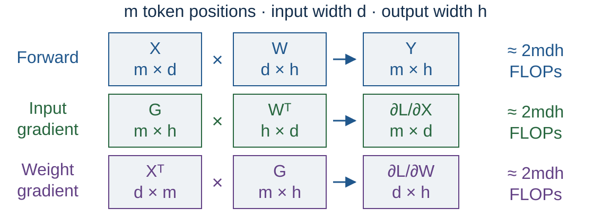
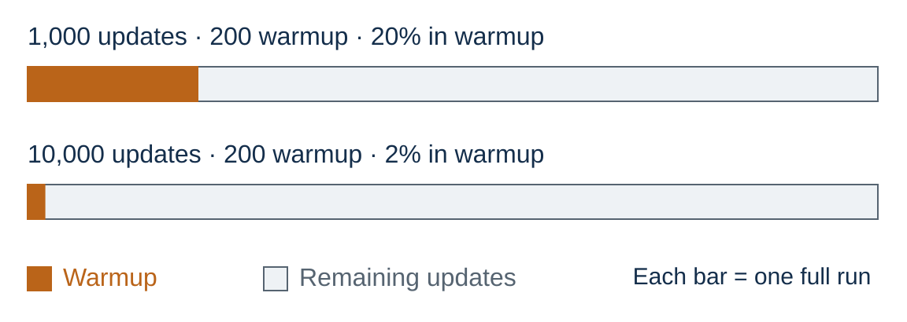
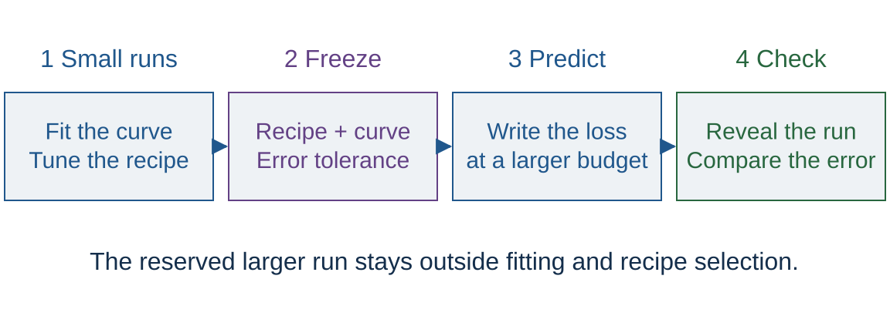

<!-- .slide: class="title-slide" id="title" -->

CS40008.01

# Compute budgets and scaling

Lecture 07 – NLP and LLMs

Baojian Zhou School of Data Science Fudan University October 21, 2026

Note:
Display the cover during the existing 15-minute Quiz 3 slot, 13:30–13:45. Questions and keys are separate private materials. This deck contains only ungraded lecture practice. After collection, teach the first block until 14:15. The second block is 14:25–15:10. Leave period 8, 15:25–16:10, for Jiaxuan Zou's guest session. The guest welcome slide is a holding slide, not a replacement for his presentation.

---

<!-- .slide: id="today" -->

## Today's class

| Time | Session |
| --- | --- |
| 13:30–14:15 | Quiz 3, then compute budgets |
| 14:25–15:10 | Scaling laws and prediction |
| 15:25–16:10 | Jiaxuan Zou: scientific scaling ladders |

Next week: data preparation and quality. All times Asia/Shanghai.

Note:
Start at 13:45 after the quiz. Allow two minutes for slides 2–3 together. Explain the topic exchange with Lecture 08. Preserve the two breaks. The project proposal is due tonight, October 21, 23:59; A2 remains due October 31, 23:59 through eLearning. Do not let a notebook setup delay consume the guest slot. Source: ../../docs/schedule.md.

---

<!-- .slide: id="learning-objectives" -->

## What you will be able to do

**How can small runs guide a larger training budget?**

- Estimate training compute and persistent memory.
- Compare model size and training tokens at equal cost.
- Interpret a power-law fit and check its extrapolation.
- Specify a controlled experiment before spending more.

Note:
These objectives build on Lecture 05's parameter counts and Lecture 06's training records. The example is deliberately synthetic so the algebra, fit, and failed extrapolation are reproducible without training a model. It is not evidence for an actual model family. Four ungraded exercises have the same requirements for everyone.

---

<!-- .slide: id="run-record" -->

## One run becomes one data point

| Record | Meaning |
| --- | --- |
| $N$ | Declared model parameter count |
| $D$ | Training tokens processed |
| $C$ | Estimated or measured training FLOPs |
| $L$ | Loss on a fixed evaluation corpus |

Keep the tokenizer, data split, architecture, and training recipe in the record.

Note:
Allow two minutes. Retrieve Lecture 06: a loss value is meaningful only with the run configuration and evaluation convention. Here all processed tokens are scored, and L is token-weighted held-out NLL in nats/token. In real logs, distinguish processed tokens from scored tokens, unique tokens, padding, and repeated exposures. Counting parameters for a fitted law and counting executed operators for compute need not use the same convention. Sources: Kaplan et al. §2, https://arxiv.org/abs/2001.08361; Hoffmann et al. §3 and Appendix F, https://arxiv.org/html/2203.15556v1.

---

<!-- .slide: id="training-flops" -->

## Where does the factor six come from?

$G=\partial L/\partial Y$. Three dense products: $\approx 6m(dh)$ FLOPs. Across training: $C\approx 6ND$.

Note:
Allow three minutes. Retrieve Lecture 03's backward pass and Lecture 05's matrix dimensions. Flatten batch and sequence into m token positions; this layer has dh weights. Multiplication and addition count as two operations, so each of the three products costs approximately 2mdh. G is the incoming gradient, not another learned matrix. Sum over dense layers and all D processed tokens to get 6ND when these products dominate. This ignores biases and pointwise work. Token lookup does not multiply every embedding weight; a tied output head still performs a vocabulary projection. Attention and checkpoint recomputation add work. State N's convention. This is not an exact runtime or hardware-cost model. Sources: Kaplan et al. Appendix A; Hoffmann et al. Appendix F; Porian et al. §3.1, https://arxiv.org/html/2406.19146v4. Original editable course diagram.

---

<!-- .slide: class="exercise" id="exercise-01" -->

Exercise E01 · 4 minutes · Notebook E01

## Which run costs more?

| Run | Parameters $N$ | Training tokens $D$ |
| --- | ---: | ---: |
| A | 50 million | 4 billion |
| B | 200 million | 1 billion |

Estimate $6ND$ for each. Can equal FLOPs imply equal memory or equal loss?

Both: $1.2\times10^{18}$ FLOPs. Memory and loss can differ.

Note:
Four minutes includes the debrief. Expected response: 6 × 50e6 × 4e9 = 6 × 200e6 × 1e9 = 1.2e18. B has four times as many parameters but sees one quarter as many tokens. Students should not infer a winner from compute alone. Common error: count a billion as 10^6, or replace D with the number of optimizer updates. The notebook computes both estimates and persistent model-state bytes under the next slide's explicit assumptions.

---

<!-- .slide: id="memory" -->

## Persistent training state

**Teaching assumption:** FP32 parameters, gradients, and Adam moments.

| State | Bytes |
| --- | ---: |
| Parameters and gradients | $8N$ |
| Two Adam moment arrays | $8N$ |
| Total persistent arrays | $16N$ |

50M: 0.8 GB. 200M: 3.2 GB. Decimal GB; activations and temporary buffers excluded.

Note:
Allow two minutes. The calculation counts four 4-byte arrays after optimizer state initialization. Real peak memory also includes saved activations, logits, temporary workspace, allocator effects, and framework bookkeeping. Precision choices, master weights, optimizer implementations, and sharding change the accounting. Equal FLOPs does not guarantee either run fits. Longer context can increase attention compute and activation memory substantially. This is arithmetic under stated assumptions, not a GPU measurement or an allocation promise. Connect to the model states students inspected in Lecture 06.

---

<!-- .slide: id="wall-clock" -->

## FLOPs and elapsed time

$$t \approx \frac{C}{\text{effective FLOPs per second}}$$

For our $1.2\times10^{18}$-FLOP example:

- Assume **100 TFLOP/s sustained** on one accelerator.
- Estimated compute time: **12,000 seconds ≈ 3.33 hours**.
- Evaluation, checkpoints, and data stalls add time.

Illustrative throughput assumption. Measure the actual model on the target hardware.

Note:
Allow two minutes. This is not a specification for any GPU. Effective throughput includes utilization only for the workload interval being measured, so avoid adding the same overhead twice. For multiple devices use aggregate measured throughput, and count total GPU-hours across all devices and attempts. A smaller model can have worse hardware utilization. FLOP-optimal and wall-clock-optimal choices can differ. The notebook uses only arithmetic, and students need no GPU today.

---

<!-- .slide: id="equal-compute" -->

## Equal compute, different allocations

Synthetic example: $D=C/(6N)$. The best allocation lies inside the tested range.

Note:
Allow three minutes. Read the axes before discussing the curve: x is millions of parameters on a log scale; y is synthetic evaluation NLL in nats/token. Increasing N forces D down. Small models have a capacity term, while larger models in this slice receive less training. The points are generated by L = 1.5 + 0.8 / sqrt(N/1e8) + 0.8 / sqrt(D/2e9). They are not extracted from a paper or a training job. The U-shaped experiment design follows Hoffmann et al. §3.2. The minimum is 100M parameters and 2B tokens for this invented surface.

---

<!-- .slide: id="loss-surface" -->

## A model of the tradeoff

$$L(N,D)=E+\frac{A}{N^\alpha}+\frac{B}{D^\beta}$$

| Term | Interpretation |
| --- | --- |
| $E$ | Fitted loss floor for this setting |
| $A/N^\alpha$ | Model-size contribution |
| $B/D^\beta$ | Training-token contribution |

Hoffmann et al. (2022), §3.3. A fitted empirical model within a specified regime.

Note:
Allow three minutes. E, A, B, alpha, and beta are fitted quantities, not universal constants. In the toy example use dimensionless n=N/1e8 and d=D/2e9, E=1.5, A=B=0.8, alpha=beta=0.5. Units affect coefficients. Repeated data, architecture changes, optimizer quality, and domain changes can invalidate the model. A fit cannot prove that its limiting E is the true entropy of language. Source: https://arxiv.org/html/2203.15556v1#S3.SS3.

---

<!-- .slide: id="power-law" -->

## Reading a power law

$$L(C)-E=K(C/C_0)^{-\gamma}$$
$$\log(L-E)=\log K-\gamma\log(C/C_0)$$

- Equal compute ratios give equal ratios of **excess loss**.
- The log-log slope is $-\gamma$.
- An unknown floor makes fitting harder.

Our reference budget: $C_0=1.2\times10^{18}$ FLOPs.

Note:
Allow two minutes. The frontier means the best allocation available for each compute level under the stated protocol, rather than every arbitrary training run. For the toy surface, minimization gives K=1.6 and gamma=0.25 with C0=1.2e18. Quadrupling compute multiplies excess loss by 4^-0.25 ≈ 0.7071. Total loss does not shrink by the same factor because of E. Straight lines can appear over a limited interval even when extrapolation fails. Kaplan et al. §§1–3 establish the empirical power-law motivation: https://arxiv.org/abs/2001.08361.

---

<!-- .slide: id="historical-evidence" -->

## What changed with Chinchilla?

| Study | $N_{\mathrm{opt}}$ versus compute | $D_{\mathrm{opt}}$ versus compute |
| --- | --- | --- |
| Kaplan et al. (2020) | $\propto C^{0.73}$ | $\propto C^{0.27}$ |
| Hoffmann et al. (2022), IsoFLOP fit | $\propto C^{0.49}$ | $\propto C^{0.51}$ |

The later estimate allocates more of each budget increase to training tokens.

Historical estimates under different experimental protocols; Hoffmann et al., Table 2.

Note:
Allow one minute. Give only the historical comparison needed for the allocation question. Hoffmann et al. trained a 70B Chinchilla model on 1.4T tokens, compared with Gopher's 280B and 300B, and reported better performance at approximately the same training budget. Do not present the table as two universal competing truths. Their three fitting methods give somewhat different exponents; the table explicitly selects the IsoFLOP method. Sources: https://arxiv.org/html/2203.15556v1#S3.SS4 and Table 1; Kaplan et al., https://arxiv.org/abs/2001.08361.

---

<!-- .slide: id="chinchilla-case" -->

## A smaller model, trained on more tokens

| Reported model | Parameters | Training tokens |
| --- | ---: | ---: |
| Gopher | 280B | 300B |
| Chinchilla | 70B | 1.4T |

Chinchilla performed better across the paper's evaluated tasks at a comparable training budget.

<a href="https://arxiv.org/html/2203.15556v1#S4">Hoffmann et al. (2022)</a>, Table 1 and §4. Reported models; separate from our synthetic examples.

Note:
Allow one minute. Ask which quantity increased when the parameter count fell. The paper reports the same training budget. The rounded headline counts inserted into 6ND give 5.04e23 and 5.88e23 FLOPs, so do not claim exact equality under that approximation; Appendix F explains detailed FLOP accounting. This comparison motivates allocation, but does not isolate allocation as the only changed variable; the paper also documents recipe changes. Avoid importing its coefficients into our invented surface.

---

<!-- .slide: id="protocol-matters" -->

## The training protocol changes the fit

Porian et al. revisited the Kaplan–Chinchilla discrepancy:

- Include the final vocabulary layer's compute.
- Account for warmup duration.
- Tune optimizer settings across scales.

Porian et al. (2024), §§3–4. These corrections brought their results close to Chinchilla scaling.

Note:
Allow two minutes, then take the 14:15 break. A curve can partly measure the training procedure rather than an intrinsic model limitation. This paper found that careful LR decay was not essential for the recovered allocation rule, so do not claim that cosine scheduling alone explains the earlier disagreement. Source: https://arxiv.org/html/2406.19146v4. The second period develops the elementary inference problem students can bring to the guest talk.

---

<!-- .slide: class="outline-slide" id="outline-prediction" -->

## Scaling laws and prediction

<ul class="outline-topics">
<li>Compute budgets</li>
<li aria-current="step">Allocation and extrapolation</li>
<li>Jiaxuan Zou's scientific scaling ladder</li>
</ul>

Period 2 · 14:25–15:10

Note:
Allow one minute. Reopen the allocation curve and ask what evidence would justify moving its minimum to a larger budget. Distinguish a prediction from a guarantee. The browser and notebook share the same synthetic examples.

---

<!-- .slide: id="optimal-allocation" -->

## Allocation at a fixed budget

Substitute $D=C/(6N)$ into the loss model.

$$L(N)=E+A N^{-\alpha}+B(6N/C)^\beta$$

At its minimum:

$$\alpha A N^{-\alpha}=\beta B D^{-\beta}$$
$$N_{\mathrm{opt}}\propto C^{\beta/(\alpha+\beta)},\qquad
D_{\mathrm{opt}}\propto C^{\alpha/(\alpha+\beta)}$$

Note:
Allow three minutes. Differentiate with respect to log N: -alpha A N^-alpha + beta B(6N/C)^beta = 0. Under positive coefficients and exponents this is a unique minimum. The constants depend on units and fitted coefficients. The excess-loss contributions are equal only when alpha=beta. When the exponents are equal, N and D both grow as sqrt(C). Source: Hoffmann et al. §3.3, Equation 4, https://arxiv.org/html/2203.15556v1#S3.SS3. No claim that real fits must have alpha=beta.

---

<!-- .slide: class="exercise" id="exercise-02" -->

Exercise E02 · 4 minutes · Notebook E02

## Four times the training budget

Our toy model has $\alpha=\beta=0.5$.

At $C_0$, its optimum is **100M parameters, 2B tokens**.

What allocation does it predict at $4C_0$?
What if we spend all the increase on parameters?

Balanced: <strong>200M, 4B</strong>. Parameters only: <strong>400M, 2B</strong>, with higher toy loss.

Note:
Four minutes including debrief. sqrt(4)=2 for each axis. Balanced loss is 1.5+1.6/sqrt(2)=2.63137085. The alternative is 1.5+0.8/2+0.8=2.7. Both use 4.8e18 FLOPs in the approximation. The notebook compares the analytic optimum with a search over a log-spaced grid, and checks larger as well as smaller budgets. Equal exponents yield a fixed D/N only within this model.

---

<!-- .slide: id="budget-demo" -->

## Moving the budget

<button type="button" id="budget-button">Budget: 1×</button> <button type="button" id="reset-button">Reset</button>

Synthetic optimum: 100M parameters, 2B tokens; loss 3.100.

Note:
Allow two minutes. Cycle 1×, 4×, 16×. The minimum moves to 100M, 200M, 400M parameters, paired with 2B, 4B, 8B training tokens. Reset restores the initial state. The curve is an analytic illustration and is available offline. Read the total budget in the status line; the x-axis unit is millions of parameters. The PDF uses the initial state. Stop the demo after one cycle to preserve time for inference and the guest.

---

<!-- .slide: id="experiment-grid" -->

## Experiments must separate the variables

Both axes logarithmic. Crossed settings separate model-size and token effects.

Note:
Allow two minutes. This is a proposed design diagram, not completed training. The 3×3 fitting grid uses N=25M,50M,100M and D=0.5B,1B,2B. The illustrative larger validation point is N=200M,D=4B. Both axes vary, and the cost of every candidate can be counted. A 3×3 grid is not a sufficient general recipe for identifying all five nonlinear coefficients or estimating uncertainty. In this class we fit only a one-dimensional synthetic frontier with a supplied floor. The design logic is related to Hoffmann et al. §3; the guest article discusses broader ladder choices.

---

<!-- .slide: id="recipe-and-frontier" -->

## What are we predicting?

| Goal | Experiment |
| --- | --- |
| Forecast a chosen recipe | Apply its declared scaling rules |
| Estimate the best allocation | Compare adequately tuned candidates |

The lowest loss among tested runs is a **measured envelope**.
Untested choices may improve it.

Note:
Allow one minute. This short distinction prepares students for Jiaxuan's article, §2.1, https://jiaxuanzou0714.github.io/blog/2026/how-to-build-scientific-scaling-ladder/. Tuning quality and forecast quality answer different questions. A fitted curve through poorly optimized small models can mislead a compute-allocation decision. A fixed recipe can still be worth forecasting even if it is not the best recipe. Charge tuning runs, repeated seeds, and validation runs to the experiment budget. Do not reproduce or pre-empt the guest's full methodology.

---

<!-- .slide: id="warmup-confound" -->

## A fixed warmup can change the comparison

Toy arithmetic. Equal warmup steps can represent different training regimes.

Note:
Allow one minute. This retrieves Lecture 06's schedule endpoints. If batch size changes, update fractions and token fractions can differ as well. The slide does not prescribe a universal warmup fraction. It shows a possible confound that must be controlled or deliberately studied. Porian et al. §3.2 discuss warmup's effect on compute-optimal estimates: https://arxiv.org/html/2406.19146v4. Hyperparameter transfer such as muP is a useful optional reading, not a promise that all hyperparameters transfer across changes in depth, data, or training duration.

---

<!-- .slide: id="evaluation-contract" -->

## Comparable measurements

- Same held-out text and domain weights.
- Same tokenization and scored positions.
- Same loss aggregation and reporting units.
- Documented precision, schedule, and random seeds.

Changing a data mixture also changes its training loss distribution.

Lecture 08 develops filtering, duplication, and contamination in detail.

Note:
Allow two minutes. Evaluate different training mixtures against a fixed external corpus. For a tokenizer change, loss per token has a new unit; Lecture 02's bits per byte offers a common-text comparison. Pair seeds where useful, but still quantify differences across independent runs. Validation has two distinct levels: held-out text measures generalization within a run, while held-out scale tests a fitted prediction across runs. The latter must be excluded from selecting the recipe and fit if it is to be a final check.

---

<!-- .slide: id="freeze-before-validation" -->

## Freeze the prediction before the larger run

If this run changes the recipe or fit, reserve another run for a fresh check.

Note:
Allow two minutes. This is the workflow for E03, which follows the small-budget plot. Ask what must be written down before opening the holdout rows: fitted coefficients, evaluation convention, target budget, prediction, and the acceptance rule. A held-out text split within each run and a held-out scale across runs answer different questions. The final larger condition must stay outside recipe selection as well as curve fitting. Our notebook uses a supplied floor and a predeclared tolerance. The next independent check costs compute too. Original course diagram; see Jiaxuan Zou's article §§8 and 10 for a broader discussion of validation: https://jiaxuanzou0714.github.io/blog/2026/how-to-build-scientific-scaling-ladder/.

---

<!-- .slide: id="fit-data" -->

## Fit a small synthetic frontier

Both axes logarithmic. Known floor $E=1.5$; three synthetic replicates per budget.

Note:
Allow two minutes. The x values C/C0 are 0.25,1,4,16. The data generator uses L=1.5+1.6(C/C0)^-0.25 and adds replicate offsets -0.01,0,+0.01. The plot shows the means and the generating curve over the fit range. These are invented replicates, not measured seeds or a real estimate of noise. Compute mean L at each budget first, then fit log(mean L-E) against log(C/C0). Giving E makes this a transparent linear fit; in research E is generally unknown and requires joint fitting or sensitivity analysis.

---

<!-- .slide: class="exercise" id="exercise-03" -->

Exercise E03 · 7 minutes · Notebook E03

## Predict before revealing the larger run

1. Fit the four supplied budget means with $E=1.5$.
2. Predict loss at $C/C_0=64$.
3. Reveal the synthetic holdout and compare.

Use a predeclared tolerance of **0.05 nats/token** for this exercise.

Fit: $K=1.6$, $\gamma=0.25$. Prediction: $2.066$. Holdout: $2.226$. Error: $0.160$.

Note:
Seven minutes includes running the notebook and discussion. The fit uses only rows labeled fit. The holdout mean has an intentionally added 0.16 shift, with the same three replicate offsets. Absolute residual 0.16 exceeds the illustrative 0.05 tolerance, so the proposed forecast fails this check despite an exact fit to the small-budget means. This is not a confidence interval or a universal threshold. Decide the tolerance before revealing the holdout; changing it afterward invalidates the exercise. Students can do the ratio calculation without running code. Do not fit the holdout and then claim to have validated on it.

---

<!-- .slide: id="holdout-result" -->

## A smooth fit can miss a larger run

Synthetic failure case. Dashed line: extrapolation. Red point: reserved larger budget.

Note:
Allow two minutes. The vertical axis here is total NLL on a linear scale, not log excess loss. Name that change explicitly. The bigger point was excluded from the fit and recipe selection. A failed check calls for diagnosis and new evidence. If we use it to revise the curve or choose a recipe, it becomes development data, and another reserved point is needed for an independent final check. The invented shift does not identify any physical cause.

---

<!-- .slide: id="diagnose-failure" -->

## Diagnosing a failed forecast

| Possible issue | Next evidence |
| --- | --- |
| Optimization changes with size | Loss curves, LR sweep, stability logs |
| Data or accounting changed | Corpus, token, and FLOP audit |
| Curve form misses the regime | Intermediate scale and alternative fit |
| Run variability matters | Independent repeats and paired differences |

Note:
Allow two minutes. These are competing hypotheses; the synthetic example alone cannot choose among them. Refit after checking measurements. Report prediction residuals and sensitivity to fitting choices, and propagate uncertainty to the decision such as which N to train. A small residual does not establish the best possible allocation, and a high R-squared within the fit range does not establish extrapolation. This is course-authored experimental reasoning. Jiaxuan's article §§8 and 10 expands the practical validation workflow.

---

<!-- .slide: id="scope-of-law" -->

## The objective determines the optimum

| Additional constraint | What changes |
| --- | --- |
| Limited unique data | More tokens may mean repeated exposures |
| Large inference demand | Training and serving costs both matter |
| Sparse experts | Total and active parameters differ |

“20 tokens per parameter” is a starting heuristic tied to a training setting.

Note:
Allow two minutes. Do not transfer the toy coefficients to these regimes. Muennighoff et al. study repeated data in data-constrained training, https://arxiv.org/abs/2305.16264. Sardana et al. include inference demand in the cost objective, https://arxiv.org/abs/2401.00448. For sparse experts, actual operator and communication costs require more detail than replacing N with a single headline count. The Chinchilla heuristic comes from particular fitted settings and parameter-count conventions. This is a vocabulary bridge; full MoE optimization is outside today's core.

---

<!-- .slide: id="loss-and-capability" -->

## Lower loss and useful capability

Held-out NLL measures average predictive quality.

Task success also depends on:

- Which examples and domains the task tests.
- Prompt, decoding, and scoring choices.
- Whether the score can distinguish small models.

A loss forecast needs a separate check against the intended use.

Note:
Allow two minutes. A model can improve average NLL while an accuracy measure stays at chance or saturates. A proxy must be validated for the target comparison, not assumed to preserve rankings at larger scales. We leave task-specific evaluation design to Lecture 09 and the guest's examples. Sources for the narrower empirical connection between lower pretraining loss and downstream evaluations: Hoffmann et al. §4.2, https://arxiv.org/html/2203.15556v1. This is not a claim that a particular capability is guaranteed by a loss threshold.

---

<!-- .slide: class="exercise" id="exercise-04" -->

Exercise E04 · 3 minutes · Notebook E04

## A small experiment proposal

You can afford **12 runs**.

Specify a comparison, a fixed evaluation set, and a run allocation.
Include repeats and one larger validation condition.

What result would make you delay the large run?

Note:
Three minutes including debrief. An acceptable forecast comparison uses two candidate recipes, two smaller fitting scales, and two seeds: 2×2×2=8 runs. Reserve two recipes × two seeds at a larger scale: 4 runs. Twelve run slots do not imply equal FLOP costs, so price every row before declaring it affordable. Two fitting scales are a limited classroom design, not enough for a robust five-parameter surface or a reliable uncertainty estimate. Expected responses name the frozen data/tokenizer, loss convention, candidate change, compute axis, and a predeclared decision threshold. Refusal to claim a confident winner with weak evidence is acceptable.

---

<!-- .slide: id="questions-for-guest" -->

## Questions for Jiaxuan

- Which small experiments are most informative?
- When does hyperparameter transfer break down?
- How do you reserve budget for testing extrapolation?
- What evidence would stop a planned large run?

<a href="https://jiaxuanzou0714.github.io/blog/2026/how-to-build-scientific-scaling-ladder/">How to Build a Scientific Scaling Ladder</a>

Note:
Allow three minutes for slides 31–32 together, finishing by 15:10. Ask each student to choose one question to carry into the guest session. These are instructor discussion prompts, not an agreed speaker agenda. The linked article is pre-reading and the basis identified by the instructor for the talk. Do not attribute the toy examples or teaching thresholds to Jiaxuan.

---

<!-- .slide: id="coursework" -->

## Applying this to your project

A useful experiment states:

- The decision it will inform.
- The comparison and controls.
- The compute estimate and smaller fallback.
- The evidence that would change the conclusion.

Proposal: October 21, 23:59. A2: October 31, 23:59. Submit privately through eLearning.

Note:
Finish by 15:10. This connects the lecture to the existing project proposal; it adds no deliverable or grading criterion. The full project scope and requirements remain in the public project guidance. Show the guest welcome during the 15-minute break, and let the guest control the final period. If running late, shorten slides 27–29 and do E04 as a spoken prompt. Preserve the guest start time.

---

<!-- .slide: class="section-slide" id="guest-welcome" -->

## How to Build a Scientific Scaling Ladder

**Jiaxuan Zou**

Xi’an Jiaotong University 
Research intern, ByteDance Seed Pre-training

Guest session · October 21 · 15:25–16:10

<a href="https://jiaxuanzou0714.github.io/">Speaker website</a> · <a href="https://jiaxuanzou0714.github.io/blog/2026/how-to-build-scientific-scaling-ladder/">Talk reading</a>

Note:
Suggested introduction, within the guest's 45-minute slot: Jiaxuan is an undergraduate in Mathematics and Statistics at Xi’an Jiaotong University and a research intern with ByteDance Seed Pre-training. His interests include optimization, deep learning theory, and scaling laws. Today he will discuss building a scientific scaling ladder, based on the article linked here. Verify any updated affiliation with the speaker before introducing him. Website checked October 20, 2026: https://jiaxuanzou0714.github.io/. Suggested allocation, subject to the speaker's preference: 2-minute introduction, 33-minute talk, 10-minute questions. No guest slides or recording are included or promised.

---

<!-- .slide: class="references" id="references" -->

## Reading

- [Kaplan et al. (2020)](https://arxiv.org/abs/2001.08361), §§2–3 and Appendix A.
- [Hoffmann et al. (2022)](https://arxiv.org/html/2203.15556v1), §3 and Appendix F.
- [Porian et al. (2024)](https://arxiv.org/html/2406.19146v4), §§3–4.
- [Jiaxuan Zou: scientific scaling ladders](https://jiaxuanzou0714.github.io/blog/2026/how-to-build-scientific-scaling-ladder/), §§1–3 and 10.

The companion notebook is ungraded and runs offline with Python's standard library.

Note:
The local reading guide, optional-reading.md, gives a short route and questions for these sources. Additional optional readings: Yang et al., Tensor Programs V, https://arxiv.org/abs/2203.03466, for muP and hyperparameter transfer; Muennighoff et al., https://arxiv.org/abs/2305.16264, for repeated data; Sardana et al., https://arxiv.org/abs/2401.00448, for inference-aware allocation. Read these after the core material. No fixed reference count or additional assignment is introduced. All numerical curves in this deck are authored synthetic illustrations, not reported research measurements.
