<!-- .slide: class="title-slide" id="title" -->

<p class="eyebrow">CS40008.01</p>

# Data and evaluation

<p class="subtitle">Lecture 10 · NLP and LLMs</p>

<p class="byline">Baojian Zhou<br>School of Data Science<br>Fudan University<br>November 11, 2026</p>

Note:
November 11, 2026. Data preparation, quality, evaluation and experimental design follow the taught InstructGPT and PPO lectures. Plan 120 teaching minutes and reserve the final 15 minutes for Quiz 4. Five ungraded offline exercises connect provenance and split construction to controlled comparisons and paired uncertainty. The main route includes historical figures and four modern benchmark cases. The optional extension has its own practice. Quiz questions are held privately.

---

<!-- .slide: id="objectives" -->

## What makes an improvement believable?

- Explain how evaluation changed from GPT-1 to tool-using systems.
- Trace data quality, source families and training exposure.
- Match benchmarks, graders and budgets to a claim.
- Report paired uncertainty, cost and failure examples.

Note:
Central question: what changed in the data, model or evaluated system, and what evidence supports the claimed improvement? The historical figures are reported paper results; the five notebook exercises use authored synthetic data. Preserve both distinctions. Sources for the timeline and recent benchmark releases are in optional-reading.md. All students use the same practices and project criteria.

---

<!-- .slide: id="evaluation-evolution" -->

## What changed when LLMs changed?

| Era | Evaluated object | New experimental choice |
| --- | --- | --- |
| GPT-1 → GPT-3, 2018–20 | Adapted classifier → prompted answer | Fine-tuning data; demonstrations |
| Codex / InstructGPT, 2021–22 | Program; preferred response | Tests; candidate budget; raters |
| GPT-4 / reasoning, 2023–24 | Exams; budgeted reasoning | Modality; sampling; inference cost |
| GPT-5 → GPT-6/6.1, 2025–26 | Tool-using system; deliverable | Harness; environment; verifier |

<p class="caption">Different experiments, not one comparable score curve. <a href="optional-reading.md#evaluation-history">Sources and dates</a>.</p>

Note:
This timeline is a course synthesis, not a claim that a model introduced every method in its row. GPT-1's main results use supervised task adaptation; GPT-2 emphasizes zero-shot transfer; GPT-3 varies context examples. Codex makes executable tests central; InstructGPT adds human preference evaluation. GPT-4 includes simulated exams and visual inputs. Reasoning and agents make inference budgets and environments essential. The current official model catalog verifies GPT-6 Astra and GPT-6.1 Sol/Terra, not the requested GPT-6.2. No GPT-6.2 performance is asserted. Sources: Radford 2018/2019; Brown 2020; Chen 2021; Ouyang 2022; GPT-4 report 2023; https://developers.openai.com/api/docs/models (checked 2026-11-11 Asia/Shanghai). Read the figure as changes in the measured object, not a causal history of all progress.

---

<!-- .slide: id="gpt1-task-adaptation" -->

## GPT-1: evaluate after task adaptation

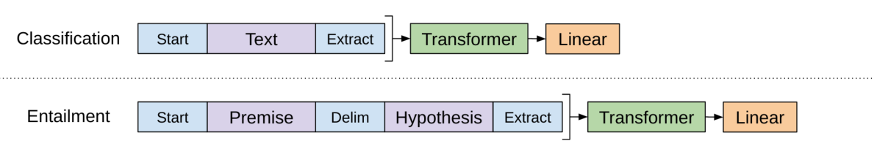

**What changes?** Input format, task head and model weights during supervised fine-tuning.

<p class="caption"><a href="https://cdn.openai.com/research-covers/language-unsupervised/language_understanding_paper.pdf">Radford et al., 2018, Fig. 1</a>, two task rows. Evaluate on held-out task examples.</p>

Note:
Ask which parameters are learned before reporting a downstream score. Expected answer: this is a pretrained model adapted on task labels, including a task-specific output layer; it is not the zero-shot score of an untouched language model. Source Section 3.2–3.3; Figure 1 right-panel excerpt preserves the classification/entailment rows. The structured-input conversion and label mapping are part of the experiment. A fair comparison must report task training data and adaptation recipe. Avoid re-teaching Transformer internals here.

---

<!-- .slide: id="gpt2-zero-shot" -->

## GPT-2: transfer without task fine-tuning

<div class="columns">
<div>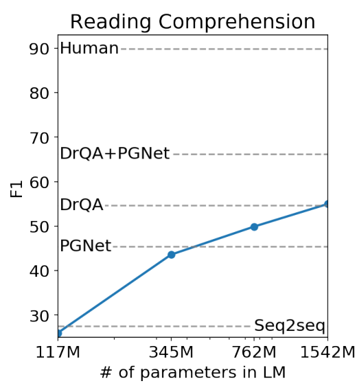</div>
<div><p><strong>Read:</strong> CoQA F1 versus model size.</p><p><strong>Hold fixed:</strong> task prompting and answer extraction.</p><p><strong>Question:</strong> does zero-shot mean the training corpus never contained related examples?</p><p>No. Task adaptation and pretraining exposure are separate questions.</p></div>
</div>

<p class="caption"><a href="https://cdn.openai.com/better-language-models/language_models_are_unsupervised_multitask_learners.pdf">Radford et al., 2019, Fig. 1</a>, CoQA panel; historical results.</p>

Note:
The curve is zero-shot task transfer from WebText language models. Its y-axis is F1, not a universal percentage of intelligence. Baselines have their own training conditions; the figure does not isolate architecture or data causally. GPT-2's CoQA protocol includes conditioning on conversational context; zero-shot does not mean an empty prompt. The cropped panel retains all original baselines and axes. Other Figure 1 panels use different metrics, so they cannot be averaged directly. Source Sections 3.3 and 4 on overlap.

---

<!-- .slide: id="gpt3-in-context" -->

## GPT-3: demonstrations change evaluation

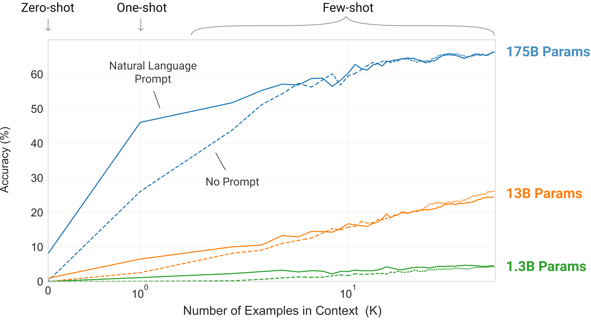

<p class="caption"><a href="https://arxiv.org/html/2005.14165v4">Brown et al., 2020, Fig. 1.2</a>. Word manipulation; weights stay fixed. Which prompt fields changed?</p>

Note:
Expected reading: number of demonstrations, model size and presence of a task description are distinct variables. This is removal of random symbols from words, not the aggregate of all benchmark tasks. Few-shot examples are input tokens, not gradient updates. Fix example IDs, order, separators, answer format, context truncation and the candidate-scoring rule. The source's Figure 2.1 makes the distinction from fine-tuning explicit. Explain that no task fine-tuning still does not establish clean pretraining exposure. Historical paper result; no course inference was run.

---

<!-- .slide: id="instructgpt-preference" -->

## InstructGPT: “better” becomes a preference

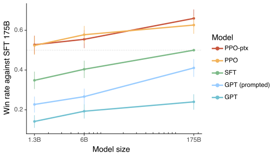

<p class="caption"><a href="https://arxiv.org/html/2203.02155v1">Ouyang et al., 2022, Fig. 1</a>. Win rate against 175B SFT; API prompts; 95% intervals.</p>

Note:
Figure question (20 seconds): what does a 50% point mean? Expected: equal preference frequency against the named 175B SFT reference under these prompts and raters, not 50% task accuracy. Read the baseline before interpreting 50 percent. Every curve is compared with the same 175B SFT reference under the paper's human-evaluation protocol. A smaller instruction-tuned model can be preferred to a larger base model on this prompt population. This does not show higher accuracy on every objective task. Distinguish the reward model used for PPO from the human evaluation that checks the result. Ask students whose preferences and which prompt distribution define the target. The next data section carries this boundary through SFT, reward models and policy training. Source Section 3.6 and Figure 1; chart values are historical, not current rankings.

---

<!-- .slide: id="reasoning-budget" -->

## Reasoning adds a second compute budget

| Procedure with fixed weights | What counts as success? |
| --- | --- |
| One longer reasoning attempt | The final answer is correct |
| Majority vote over sampled answers | The selected consensus is correct |
| Any of several programs passes | An oracle test accepts at least one |
| Agent repairs with test feedback | The adaptive trajectory succeeds |

Report tokens, attempts, feedback and wall time separately.

<p class="caption"><a href="https://openai.com/index/learning-to-reason-with-llms/">o1 research report, 2024</a>; <a href="https://arxiv.org/html/2107.03374v2">Codex, 2021</a>.</p>

Note:
These procedures estimate different quantities. The o1 report explicitly studies increased train-time and test-time compute; the two axes must not be conflated. This table is a methodological synthesis, not copied scores. Best-of-k under oracle verification is not a deployable selection rule for open-ended answers. Adaptive repair uses feedback and violates the interpretation of k independent completions. The appendix derives pass@k and shows the actual Codex sampling curve. Ask students which resource changes could improve a score while keeping all weights unchanged.

---

<!-- .slide: id="current-model-boundary" -->

## Current models: evaluate the configured system

| Record | Why it changes the result |
| --- | --- |
| Model ID and snapshot | A family name hides revisions |
| Reasoning setting and output cap | Different inference budgets |
| Agent code and tools | Different action policies |
| Environment and scorer | Different tasks and acceptance rules |

<p class="caption">Verified endpoint: GPT-6/6.1. GPT-6.2 was not verified in <a href="https://developers.openai.com/api/docs/models">official documentation</a> on November 11, 2026.</p>

Note:
The user requested a timeline through GPT-6.2. Exact official-document searches and the model catalog did not establish that release, so we explicitly preserve the source boundary instead of inventing it or silently renaming it. The official catalog documents GPT-5-series and GPT-6/6.1 model interfaces; it does not by itself provide independent benchmark evidence. The protocol lesson is our inference from configurable reasoning, tool use and environments. Pin an actual snapshot where the service exposes one; otherwise record alias and access timestamp. Historical model figures and today's agent benchmarks are not a shared longitudinal score curve. Checked 2026-11-11 Asia/Shanghai.

---

<!-- .slide: class="outline-slide" id="outline-data" -->

## Lecture outline

<ol class="outline-topics"><li aria-current="step">Sources, extraction and quality</li><li>Families, splits and exposure</li><li>Evaluation and experimental design</li></ol>

Note:
Data and evaluation are one experimental design. Keep the inference population and the training budget explicit.

---

<!-- .slide: id="running-comparison" -->

## One comparison throughout the lecture

| Condition | Training data | Everything else |
| --- | --- | --- |
| A | Original corpus | Fixed model and tokenizer |
| B | Deduplicated corpus | Same training-token budget |

We need a common evaluation set and a declared scoring rule.

<p class="caption">Classroom outcomes are synthetic. They illustrate an audit, not a measured training result.</p>

Note:
Use the same initial weights, optimizer settings, and training schedule for a single paired run. Multiple training seeds are a separate source of uncertainty. A2 already supplies an exact-document deduplication comparison under matched processed-token budgets. This lesson uses small authored fixtures so students can inspect every assumption. Source: ../../assignments/a2-build-a-small-lm/README.md, Part 4.

---

<!-- .slide: id="posttraining-data-boundaries" -->

## Evaluation must stay outside every fitting stage

| Taught stage | Data used to fit | Audit before training |
| --- | --- | --- |
| SFT | Demonstrations | Source IDs; response masks |
| Reward model | Preference pairs | Prompt families; rubric |
| PPO | Prompts and rollouts | Exposure to evaluation tasks |

Carry source-family IDs across stages. Reserve final evaluation before selection.

Note:
Bridge from Lectures 08–09. A prompt excluded from PPO may still have appeared in SFT demonstrations or reward-model pairs. Different splits for the three stages do not establish independence from the final evaluation. Audit related prompts, source documents and generated variants, not just exact strings. Use development data to select prompts and policies. This is an original course audit table, not a requirement that SFT, RM and PPO training pools must be mutually disjoint. In a retrospective audit of opaque pretraining data, report unknown exposure rather than claiming it was ruled out. Keep the original-corpus versus deduplicated-corpus comparison as today's numerical running example.

---

<!-- .slide: id="data-lineage" -->

## A traceable data pipeline

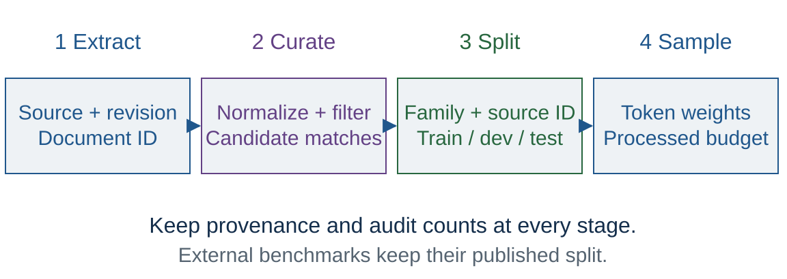

<p class="caption">Keep source IDs, policy versions, and retained counts. Freeze final evaluation examples.</p>

Note:
This is an original course workflow. Extraction, normalization, language/quality selection, and matching make distinct decisions. Keep the mapping from raw records to retained records. A newly constructed dataset groups related records before splitting. An existing benchmark keeps its published split; audit training overlap against it using a declared policy. Source: FineWeb, https://arxiv.org/abs/2406.17557, Section 3. Exact ordering is a policy to evaluate rather than a universal recipe.

---

<!-- .slide: id="fineweb-extraction-evidence" -->

## FineWeb: extraction is an experimental variable

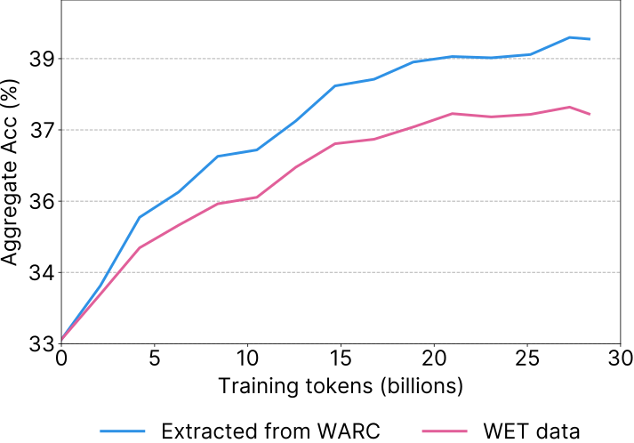

<p class="caption"><a href="https://arxiv.org/html/2406.17557v2">Penedo et al., 2024, Fig. 1</a>. Same 28B-token budget; compare extraction before adding filters.</p>

Note:
Figure question (20 seconds): which data decision changes while the token budget is held fixed? Expected: WARC custom extraction versus default WET extraction, before later quality filters/deduplication. This is actual paper evidence rather than the course's synthetic page illustration. WARC holds raw web captures; WET contains extracted text. The paper compares its custom Trafilatura extraction to default WET extraction, with English language filtering but without later quality filtering or deduplication. Its ablation setup uses a fixed 1.71B architecture. Read the paper's aggregate as an average over selected tasks, not universal corpus quality. The classroom does not reproduce this training scale. A small project can audit extraction on hand-inspected pages or run a smaller matched-budget study; mark such budgets as planning estimates.

---

<!-- .slide: id="filter-audit" -->

## A filter needs retained and rejected examples

| Toy rule | Useful rejection | Possible false rejection |
| --- | --- | --- |
| Many repeated lines | Repeated navigation | A poem or code pattern |
| Few words | An empty page | A short definition |
| Low reference-model likelihood | Broken text | A different domain or language |

Measure retained tokens and inspect errors by source and language.

Note:
Use development evidence to choose a policy, then preserve a final evaluation. A heuristic score is not a gold quality label. English whitespace word counts do not transfer unchanged to Chinese. This table contains authored failure possibilities, not measured rates. FineWeb Sections 3.5–3.6 documents controlled filter ablations; generalize the method rather than copying every threshold.

---

<!-- .slide: id="negative-construction" -->

## Distractors can reveal the answer

SWAG / HellaSwag: generated alternatives and adversarial filtering.

1. Retain the source context and candidate provenance.
2. Audit easy cues: length, style and answer position.
3. Check that people can resolve the intended contrast.

A difficult alternative may also be a valid answer.

<p class="caption">Construction choices need development evidence and a separate final evaluation.</p>

Note:
The historical motivation is SWAG Section 2 and Figure 1, https://aclanthology.org/D18-1009/, and HellaSwag Sections 3–4, https://aclanthology.org/P19-1472/. Supplied 2025 slides 25–31. SWAG iteratively trains classifiers on construction folds and replaces easy generated negatives; human validation is a distinct step. These three classroom audit steps summarize design questions, not a faithful implementation of either full algorithm. A low adversary score does not establish semantic validity or eliminate every shortcut. For a new course dataset, record the candidate generator, filtering model, selection history and human decisions. Freeze a final evaluation after development. The next chart shows why an answer-only check is useful.

---

<!-- .slide: id="historical-shortcuts" -->

## Shortcut checks can expose dataset artifacts

<div class="plot" data-plotly="assets/historical-shortcuts.json" role="img" aria-label="Historical 2019 BERT-Large accuracy on SWAG and HellaSwag under default, ending-only, shuffled, and shuffled-ending-only conditions."></div>

<p class="caption">Historical BERT-Large results, 2019. Ending-only removes the context.</p>

Note:
The original Spring slide 17 and 2025 slide 29 include Figure 4 of Zellers et al., HellaSwag. This editable replot preserves all eight values and uses a zero baseline. Models were trained and evaluated under the stated conditions. High ending-only performance suggests exploitable information in the candidate endings; it does not measure understanding of the missing context. Shuffled means token order within endings is shuffled. These are historical experimental results, not current model rankings. Source: https://arxiv.org/abs/1905.07830, Figure 4; Spring media image16.png; 2025 media image27.png. The chart is now in the core data-quality route: inspect a construction shortcut before interpreting the dataset as a capability test. A low ending-only score would not certify an artifact-free dataset.

---

<!-- .slide: id="exact-duplicates" -->

## Exact duplicates depend on normalization

```python
text = unicodedata.normalize("NFC", text)
text = text.replace("\r\n", "\n").replace("\r", "\n")
key = text.strip()
```

Preserve case and internal whitespace in this exercise.

`"Noa reads the red book."` and its padded copy share a key.

Note:
This is the A2 normalization convention. A stable hash can index keys in a larger system, with collision handling appropriate to the application. The classroom audit groups text values directly. It records IDs without deleting any files. Explain that changing normalization can merge genuinely distinct code, quotations, or formatting-sensitive documents. Source: ../../assignments/a2-build-a-small-lm/README.md, Part 4.

---

<!-- .slide: id="near-duplicates" -->

## Near duplicates need an explicit similarity rule

$$J(A,B)=\frac{|A\cap B|}{|A\cup B|}$$

Compare word-bigram sets:

- Noa reads the **red** book.
- Noa reads the **blue** book.

Two shared bigrams, six in the union: **$J=1/3$**.

<p class="caption">A similarity threshold flags candidates for review.</p>

Note:
The two shared bigrams are “Noa reads” and “reads the.” These are whitespace word shingles for this English toy example, not model BPE tokens. Shingle size and normalization affect the score. A color substitution may change the answer to a question, so similarity alone does not establish semantic equivalence. The optional P03 sequence introduces MinHash for finding candidates efficiently. Source: Lee et al., https://aclanthology.org/2022.acl-long.577/, deduplication methods.

---

<!-- .slide: class="exercise" id="exercise-01" -->

<p class="exercise-meta">Exercise E01 · 6 minutes · Notebook E01</p>

## Which records belong together?

Inspect the six supplied documents.

1. Find exact duplicate groups after normalization.
2. Identify the group that crosses train and development splits.
3. Explain why the red/blue pair needs separate consideration.

<div class="answer fragment"><p>Duplicates: train-1/train-2 and train-4/dev-1. The café pair crosses splits.</p></div>

Note:
Expected response: Unicode normalization equates the decomposed accent in train-4 with dev-1's composed accent. The padded Noa copy is a training duplicate. Red and blue produce distinct normalized texts, although they have shared word bigrams. For a new dataset, keep duplicate families within one split. For fixed external held-out data, exclude overlapping training records under the declared policy and audit remaining overlap. Preserve the source files. Fixtures: assets/toy-documents.json.

---

<!-- .slide: class="outline-slide" id="outline-curation" -->

## Lecture outline

<ol class="outline-topics"><li>Sources, extraction and quality</li><li aria-current="step">Families, splits and exposure</li><li>Evaluation and experimental design</li></ol>

Note:
Data and evaluation are one experimental design. Keep the inference population and the training budget explicit.

---

<!-- .slide: id="duplicate-families" -->

## A match family can contain nonmatching endpoints

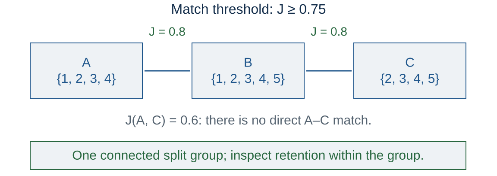

<p class="caption">Connected components define split groups. Choosing which records to retain is a separate policy.</p>

Note:
These are shingle sets, not literal document IDs. Draw edges for pairwise Jaccard at least 0.75. Connectivity is transitive but pairwise similarity at this threshold is not. Keeping this component within one split blocks these declared match edges from crossing splits. It does not prove every member is redundant, and it does not detect every semantic paraphrase. A connected component is not automatically a justification to delete all but one record.

---

<!-- .slide: id="task-construction" -->

## One article becomes several question–sentence rows

| Article | Question | Sentence | Contains answer? |
| --- | --- | --- | --- |
| 17 | Q1 | S1 | Yes |
| 17 | Q1 | S2 | No |
| 17 | Q2 | S1 | No |
| 17 | Q2 | S2 | Yes |

Q1 in training and Q2 in development still share article 17.

<p class="caption">QNLI-inspired toy conversion. An unseen-article claim needs article-family splits.</p>

Note:
Adapted concept: 2025 PPTX slide 11; GLUE Section 3.3 and Appendix A, https://arxiv.org/html/1804.07461v3. The toy article contains S1: Noa stores the model on the shared drive. S2: Mina writes the report. Q1 asks where Noa stores the model; Q2 asks who writes the report. The table is authored, not released QNLI data or its full selection recipe. Group related articles, assign splits, then materialize question–sentence rows with inherited source IDs. New questions about familiar articles are a different generalization target. Preserve published benchmark splits when reproducing official results. MultiRC supplies a separate aggregation lesson: option labels need question IDs for whole-answer-set exact match, and related questions may need passage-level resampling. E02 checks the article boundary as well as duplicate families.

---

<!-- .slide: class="exercise" id="data-exercise-03" -->

<p class="exercise-meta">Exercise E02 · 8 minutes · Notebook E02</p>

## Which proposed split leaks a match family?

Declared matches: A–B and B–C. Record D is unrelated.

| Proposed training | Proposed development |
| --- | --- |
| A, C | B, D |

Find the components and repair the split.

For unseen articles, is grouping only by question ID enough?

<div class="answer fragment"><p>Components: {A, B, C}, {D}. One feasible split: train A/B/C; development D.<br>Question IDs alone do not separate articles.</p></div>

Note:
This four-record split is only an illustration of the invariant; one development record cannot support a useful real estimate. Discuss group imbalance and the deployment question before using a real partition. Keep chunks and revisions under their parent grouping. The notebook detects both a duplicate-family crossing and an article shared across distinct question groups. It verifies repaired assignments without deleting records. Allow six minutes for the graph and two for the question/article contrast.

---

<!-- .slide: id="fixed-budget" -->

## Match processed tokens when data size changes

| Condition | Corpus tokens | Processed tokens | Approximate passes |
| --- | ---: | ---: | ---: |
| A | 4 million | 12 million | 3 |
| B | 3 million | 12 million | 4 |

Keep the architecture, tokenizer, context length, and training recipe fixed.

<p class="caption">Illustrative counts. Equal epochs would change the training budget.</p>

Note:
Processed tokens count repeated exposures. The retained corpus size measures a different quantity. With fixed architecture, sequence shape, and implementation, matching processed tokens is a useful approximation to matching training FLOPs. Report measured runtime separately because throughput and data handling can differ. The pass count is approximate when packing or incomplete windows affect consumption. This is the same budget convention required by A2.

---

<!-- .slide: id="fineweb-case" -->

## FineWeb: more deduplication is not always better

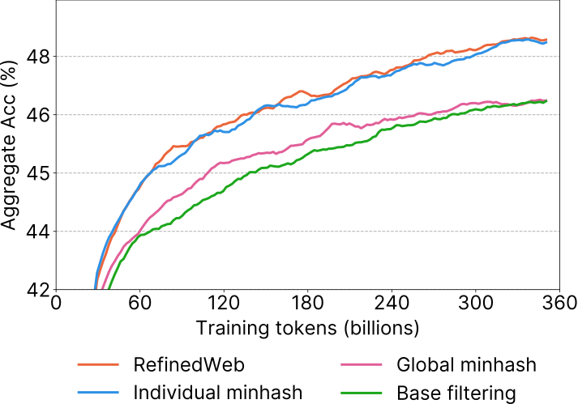

<p class="caption"><a href="https://arxiv.org/html/2406.17557v2">Penedo et al., 2024, Fig. 5</a>. Per-crawl deduplication outperforms global deduplication in this study.</p>

Note:
Figure question (20 seconds): does removing duplicates across more crawls guarantee higher accuracy? Expected: no; the individual-crawl curve outperforms global deduplication in this matched setup. Read Section 3.4 and Figures 3–5 together. Global deduplication across 96 snapshots removed a large share from older crawls; inspecting retained versus removed material motivated individual-crawl deduplication. The cited comparison uses 350B training tokens and a fixed 1.71B architecture. More removal changes the retained mixture and repeated exposure, so it is not automatically better. The authors' explanation about the remaining data is an empirical interpretation under their recipe, not a theorem about all corpora. Our A/B exercise remains synthetic and does not reproduce FineWeb. Its scale is not a student compute allocation.

---

<!-- .slide: id="training-mixture" -->

## Sampling weights determine the training distribution

Available source shares: $q_i=n_i/\sum_j n_j$.

$$p_i=\frac{q_i^\tau}{\sum_j q_j^\tau},\qquad
 D_i=D\,p_i,\qquad e_i=\frac{D_i}{n_i}.$$

- $p_i$: share of processed training tokens.
- $e_i$: expected passes over source $i$.
- $\tau=1$: natural shares; $\tau=0$: equal source weights.

<p class="caption">Illustrative sampling family. Source weights refer to tokens, not documents.</p>

Note:
This is an explicitly chosen classroom policy. It is not a claim that every named corpus uses this formula or that one exponent is optimal. Exposures assume uniform sampling within each source with replacement, ignoring packing overhead. Long documents make document-weighted sampling different from token-weighted sampling. For 0<tau<1, source probabilities become more balanced, which may repeatedly expose a small pool. Evaluate the policy rather than treating balance as automatically better.

---

<!-- .slide: class="exercise" id="data-exercise-04" -->

<p class="exercise-meta">Exercise E03 · 7 minutes · Notebook E03</p>

## How often does each source repeat?

English: 9M tokens. Chinese: 1M tokens. Total processed budget: 60M.

1. Calculate $p_i$ for $\tau=1/2$.
2. Calculate the processed tokens and expected passes per source.
3. Compare with natural sampling, $\tau=1$.

<div class="answer fragment"><p>Weights 75%/25%; processed tokens 45M/15M; expected passes 5/15. Natural sampling gives 6/6.</p></div>

Note:
Seven minutes includes arithmetic and debrief. State the within-source sampling assumption. The two language names label a toy mixture and do not recommend a language ratio for this course. Ask which experimental evidence would justify paying for the extra repetition. If changing the total token budget, it is a different comparison.

---

<!-- .slide: id="mixture-exposure" -->

## More weight can mean more repetition

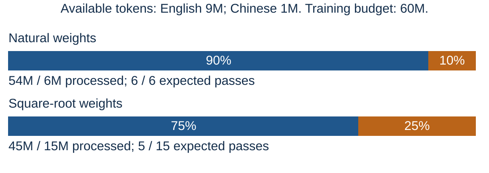

<p class="caption">Synthetic counts. Blue: English. Orange: Chinese. Both runs process 60M tokens.</p>

Note:
After students predict in E03, work through sqrt(0.9)/(sqrt(0.9)+sqrt(0.1))=0.75. The smaller source receives one quarter of the processed tokens despite providing one tenth of the unique pool. More repeated exposure is not the same as more unique data. No measured loss or accuracy is implied by this arithmetic. A cap, more source data, or a different mixture is a policy to study under a declared budget.

---

<!-- .slide: class="outline-slide" id="outline-evidence" -->

## Lecture outline

<ol class="outline-topics"><li>Sources, extraction and quality</li><li>Families, splits and exposure</li><li aria-current="step">Evaluation and experimental design</li></ol>

Note:
Data and evaluation are one experimental design. Keep the inference population and the training budget explicit.

---

<!-- .slide: id="comparison-record" -->

## A comparison needs a frozen record

| Training record | Evaluation record |
| --- | --- |
| Data policy and source revision | Dataset revision and item IDs |
| Model, tokenizer, initialization | Prompt and answer parser |
| Processed tokens and schedule | Attempts, tools, time and cost |
| Training seeds | Metric, slices, and aggregation |

Use development evidence for choices, then run the declared final evaluation.

Note:
Fixing a record is a procedural decision, not a claim that files cannot change. Record hashes where useful and retain predictions by item ID. If a bug invalidates the final evaluation, document it and design a fresh valid comparison rather than silently treating a repeatedly optimized score as untouched evidence. This extends Lecture 07's separation of fitting and validation to data policies and task evaluation.

---

<!-- .slide: id="benchmark-objects" -->

## Four benchmarks, four objects to grade

| Benchmark | Output | Main check | Blind spot |
| --- | --- | --- | --- |
| HLE-Diamond | Expert answer | Extract and judge | Research process |
| SWE-bench Verified | Repository patch | Issue + regression tests | Untested behavior |
| Terminal-Bench 4.0 | Task outcome | Separate verifier | Changed resources |
| Agents’ Last Exam | Professional artifact | Rubrics + execution | Deployment value |

<p class="caption">Choose the object that matches the claim. Each row requires a pinned release.</p>

Note:
The names alone are insufficient protocols. This table previews the four anchor case studies. HLE is Humanity's Last Exam, an academic question set; ALE is Agents' Last Exam, professional workflows. They are unrelated collections. A high score on either is not a proof of general intelligence. Sources: https://labs.scale.com/leaderboard/hle-diamond; https://www.swebench.com/; https://www.tbench.ai/news/terminal-bench-4-0; https://arxiv.org/html/2606.05405v4. Checked 2026-11-11 Asia/Shanghai. Each case below gives a different lesson in data quality, environment control or scoring.

---

<!-- .slide: id="hle-construction" -->

## Humanity’s Last Exam: building hard questions

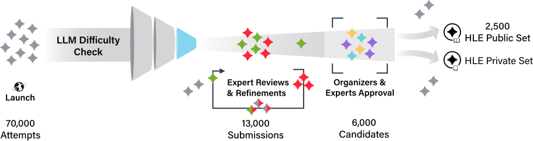

<p class="caption"><a href="https://arxiv.org/html/2501.14249v10">Phan et al., HLE, Fig. 4</a>. Model failure selects difficulty; expert review checks validity.</p>

Note:
Figure question (20 seconds): does rejecting questions answered by a frontier model validate the remaining labels? Expected: no; difficulty filtering and expert correctness review are distinct stages. HLE was first released in January 2025; its finalized 2,500-question release is dated April 3, 2025; Nature publication was January 28, 2026. Do not label the original collection as first introduced in 2026. It contains closed-ended questions across academic subjects, including image-dependent items. Accuracy and calibration are distinct measurements. Model filtering can select weaknesses specific to the filtering models, so it does not alone validate the intended expertise. Expert review can still leave errors; revisions must identify which questions changed. Original HLE, Rolling and Diamond are different populations. The next slide describes the verified September 2026 Diamond release, not this figure's original 2,500-item dataset.

---

<!-- .slide: id="hle-diamond" -->

## HLE-Diamond: a new version changes the population

**Announced September 22, 2026.**

- 1,000 questions with stable identifiers.
- 500 reasoning questions and 500 knowledge questions.
- Revised from the original HLE pool and its reserve.
- Report the partition scores and the tool setting.

<p class="caption">HLE, HLE-Rolling, and HLE-Diamond are different evaluation versions.</p>

Note:
The publisher describes Diamond as a frozen, refined collection. Its protocol uses automatic answer extraction/judging and also reports calibration. A new question set changes the comparison population: do not place an original-HLE score beside a Diamond score as if they were the same experiment. Strong results support claims about these expert questions, not a general claim about autonomous research. Sources: https://www.lastexam.ai/, latest-news entry; https://labs.scale.com/leaderboard/hle-diamond, design and methodology. Counts and announcement date checked November 11, 2026.

---

<!-- .slide: id="swebench-task" -->

## SWE-bench: evaluate a patch in its repository

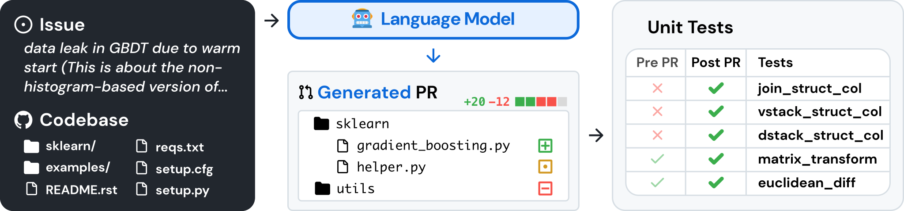

<p class="caption"><a href="https://arxiv.org/html/2310.06770v3">Jimenez et al., SWE-bench, Fig. 1</a>. Issue + snapshot → patch → execution.</p>

Note:
Figure question (20 seconds): what evidence distinguishes a plausible patch from a resolved task? Expected: execute the issue tests and regression tests in the pinned repository environment. Original paper released in 2023 and published at ICLR 2024. Explain FAIL_TO_PASS tests for the reported issue and PASS_TO_PASS tests for regression behavior. A resolved task must satisfy the release's test contract; it does not establish all untested behavior. Repository snapshot, dependencies and harness are part of the evaluation. Source issue and patch lineage also connect back to our split-family exercise. The model can be surrounded by retrieval and editing tools, so compare the complete evaluated system. The original figure shows a specific task, not a requirement for a student's project to run the entire benchmark.

---

<!-- .slide: id="swebench-family" -->

## “SWE-bench” does not identify one test set

| Collection | Tasks | Distinct scope |
| --- | ---: | --- |
| Original / Lite | 2,294 / 300 | Repository issue resolution |
| Verified | 500 | Human-filtered original tasks |
| Multilingual | 300 | Nine programming languages |
| Pro V2, September 2026 | 642 public | Separate collection and corrected tasks |

<p class="caption"><a href="https://www.swebench.com/">SWE-bench definitions</a>; <a href="https://labs.scale.com/blog/swe-bench-pro-v2">Pro V2 release</a>. Percent resolved needs a named denominator.</p>

Note:
Counts were verified on 2026-11-11 Asia/Shanghai. Verified is not Pro V2. The Multilingual release spans 42 repositories; this is different from changing a model's natural-language prompt. Pro V2's Hard subset has 51 tasks, so a Hard score uses another denominator. Never compare scores across these sets as if the same tasks were paired. Even on the same set, report scaffold, retrieval, tool, attempt and environment settings. The next optional repair case explains reference-patch/empty-patch tests, task corrections and pristine re-grading.

---

<!-- .slide: id="terminal-task" -->

## Terminal-Bench: tasks include environments

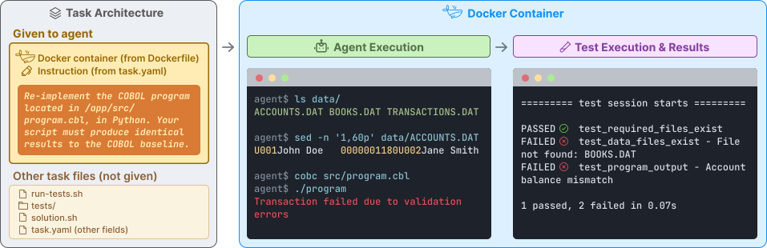

<p class="caption"><a href="https://arxiv.org/html/2601.11868v1">Terminal-Bench paper, 2026, Fig. 2</a>. TB2-era design; TB3/4 separates agent and verifier containers.</p>

Note:
Figure question (20 seconds): which hidden artifact checks that a task is solvable? Expected: the oracle solution; the agent receives the instruction/environment, not that solution. The paper describes the Terminal-Bench 2.0-era system, released in November 2025; paper publication in January 2026 is not the benchmark's first release. A task defines initial state, permitted actions, an outcome verifier and a time budget. An oracle solution checks feasibility; it is not supplied to the evaluated agent. In the pictured older design the tests are copied into the agent container after its run. TB3/4 separates verifier and agent containers, so do not describe this image as current TB4 architecture. Artifacts and execution traces help diagnose failures; test success depends on specification and coverage.

---

<!-- .slide: id="terminal-series" -->

## Terminal-Bench evolves by changing its contract

| Release | Date | What to inspect |
| --- | --- | --- |
| 1.0 → 2.0 | May / Nov 2025 | First suites; task difficulty |
| 2.1 | May 6, 2026 | Task and verifier corrections |
| 3.0 | July 30, 2026 | Separate verifier; richer artifacts |
| Science 0.1 | August 27, 2026 | 70 scientific workflows |
| 4.0 | August 28, 2026 | Resource calibration; repairs |

<p class="caption"><a href="https://www.tbench.ai/benchmarks">Official release index</a>. A newer release changes the experiment, not just the title.</p>

Note:
TB1.0 was May 19, 2025; TB2.0 November 7, 2025. Challenges was June 18, 2026, an additional collection rather than a point on one common score axis. TB4 reports removal of eight tasks and repair of 19, with CPU/memory calibration and an eight-hour agent timeout. That timeout is a benchmark protocol, not a course resource allocation. Science adds domain workflow evaluation; discussion stays at artifact and verification design. Different tasks and hardware can change rankings without a model update. Checked November 11, 2026 against the release index and https://www.tbench.ai/news/terminal-bench-4-0.

---

<!-- .slide: id="terminal-versioning" -->

## Did the agent improve, or did grading change?

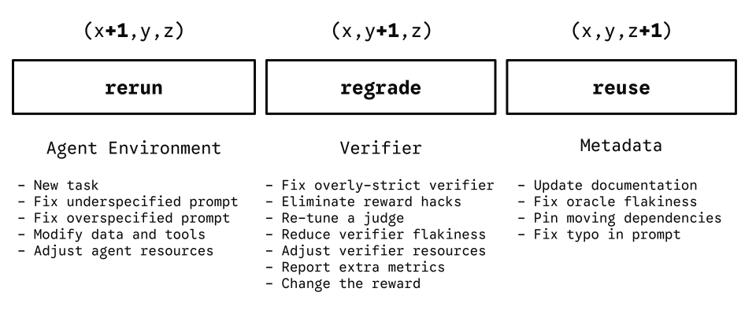

<p class="caption"><a href="https://www.tbench.ai/news/terminal-bench-4-0">Terminal-Bench 4.0 release illustration, 2026</a>. Preserve task, run and verifier revisions separately.</p>

Note:
This is a publisher's web illustration, not a numbered paper figure. Major changes require rerunning agents, minor verifier-only changes can allow regrading stored artifacts, and compatible patch changes allow reuse under the release's rules. Do not infer exact compatibility from a number without reading the changelog. Regrading the same artifacts can change scores with no new agent behavior. This is the concrete reason our experiment record contains both task and scorer revisions. Ask which operation costs new model inference and which requires stored artifacts. Sources checked 2026-11-11 Asia/Shanghai.

---

<!-- .slide: id="ale-task" -->

## Agents’ Last Exam: task → deliverable

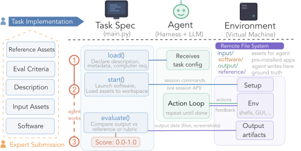

Agent: task + tools. Evaluator: isolated references + rubric.

<p class="caption"><a href="https://arxiv.org/html/2606.05405v4">ALE v4, 2026, Fig. 6</a>. GUI/CLI workflow; full-pass rate and partial-credit score differ.</p>

Note:
Figure question (20 seconds): which component receives reference answers and evaluates the output? Expected: the task specification/evaluator, isolated from the agent’s task description and working assets. The canonical name is Agents' Last Exam, plural possessive; it is distinct from Humanity's Last Exam. First paper June 3, 2026; this figure comes from October 25 v4. The task specification controls load/start/evaluate over a VM. The agent is harness plus model and only receives task description and metadata, while references and rubrics belong to evaluation. Report public/CLI/full subset and QC-approved task IDs; dynamic collected-task counts can include unverified tasks and are not the evaluation denominator. End-state checks, milestone checks and human-authored rubrics have different failure modes. A mean normalized score can reward progress even when few tasks fully pass.

---

<!-- .slide: id="ale-harness-evidence" -->

## Separate model effects from harness effects

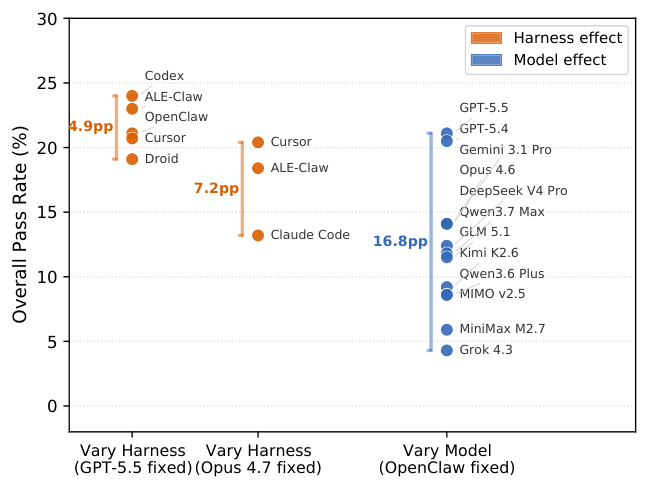

Model sweep: OpenClaw fixed. Harness sweeps: backbone fixed.

<p class="caption"><a href="https://arxiv.org/html/2606.05405v4">ALE v4, Fig. 12</a>. Unequal sets: 12 models versus 5 / 3 harnesses; descriptive ranges.</p>

Note:
Figure question (20 seconds): can the three spreads establish a universal model-versus-harness effect ratio? Expected: no; the configuration sets are unequal and selected, and the ranges have no uncertainty. The reported comparison fixes OpenClaw while varying 12 models, then fixes backbones while varying harnesses. The figure reports a 16.8 percentage-point model spread versus 4.9–7.2 point harness spreads in these configurations. The paper uses a five-hour cap. The model sweep has 12 configurations, while the GPT-5.5 and Opus-4.7 harness sweeps have five and three. Max-minus-min ranges depend on both configuration count and selection. This is not a balanced variance decomposition, causal effect-size estimate or significance test; no uncertainty is provided for the ranges. v4 mentions 150 public tasks in construction and 152 in experiments, so treat this as the authors’ reported public-set comparison and pin actual run task IDs before reproducing it. Do not turn the observed roughly threefold ratio into a universal law: the chosen models, harnesses, tasks and budgets determine the contrast. It supports the need for controlled comparisons, not a claim that harness design is always less important. If both model and harness change, attribute improvement to the system unless a factorial experiment separates them. Historical v4 measurements; no course reproduction.

---

<!-- .slide: id="agent-protocol" -->

## An agent result needs a complete protocol

| Identity | Resources and decisions |
| --- | --- |
| Task IDs; release; split | Attempts; timeout; stop rule |
| Model snapshot; harness commit | Reasoning/output token budget |
| Image; dependencies; initial state | CPU; RAM; tools; network |
| Verifier; rubric; judge snapshot | Cost; failures; saved artifacts |

Save per-task outcomes and trajectories before aggregating.

Note:
Cost per fully solved task is total cost including failed attempts divided by fully solved tasks; with zero successes it is undefined. Track API spend, environment resources and elapsed latency separately. A model API name alone cannot reproduce a system score. Report timeout and infrastructure-error policy before observing results; do not silently discard failures. Deterministic infrastructure failures may warrant a documented rerun under a fixed policy, not selective extra attempts for one system. Cache and network state can change available evidence. For repeated tasks, pair systems by task ID and initial state; report stochastic reruns separately. Sources: Terminal-Bench paper/release protocol; ALE v4 evaluation lifecycle; SWE-bench harness. This is our general experiment-record synthesis.

---

<!-- .slide: id="agent-comparison-check" -->

<p class="exercise-meta">Discussion checkpoint · 90 seconds · No new notebook task</p>

## Two agents solve six of ten tasks. Are they tied?

| Synthetic run | Agent A | Agent B |
| --- | --- | --- |
| Attempts per task | 1 | 5 |
| Network | Disabled | Enabled |
| Total cost, including failures | $12 | $60 |
| Tasks fully passed | 6/10 | 6/10 |

<div class="answer fragment"><p>60% each; $2 versus $10 per solved task. Different tools and budgets.</p></div>

Note:
Compute cost per fully solved task as total cost of all evaluated attempts (including failures) divided by fully solved tasks: 12/6 = 2 and 60/6 = 10 dollars. It is undefined if no tasks succeed. These are authored totals, not live API prices. Report API spend and environment compute separately; latency is elapsed time, not the sum of parallel trial durations. Expected response: neither equal model ability nor statistical equivalence follows. The ten tasks must also be identical and paired before a useful comparison. Keep this as a short oral check after the agent protocol; no new graded work or notebook ID. Ask students to name a next comparison: same model/harness/environment, vary only attempt count; or compare complete systems at a common cost ceiling. With only ten tasks, uncertainty can remain large. The values are authored; no agent runs were performed.

---

<!-- .slide: id="graders" -->

## A grader needs its own validation

| Grader | Example failure |
| --- | --- |
| Exact string match | Equivalent answer rejected |
| Unit tests | Untested behavior accepted |
| LLM judge | Rubric or presentation changes the judgment |
| Human rubric | Reviewers disagree on an ambiguous criterion |

Inspect disagreements and retain examples behind the score.

Note:
These are possibilities to audit, not measured error rates for a named grader. Use known correct and incorrect examples, check label mappings, and manually inspect a small sample. For an LLM judge, record its model revision, prompt, rubric, and reference-answer access. A grader's agreement with humans on a particular sample does not establish universal validity. HLE-Diamond's answer-extraction protocol and the SWE-Bench Pro V2 clean re-grading example provide concrete contexts. Detailed judge studies are linked in optional-reading.md.

---

<!-- .slide: id="judge-order-audit" -->

## Validate the judge with an order swap

| Authored probe | First slot | Second slot | Judge selects |
| --- | --- | --- | --- |
| Original order | Answer X | Answer Y | First: X |
| Swapped order | Answer Y | Answer X | First: Y |

The verdict changed although the answers did not.

Repeat across a labeled sample; inspect false accepts and false rejects.

<p class="caption">Toy counterexample; <a href="https://arxiv.org/abs/2306.05685">Zheng et al., 2023, §3.3–3.4</a> studies judge biases.</p>

Note:
Expected response: the pair is order-sensitive. One pair is a diagnostic counterexample, not an estimated bias rate. Preserve answer identity after swapping; a consistent judge that prefers X should select the second slot in the second row. A tie can be a valid outcome. The paper also discusses verbosity and self-enhancement biases and limited reasoning; human agreement is distribution-specific. Fix judge revision, prompt, rubric and reference access. Report error types against independently labeled cases; broad agreement can hide systematic false acceptance of invalid artifacts. This is not the paper's original measured table.

---

<!-- .slide: id="reward-is-not-evaluation" -->

## Passing the reward test can miss the task

Task: return the square of the input.

| Candidate | Training reward: input 2 | Independent check: input 3 |
| --- | --- | --- |
| `return 4` | Pass: 4 | Fail: expected 9 |
| `return x * x` | Pass: 4 | Pass: 9 |

A reward is an optimization signal. Validate the intended behavior separately.

<p class="caption">Authored toy example; no policy was trained. Two tests do not prove general correctness.</p>

Note:
Retrieve the reward in Lecture 09's policy objective. A perfect training-reward score is compatible with failure outside the checked case. The example demonstrates an incomplete verifier, not a measured outcome of PPO or a learned reward model. The notebook executes both candidates. Hold out independent task instances and inspect verifier blind spots; choosing this check after noticing the bug is development work, so freeze another evaluation for a final claim. Connect to Lecture 11: a verifiable reward is only as informative as its specification and coverage. Contextual reading: Gao, Schulman and Hilton, Scaling Laws for Reward Model Overoptimization, https://arxiv.org/abs/2210.10760. Their experiments concern proxy reward optimization; this two-function fixture is our illustration, not a reproduction of their experiment.

---

<!-- .slide: id="prompt-sensitivity" -->

## Prompt selection is part of model selection

| Synthetic accuracy on 100 items | Model A | Model B |
| --- | ---: | ---: |
| Template 1 | 60% | 64% |
| Template 2 | 62% | 58% |

Choose a prompt on development data, or report a prespecified set of prompts.

<p class="caption">Changing the prompt can change the model ranking.</p>

Note:
The table is a constructed counterexample, not empirical evidence about a model family. Both prompts use the same item population. Reporting only each model's best test prompt introduces selection bias. Shared prompts and model-specific prompts answer different questions; either needs a declared protocol. Choice ordering, chat templates, truncation, and answer extraction can also change results. MMLU-Pro's prompt sensitivity study is a concrete reading: https://arxiv.org/abs/2406.01574, experiments on prompt variations.

---

<!-- .slide: class="exercise" id="exercise-04" -->

<p class="exercise-meta">Exercise E04 · 6 minutes · Notebook E04</p>

## Does the evaluation set change the conclusion?

| Synthetic outcomes | Raw data A | Deduplicated data B |
| --- | ---: | ---: |
| 100 clean items | 60 correct | 64 correct |
| 20 exposed items | 19 correct | 11 correct |

Compute accuracy on all 120 items and on the clean 100.

<div class="answer fragment"><p>All: A 65.8%, B 62.5%. Clean: A 60%, B 64%.</p></div>

Note:
An independent audit has already marked the exposed items in this constructed example. The numbers show how sample composition can reverse the ranking. They do not establish how much of a real score is caused by memorization. Students must not exclude examples because a preferred model gets them wrong. Exclusion needs an independently justified rule, and changing the evaluated population must be reported. Full item-level correctness vectors are constructed in assets/evaluation.py.

---

<!-- .slide: id="evaluation-demo" -->

## The ranking changes with the evaluated items

<div class="demo-form">
  <button id="evaluation-toggle" type="button" aria-pressed="false">Mixed evaluation</button>
  <button id="reset-button" type="button">Reset</button>
</div>

<div id="evaluation-plot" class="plot" data-plotly="assets/contamination.json" role="img" aria-label="Synthetic accuracies for raw and deduplicated training data. Toggle between a mixed evaluation with 120 items and a clean evaluation with 100 items."></div>

<p class="caption" id="evaluation-status" aria-live="polite">Synthetic: 100 clean items plus 20 exposed items. Raw 65.8%, deduplicated 62.5%.</p>

Note:
Toggle once after students calculate both results, then reset. The chart uses a zero baseline and a fixed 0–100 percent scale. The evaluation size changes, while the predictions on the clean items stay fixed. This demonstration does not run inference or remove any files. In the PDF, the initial mixed set appears; the preceding exercise gives both outcomes.

---

<!-- .slide: id="uncertainty-sources" -->

## What uncertainty does a result include?

| Source | Useful evidence |
| --- | --- |
| Which evaluation items appear | Item or cluster resampling |
| Training randomness | Independent training seeds |
| Generation randomness | Repeated samples with fixed settings |
| Prompt or grader choices | Prespecified robustness checks |

One interval cannot automatically cover all four.

Note:
The core E05 bootstrap conditions on two fixed fitted systems and their fixed prompts. It estimates sampling uncertainty across independent items drawn from the same population. It does not include training-run variation. Related examples may require resampling document or task groups rather than individual rows. Source: Dror et al., https://aclanthology.org/P18-1128/, statistical testing assumptions and test selection. The resampling implementation and limitations are documented in assets/evaluation.py.

---

<!-- .slide: id="paired-items" -->

## Compare the same items together

| Clean synthetic items | Count |
| --- | ---: |
| Both A and B correct | 50 |
| Only A correct | 10 |
| Only B correct | 14 |
| Both wrong | 26 |

$$\Delta=\mathrm{accuracy}(B)-\mathrm{accuracy}(A)=\frac{14-10}{100}=4\text{ percentage points}$$

Note:
Students often compare two independent error bars even though both models answer the same questions. The paired difference uses the joint outcomes. Here 24 items disagree. Pair each item's two predictions before resampling; independent resampling of A and B loses that dependence. All counts derive from the explicit synthetic vectors used by E04 and E05.

---

<!-- .slide: class="exercise" id="exercise-05" -->

<p class="exercise-meta">Exercise E05 · 8 minutes · Notebook E05</p>

## How strong is the four-point improvement?

Resample the 100 paired items with replacement 5,000 times.

1. Compute the accuracy difference in each resample.
2. Read the central 95% percentile interval.
3. State which uncertainty this interval leaves out.

<div class="answer fragment"><p>The interval crosses zero. These items do not establish a reliable positive gain.</p></div>

Note:
The notebook fixes the seed at 20261028 and uses a transparent percentile implementation. It reports the exact computed endpoints and the point estimate. An interval crossing zero does not prove the models are identical. The small fixture is for understanding the procedure, not deciding a research result from one run. Expected limitations include training seeds, prompt choice, grader errors, and violations of item independence. Use this exercise to practice a qualified conclusion.

---

<!-- .slide: id="bootstrap-result" -->

## The paired differences include both signs

<div class="plot" data-plotly="assets/bootstrap.json" role="img" aria-label="Histogram of 5000 paired bootstrap accuracy differences from synthetic predictions. The distribution includes negative and positive differences around a four-percentage-point estimate."></div>

<p class="caption">95% interval: −5 to +13 points. Dashed line: zero. Synthetic items; fixed systems.</p>

Note:
Read the units as percentage points, not relative percent improvement. The plot is generated directly from the same seeded samples as Notebook E05. The histogram counts resampled differences; it is not a Bayesian posterior probability that B is better. More representative independent evaluation items or repeated training runs answer different uncertainty questions; choose the next experiment based on the dominant uncertainty and compute budget.

---

<!-- .slide: id="error-analysis" -->

## Error analysis turns a score into a hypothesis

| Inspect | Possible next comparison |
| --- | --- |
| Both systems fail the same items | Review labels and missing skills |
| One language loses after filtering | Audit retained language coverage |
| Answer text is right but parsing fails | Test a corrected parser on development data |
| Only long inputs fail | Check truncation and context limits |

Note:
These are hypotheses to investigate, not diagnoses guaranteed by the observed pattern. Inspect raw predictions alongside labels and item metadata. Avoid changing many parts of the pipeline at once. If label errors are discovered, keep an audit trail and report the revised dataset version. The purpose is to decide which evidence would discriminate among explanations, building on the course's individual-project requirements.

---

<!-- .slide: id="project-evaluation" -->

## A feasible project comparison

| Field | Example plan: deduplication study |
| --- | --- |
| Change | Original corpus → deduplicated corpus |
| Controls | Same small model, tokenizer, 1M processed tokens |
| Evaluation | Frozen document families; paired outcomes |
| Resources | CPU-only; 0 GPU-hours; 2 CPU-hours estimated |
| Fallback | Audit supplied examples; analyze held-out predictions |

<p class="caption">Planning example, not a measured runtime or resource allocation.</p>

Note:
The exact model size, hardware and throughput must be established by a pilot before committing to the two-CPU-hour envelope. A 1M processed-token budget is deliberately small; it supports a narrow study, not a frontier capability claim. Fallback must still include an implementation, experiment or tested artifact with a meaningful comparison and analysis, not a survey-only report. Record commands, Git revision/dirty state, configuration, seeds, data/model versions, total resources and artifact locations. All students follow the same rubric; no new graded deliverable is introduced. The six-page final main-content limit remains unchanged. Use the existing project process.

---

<!-- .slide: id="summary" -->

## Report the experiment behind the score

1. Sources, exclusions and split groups.
2. Processed tokens and compute across all runs.
3. Model, prompt, decoding and grader versions.
4. Paired difference, uncertainty and error slices.

Note:
The same structure applies to a data-filter comparison, SFT adaptation, reward-model evaluation or policy optimization. A negative result with sound controls is useful. Choose one meaningful comparison within a small budget; do not promise improvement from a preferred method. Next, Lecture 11 introduces DPO and GRPO using the same independent-evaluation boundary: ../../docs/course-revision.html#lecture-11-dpo-grpo-and-verifiable-rewards.

---

<!-- .slide: class="references" id="methods-reading" -->

## Reading: data preparation methods

- [Lee et al., 2022](https://aclanthology.org/2022.acl-long.577/): deduplication and overlap.
- [FineWeb, 2024](https://arxiv.org/abs/2406.17557): controlled extraction and filtering ablations.
- [Dolma, 2024](https://arxiv.org/abs/2402.00159): source composition and curation tools.
- [DataComp-LM, 2024](https://arxiv.org/abs/2406.11794): comparisons under shared training conditions.

[Benchmark construction cases and full reading guide](optional-reading.md)

Note:
End the 120 teaching minutes here, then allow 15 minutes for Quiz 4. The following broader benchmark catalog, construction cases, scoring details and matching methods are optional. QNLI-style lineage, SWAG/HellaSwag shortcuts and paired uncertainty are core; the detailed GLUE/STS schema table is optional. Reading choices follow the project question; there is no reference-count requirement and no new graded work.

---

<!-- .slide: class="outline-slide" id="outline-benchmarks" -->

## Optional depth and benchmark atlas

- More 2026 benchmarks and historical evidence.
- Context, minimal pairs and task-specific schemas.
- Candidate scoring: P01.
- Attempt budgets and pass@k: P02.
- Collection rounds, curation cases and MinHash: P03.

Note:
This extension is outside the 120-minute Lecture 10 core. Paired evaluation and uncertainty are now core E05. Keep the catalog as reading rather than racing through benchmark names. Current examples are protocol case studies, not a model ranking.

---

<!-- .slide: id="gpt4-evaluation" -->

## GPT-4: predict a held-out capability metric

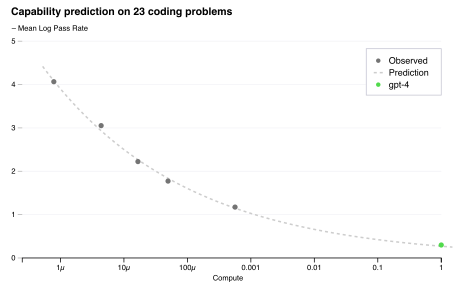

**Negative mean log pass rate:** lower means higher pass probabilities.

<p class="caption"><a href="https://arxiv.org/html/2303.08774v6">OpenAI, 2023, Fig. 2</a>. HumanEval subset; normalized training compute.</p>

Note:
This connects Lecture 07's held-out scaling prediction to evaluation. The fit excludes GPT-4, and the x-axis is normalized training compute. Both axes and the selected HumanEval subset matter. The source graphic labels the plotted quantity with a leading minus sign (negative mean log pass rate), even though its paper caption abbreviates it as mean log pass rate. Lower plotted values mean higher geometric-mean pass probability. This figure does not measure test-time scaling. The report separately evaluates academic/professional exams, multilingual MMLU and visual inputs (Section 4 and Figure 4). Those simulated exam percentiles depend on their reference population and sometimes wide percentile bins; they do not establish occupational competence. Main route uses the brief timeline; this detailed result is a reference stop if time permits.

---

<!-- .slide: id="benchmarks-2026-code" -->

## New in 2026: coding beyond issue repair

| Benchmark | Task | Grading distinction |
| --- | --- | --- |
| ProgramBench, May 5 paper | Rebuild software from executable + docs | All tests vs ≥95% passed |
| SWE Atlas, Mar 4 / May 7 | Codebase QA, tests, refactoring | Programmatic + rubric checks |
| OSWorld 2.0, June 26 | Long desktop workflows | End state in pinned VM |

<p class="caption"><a href="https://programbench.com/">ProgramBench</a> · <a href="https://scale.com/blog/swe-atlas-complete">SWE Atlas</a> · <a href="https://github.com/xlang-ai/OSWorld-V2">OSWorld-V2</a></p>

Note:
ProgramBench v1 has 200 tasks; % Resolved requires all tests, while % Almost uses at least 95 percent. Its paper appeared May 5, 2026, https://arxiv.org/html/2605.03546v1. SWE Atlas initial release March 4 and complete suite May 7 span 284 tasks; November v1.1 updates judge/network methodology, with no exact day established here, so use a named version. OSWorld 2.0 release June 26 and paper June 28; bug-fix version 2.1 September 16. Pin code, task files, assets, mocked websites and VM image together. These are design references, not required course runs. Verified 2026-11-11 Asia/Shanghai.

---

<!-- .slide: id="benchmarks-2026-interaction" -->

## New in 2026: interaction, artifacts and time

| Benchmark | Evaluated object | What must be reported? |
| --- | --- | --- |
| ARC-AGI-3, March 25 | Unfamiliar interactive games | Actions; human-relative efficiency |
| LiveBench 2.0, Oct 14 → Nov 6 | Reports, software, decks | Release; suite weights; grader |
| AgentTime, September 26 | Following duration requests | Time asked; time worked; quality |

<p class="caption"><a href="https://arcprize.org/arc-agi/3">ARC-AGI-3</a> · <a href="https://livebench.ai/">LiveBench</a> · <a href="https://agenttimebench.com/data/">AgentTime</a></p>

Note:
These release dates were checked November 11, 2026. AgentTime added agent results on November 2; its current v1.1 reduces the original 222 tasks to 200. Duration instruction-following is the selected example here; the current index also covers forecasting and retrospection. See https://agenttimebench.com/method/. It uses tasks drawn from other benchmarks, so elapsed time and task correctness must remain separate metrics. For reproducibility pin a data release; this new benchmark is optional reading, not an established universal measure. LiveBench first released v2 on October 14; the current checked release is November 6. October 25 changed suite weights (Long Agentic 2, Coding 1.5, Design 1.5, others 1) from October 14’s equal weights. Match release, coverage, weights and grader even within v2. Source: https://livebench.ai/data/20261106/categories.json and the October 14/25 category metadata. ARC-AGI-3 is interactive and distinct from AI2's ARC science questions and the static ARC-AGI predecessors. See the separate ARC slide for action-efficiency interpretation. Benchmark author claims of low contamination are not a guarantee of zero exposure.

---

<!-- .slide: id="benchmark-breadth" -->

## A benchmark portfolio starts from the claim

| Claim | Useful examples | Required control |
| --- | --- | --- |
| Knowledge / reasoning | MMLU-Pro, GPQA, HLE | Subset; tools; answer parser |
| Executable programming | HumanEval, LiveCodeBench | Tests; date window; pass@k |
| Dialogue quality | MT-Bench, Chatbot Arena | Judge or voter population |
| Interactive completion | SWE-bench, TB, ALE, ARC-AGI-3 | Harness; state; resource budget |

<p class="caption">Older benchmarks remain useful diagnostics. Breadth does not replace a defined target population.</p>

Note:
This is a design map, not a recommendation to compute every benchmark. MMLU-Pro (2024), GPQA (2023), HumanEval (2021), LiveCodeBench (2024), MT-Bench/Arena (2023) are not all new in 2026. Links and exact versions are in optional-reading.md. For a small model, an unsaturated, relevant slice can teach more than a frontier benchmark with a floor effect. Public subsets are development evidence once used for selection. Domain coverage, multilingual coverage, safety and calibration may require separate targeted checks. Report why each selected task supports the project's claim.

---

<!-- .slide: id="source-card" -->

## A source record students can audit

| Field | Example value |
| --- | --- |
| Source and revision | Course fixture, revision 1 |
| Document and parent IDs | `article-17`, `site-a` |
| Extraction and filter rules | `extract-v1`, `policy-b` |
| Rights and access metadata | Course-authored text |
| Counts | Raw bytes, retained documents, tokenizer tokens |

<p class="caption">A dataset name alone does not identify the training mixture.</p>

Note:
Use an authored record so no rights or provenance claim is inferred from a real URL. Preserve dates, source licenses or terms, language metadata, and removal decisions when constructing a real dataset. A permissive toolkit license does not automatically describe every source document. Byte, document, and token counts answer different questions; token counts depend on the tokenizer. This is a metadata design exercise, not legal advice.

---

<!-- .slide: id="data-evidence" -->

## Data policies need controlled evidence

**Lee et al., 2022:** investigate deduplication, memorization, and evaluation overlap.

**FineWeb, 2024:** document extraction, filtering, and deduplication ablations.

For our course: change one data policy and keep a comparable training budget.

Note:
These papers provide methods and empirical case studies. Their findings do not guarantee that every deduplication or quality threshold improves every model. Students can get a sound negative result. Read Lee et al., methods and experimental sections, https://aclanthology.org/2022.acl-long.577/; FineWeb, dataset-construction ablations, https://arxiv.org/abs/2406.17557. Full paper training budgets are outside the classroom scope. Allow a short transition before the break.

---

<!-- .slide: id="data-schema" -->

## A target needs a definition and a schema

| Case | Target | Preparation check |
| --- | --- | --- |
| CoLA | Binary acceptability | Label ≠ Matthews correlation |
| STS-B | Similarity, 0–5 | Scale and annotation anchors |
| MNLI / RTE | Relation label | Input order and label mapping |
| MultiRC | Answer-option label | Passage, question and option IDs |

Save the rubric and inspect annotation disagreements.

Note:
Adapted from the instructor's October 29, 2025 PPTX, slides 5–13 and 15–23. GLUE Section 3: https://arxiv.org/html/1804.07461v3. CoLA labels are binary; −1 to 1 describes its Matthews correlation metric. STS-B is a real-valued similarity task on a 0–5 scale: see Cer et al., Section 2, Table 1 and Section 8, https://aclanthology.org/S17-2001/. The source deck and GLUE paper say 1–5, but the original STS rubric includes zero. Store named labels and the pinned release's integer mapping; do not copy a numeric convention from a different NLI dataset. MultiRC uses answer-option F1 and question-level exact match: SuperGLUE Sections 3.2–3.3, https://arxiv.org/html/1905.00537v3. The rubric/annotation audit is our course recommendation: pilot independent judgments, retain disagreements and adjudication. Connect to Week 8: grammaticality and human preference answer different questions.

---

<!-- .slide: id="text-extraction" -->

## Text extraction changes the learning problem

| Input | Possible extraction error |
| --- | --- |
| Web article | Navigation repeated on every page |
| Code tutorial | Indentation or symbols lost |
| Table | Values detached from their headers |
| Multilingual text | Useful passages rejected by an English rule |

Inspect retained examples and rejected examples.

Note:
These are authored failure examples. Parsing HTML is only one step: preserving the meaningful sequence matters for a language model. Do not show an HTML-tag regex as a general web extractor. Normalization, content extraction, and quality selection make different changes. Keep original source identifiers so a suspicious example can be traced back. FineWeb provides a concrete large-scale case study, not a recipe students must reproduce at its full scale.

---

<!-- .slide: id="extraction-example" -->

## Content extraction on one page

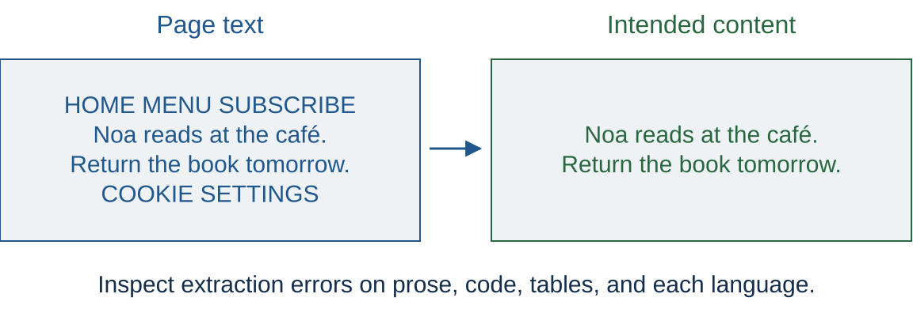

<p class="caption">Toy page. Code indentation and table relationships need their own checks.</p>

Note:
Ask students which parts they would keep and which extraction errors would change meaning. Navigation may recur on thousands of pages. Removing every short line would also remove useful headings or code. This illustration is the desired result for one authored page, not a general extraction algorithm. Do not present stripping tags with a regex as a reliable HTML extractor.

---

<!-- .slide: id="quality-filters" -->

## Quality depends on the intended use

- Repetition filters can catch boilerplate.
- Language filters change which communities remain represented.
- Model-based scores inherit the reference model's preferences.
- Aggressive thresholds can remove difficult but useful examples.

Compare the resulting models on relevant held-out tasks.

Note:
Ask students for an example of useful repetition, such as definitions in textbooks or common code syntax. A filtering score is a selection rule, and its effectiveness is an empirical question for a target task and budget. A held-out development set can guide threshold selection. Preserve a final set for the selected policy. Relevant ablations: FineWeb, https://arxiv.org/abs/2406.17557. The language-coverage cautions here are experimental design considerations rather than universal measured effects of every filter.

---

<!-- .slide: id="split-construction" -->

## A random row split can leak source content

| Related records | Useful grouping boundary |
| --- | --- |
| Copies of one article | Duplicate family |
| Chunks of one document | Original document |
| Revisions of one repository task | Task or repository lineage |
| Repeated records from one person | Person, when appropriate |

Choose the boundary that matches the generalization question.

Note:
Rows are not always independent examples. A chunk split asks a different question from a document split. A repository split can test transfer to new projects, while an issue split within a repository tests another setting. Grouping choices can also make evaluation harder or change its target population. Explain the intended deployment before choosing the boundary. These are course-authored design examples, not a claim that one grouping rule suits every dataset.

---

<!-- .slide: id="contamination-paths" -->

## Evaluation information can enter several stages

- Pretraining includes benchmark questions or solutions.
- Fine-tuning examples contain evaluation answers.
- Demonstrations reproduce a held-out item.
- Repeated test-set feedback guides model or prompt selection.
- A tool retrieves the solution during evaluation.

The audit must cover the full evaluated system.

Note:
Direct text overlap is only one route. Paraphrases and derived examples may escape exact matching. Repeated use of a public test set can also bias model selection without literal memorization. A permitted web search is part of a tool-enabled protocol, but looking up a benchmark solution may violate the intended task. State the tool policy before running. Lee et al. supports train/evaluation overlap analysis; the tool and grading case returns in the SWE-Bench Pro V2 slide.

---

<!-- .slide: id="pipeline-order" -->

## Chunking preserves parent and family IDs

| Record | Parent document | Duplicate family | Split |
| --- | --- | --- | --- |
| `A-1`, `A-2` | A | family-1 | train |
| `B-1`, `B-2` | B | family-1 | train |
| `D-1` | D | family-2 | development |

Tokenize and pack within the assigned split.

Note:
A random chunk split can move near-identical context across partitions even after document matching was done correctly. Carry parent and family IDs to chunks and packed sequences. Record tokenizer revision, document boundaries, scored token positions, and packing rules. Training shuffle and evaluation grouping serve different purposes. This is an authored example, not a prescribed ratio for real dataset sizes.

---

<!-- .slide: id="benchmark-definition" -->

## A benchmark includes a protocol

| Component | Example |
| --- | --- |
| Task | Select a plausible continuation |
| Dataset | A versioned set of contexts and choices |
| Protocol | Prompt, demonstrations, tools, budget |
| Scoring | Answer extraction and aggregation |

A model name and one number leave much of the experiment unspecified.

Note:
An evaluation harness implements this contract. Record the dataset revision, task configuration, model revision, tokenizer, prompt, generation settings, and scoring code. The EleutherAI harness distinguishes likelihood-based requests from generated responses; a backend's capabilities constrain which task interface can run. Source: https://github.com/EleutherAI/lm-evaluation-harness, model request types and reproducibility guidance. We inspect the concepts without requiring a new harness installation today.

---

<!-- .slide: id="loss-and-task" -->

## Language-model loss and task accuracy answer different questions

| Measure | What contributes |
| --- | --- |
| Held-out NLL or PPL | Probabilities of observed text tokens |
| Task accuracy | Whether the selected answer is correct |
| Per-language score | Behavior on a specified language slice |
| Cost per task | Resources consumed under the protocol |

A lower average loss does not guarantee every task improves.

Note:
Retrieve Lecture 02's units: PPL is exp(mean NLL in nats per scored token). Its direct comparison requires compatible tokenization and evaluation conventions. BPB changes the normalization unit but still requires the same text and scoring scope. Task metrics may use a subset of outputs and a discontinuous decision rule. A model can change answer probabilities without changing its selected answer, or improve one domain while losing another. Source: ../../docs/lecture-02-lm-metrics.md. No loss values are invented for the synthetic accuracy fixtures.

---

<!-- .slide: id="mixtures" -->

## An aggregate score reflects the language mixture

| Synthetic accuracy | English | Chinese | 80/20 mixture | Equal language weight |
| --- | ---: | ---: | ---: | ---: |
| A | 90% | 40% | 80% | 65% |
| B | 85% | 60% | 80% | 72.5% |

Report relevant slices and state their weights.

Note:
Compute A's 80/20 score as 0.8 times 90 plus 0.2 times 40. These are constructed values, not measurements of a real model or language. Equal language weighting is a macro average over these two language accuracies; an item-weighted average depends on the item counts. Neither weighting is universally right. Choose weights that answer the application question before comparing systems. Training mixtures and evaluation mixtures are separate choices.

---

<!-- .slide: id="historical-tasks" -->

## Established tasks still teach useful distinctions

| Historical example | What the model returns |
| --- | --- |
| SuperGLUE: BoolQ, RTE | A label about a passage or sentence pair |
| HellaSwag | A continuation choice |
| MMLU | A subject-question answer |
| GSM8K | A final numerical answer |
| HumanEval | Executable code |

<p class="caption">From the 2025 and Spring benchmark materials. Each requires its own scoring rule.</p>

Note:
This compresses the Spring and 2025 decks' dataset catalogs. Different SuperGLUE tasks also use different metrics, so do not call every suite score plain accuracy. Older public tasks remain useful for small models, debugging, and studying specific failure modes. Strong scores alone do not establish broad capability. Source: supplied Spring PPTX slides 3–29 and 2025 PPTX slides 3–42, which credits Anoop Sarkar; SuperGLUE paper https://arxiv.org/abs/1905.00537; HellaSwag project https://rowanzellers.com/hellaswag/.

---

<!-- .slide: id="lambada-construction" -->

## LAMBADA: select examples that need context

**Earlier context:** Noa handed Mina a notebook. Its cover was green.

**Target sentence:** Later Mina described the cover as ____.

**Target word:** green.

Compare prediction with the full passage and the target sentence alone.

<p class="caption">Authored illustration. Human filtering must establish the context contrast.</p>

Note:
Source: supplied 2025 slide 34 and Paperno et al., Sections 3.1–3.2, https://aclanthology.org/P16-1144/. LAMBADA selects passages using automated and human checks, including full versus limited context. This invented example illustrates the design and has not passed that collection protocol. Retain book IDs and context-window rules in a course adaptation; compare the same target under both conditions. The original 10,022 filtered passages are development/test data, not a training set. Raw training novels are disjoint and not filtered the same way. A target word may occupy multiple BPE tokens: do not silently score only its first token. A context ablation measures dependence on the provided context; it alone does not prove broad comprehension.

---

<!-- .slide: id="minimal-pair-construction" -->

## BLiMP: preserve the intended contrast

| Authored agreement pair | Sentence |
| --- | --- |
| Acceptable | The keys beside the folder **are** missing. |
| Unacceptable | The keys beside the folder **is** missing. |

Retain pair and template IDs; check grammar and lexical cues.

<p class="caption">A grammaticality contrast is different from a human-preference pair.</p>

Note:
Source: supplied 2025 slide 41 and Warstadt et al., Sections 2–3, https://aclanthology.org/2020.tacl-1.25/. BLiMP uses linguist-designed generation templates and evaluates sentence probability preferences. These sentences are authored course examples, not copied benchmark rows. Keep the contrast, vocabulary choices and template provenance. A course experiment claiming transfer to new templates must split by template families before generating variants. For an autoregressive model, specify complete sentence scoring, token boundaries and tie handling. The target is a specified English agreement judgment, not overall response helpfulness; do not automatically reuse these labels as reward-model preferences.

---

<!-- .slide: id="benchmark-task-fields" -->

## Task families require different preparation checks

| Task family | What must survive preprocessing? |
| --- | --- |
| Question answering | Source evidence, answer spans or aliases |
| Summarization | Document–reference alignment and provenance |
| Translation | Aligned source/target text and language IDs |
| Structured prediction | Text revision, token/span offsets and labels |

Normalization or truncation can invalidate an annotation.

Note:
Adapted from the 2025 deck's task catalog, slides 44–47: Natural Questions and other QA examples, summarization, FLORES and other translation resources, and CoNLL/structured prediction. This table is an original checklist, not a claim about every dataset's official format. Preserve source-family IDs in every family, inspect transformations with examples, and use the pinned task's scorer. In structured prediction, changing Unicode normalization may shift character offsets; in summarization, truncating a document may remove support for the reference. Select a task because it matches the claim, then inspect its data contract. The catalog creates no requirement to run all these tasks.

---

<!-- .slide: id="model-interfaces" -->

## The same task can use different model interfaces

| Interface | Sentiment example |
| --- | --- |
| BERT masked token | “It was [MASK].” Compare label words. |
| Causal LM likelihood | Score each candidate answer. |
| Chat generation | Generate a label, then parse it. |

Prompts, label words, and parsing rules are experimental choices.

Note:
Retain the useful comparison in the Spring companion notebook. BERT predicts a masked token using both sides of its input. A causal LM scores an answer token sequence conditioned on a prefix. A chat model generates a response that needs a declared extraction rule. A plain masked-token score is not an autoregressive sequence probability. Check label-token boundaries and label mappings. Do not copy the old notebook's automatic model downloads into the classroom core. Source: BERT, https://aclanthology.org/N19-1423/, Section 3; supplied Spring notebook, zero-shot evaluation section.

---

<!-- .slide: id="completion-scoring" -->

## Candidate likelihood and length normalization

$$s(y\mid x)=\sum_{t=1}^{|y|}\log p(y_t\mid x,y_{<t})$$

An alternative rule uses $s(y\mid x)/|y|$.

- Score the answer tokens under a fixed prompt.
- State how the denominator counts length.
- Choose the rule before inspecting test results.

Note:
The sum is the candidate's conditional log probability under the token sequence model. Dividing by answer length creates a different decision rule, and neither rule is universally appropriate for every benchmark. Our exercise uses token counts. Real harness tasks may normalize by characters, bytes, or another convention, so inspect the pinned task definition. Leading spaces and prompt/completion tokenization boundaries can also matter. Source: EleutherAI harness task configuration documentation, linked from https://github.com/EleutherAI/lm-evaluation-harness.

---

<!-- .slide: class="exercise" id="exercise-02" -->

<p class="exercise-meta">Optional practice P01 · 6 minutes · Notebook P01</p>

## Which candidate wins under each rule?

| Candidate | Token log probabilities | Sum | Per token |
| --- | --- | ---: | ---: |
| A | −1.1, −1.3 | ? | ? |
| B | −0.7, −0.8, −0.8, −0.9 | ? | ? |

<div class="answer fragment"><p>Sum: A wins, −2.4 versus −3.2.<br>Per token: B wins, −0.8 versus −1.2.</p></div>

Note:
These are invented valid log probabilities. Larger, less negative scores win. Expected response: the choice flips because the protocol changed. No task label has been supplied, so students cannot infer which rule is more accurate from this calculation. The result does not imply that a normalized score is a joint probability. Compare only runs with the same declared scoring convention.

---

<!-- .slide: id="knowledge-benchmarks" -->

## Knowledge and reasoning benchmarks

| Benchmark | Useful distinction |
| --- | --- |
| MMLU-Pro | More reasoning-focused questions, up to ten choices |
| GPQA | Expert-written science questions |
| HLE-Diamond | A revised, frozen expert-question collection |

Inspect the subject coverage, answer format, and selected subset.

<p class="caption">Benchmark sources checked November 11, 2026.</p>

Note:
MMLU-Pro covers 14 subject domains and was introduced in 2024. GPQA's original main set contains 448 questions in biology, physics, and chemistry; reports using the Diamond subset must name that subset. Avoid treating either as a complete measure of reasoning in every domain. Sources: https://arxiv.org/abs/2406.01574 and https://github.com/TIGER-AI-Lab/MMLU-Pro; https://arxiv.org/abs/2311.12022. HLE-Diamond is the recent revision discussed in the core sequence. Do not reuse the Spring MMLU leaderboard as a current ranking.

---

<!-- .slide: id="code-and-interaction" -->

## Code and interaction need richer protocols

| Benchmark | Evaluated behavior |
| --- | --- |
| LiveCodeBench | Code tasks with dated problem windows |
| SWE-Bench Pro V2 | Repository changes checked by tests |
| ARC-AGI-3 | Learning through actions in unfamiliar environments |
| LiveBench 2.0 | Longer tasks with graded deliverables |

Record the available tools, time limits, and grading environment.

Note:
LiveCodeBench's official repository explains release versions and date-window selection. SWE-Bench Pro V2 and ARC-AGI-3 are developed on the next slides. LiveBench's publisher lists version 2.0 dated October 14, 2026 and tasks involving artifacts such as reports, software, and decks. The first v2 release is October 14; later releases are October 25 and November 6. October 25 changed category weights: Long Agentic 2, Coding 1.5, Design 1.5, others 1; October 14 used equal suite weights. Match the exact release, suite coverage, weights and grader even within v2. Primary metadata: https://livebench.ai/data/20261014/categories.json; https://livebench.ai/data/20261025/categories.json; https://livebench.ai/data/20261106/categories.json. Sources: https://github.com/LiveCodeBench/LiveCodeBench; https://labs.scale.com/blog/swe-bench-pro-v2; https://arcprize.org/arc-agi/3; https://livebench.ai/. These are protocol examples, not required full-suite student runs.

---

<!-- .slide: id="swe-benchmark-repair" -->

## SWE-Bench Pro V2: task quality and grading

| Publisher's September 2026 revision | Evaluation issue |
| --- | --- |
| 731 public tasks reduced to 642 | Invalid task instances |
| Instructions checked by independent engineers | Ambiguous task specifications |
| Restricted network during agent work | Access to solution information |
| Re-grading on a pristine image | Changes to the grading environment |

Note:
This is a concrete current case where data curation and evaluation belong in one lesson. Scale's release describes checking reference-patch success and empty-patch failure, alongside manual task review. A second engineer solves a corrected specification without seeing the reference solution. Network restrictions cannot undo prior training exposure. Distinguish this named Pro V2 release from SWE-bench Verified and from other independently revised Pro datasets. Sources: https://labs.scale.com/blog/swe-bench-pro-v2, Sections 1, 3, and 5; https://labs.scale.com/leaderboard/swe_bench_pro_public_v2. Counts describe the publisher's release, not an independent audit by this course.

---

<!-- .slide: id="interactive-evaluation" -->

## ARC-AGI-3: actions become part of evaluation

- The agent explores an unfamiliar interactive environment.
- It infers goals and tests actions using feedback.
- Scoring considers efficiency relative to human action baselines.
- Replays help explain failures behind the final score.

Memory, tools, and the agent's control loop affect the measured system.

Note:
ARC-AGI-3 launched in March 2026. This is an introduction to evaluating an interactive system; agent implementation comes later in the course. Completion and action efficiency are different quantities, so a score is not simply the percentage of games solved. Public demo and semi-private results also represent different evaluation sets. Sources: https://arcprize.org/arc-agi/3; https://arcprize.org/media/ARC_AGI_3_Technical_Report.pdf, benchmark and scoring sections. Avoid carrying the launch-time model scores into a current leaderboard claim.

---

<!-- .slide: id="collection-rounds" -->

## Dynabench: model failures guide data collection

1. People propose examples that challenge a model.
2. Independent checks validate the intended labels.
3. Record the model, rubric and collection round.
4. Evaluate improvements on a separate, fixed set.

Report results by evaluation round: later rounds can change difficulty.

<p class="caption">Historical design, 2021; the final-check recommendation is our course adaptation.</p>

Note:
Source: supplied 2025 slide 48; Kiela et al., Sections 2–3, https://aclanthology.org/2021.naacl-main.324/. Dynabench studies dynamic human-and-model data collection. The last two steps emphasize our experimental-design recommendations, not a verbatim description of every task's workflow. Model failures are useful development evidence; a collected example needs validation before it becomes a target. Preserve model and round identity, and distinguish validated failures from annotation errors. New rounds may select another population, so a score on round 2 is not directly comparable with a score on round 1 for attributing improvement. The lecture does not require the historical web service or claim it remains operational.

---

<!-- .slide: id="pass-budget-figure" -->

## HumanEval: temperature and attempts interact

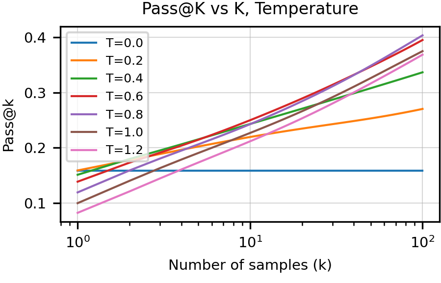

Compare $k=1$ and $k=100$: same weights, different search.

<p class="caption"><a href="https://arxiv.org/html/2107.03374v2">Chen et al., 2021, Fig. 5, upper panel</a>. A larger search budget can favor more diverse samples.</p>

Note:
The lower optimal-temperature panel is omitted to enlarge the upper panel; all upper-panel curves and axes are preserved. Read k on the horizontal axis and success of at least one sample on the vertical axis. The best temperature changes with k under the paper's fixed Codex generator. This does not show that the model weights improved or that an unassisted selector can identify the passing sample. The next formula estimates pass@k from n samples. P02 calculates it exactly for n=10 and c=2. Adaptive repair with feedback requires another protocol. Historical measurements; the classroom uses supplied synthetic counts only.

---

<!-- .slide: id="pass-at-k" -->

## More attempts change the success measure

With $c$ correct completions among $n$ samples:

$$\widehat{\mathrm{pass@}k}=1-\frac{\binom{n-c}{k}}{\binom{n}{k}}$$

This estimates success among $k$ attempts under the sampling protocol.

Report the sampling settings and total attempt budget.

Note:
This is the HumanEval estimator, with n at least k. The probability of selecting no successful completion from n fixed samples is the ratio of combinations. Under independent samples from a fixed generator, it estimates the probability that at least one of k attempts passes the tests. It does not give a deployment method for choosing the successful answer without a checker. Adaptive repair with feedback is a different protocol. Source: Chen et al., https://arxiv.org/abs/2107.03374, Section 3 and Appendix A.

---

<!-- .slide: class="exercise" id="exercise-03" -->

<p class="exercise-meta">Optional practice P02 · 5 minutes · Notebook P02</p>

## How much does the attempt budget matter?

Ten sampled programs contain two that pass all tests.

1. Calculate estimated pass@1 and pass@5.
2. Does the difference show that the model weights improved?

<div class="answer fragment"><p>pass@1 = 20%. pass@5 = $7/9\approx77.8\%$. The sampling budget changed.</p></div>

Note:
Expected arithmetic: 1 minus choose(8,5) divided by choose(10,5) equals 1 minus 56/252. The same ten outcomes support both estimates. This example contains no generated executable code. Students should distinguish a task-level pass fraction from repeated attempts on a task, and should not compare pass@1 to pass@5 as if the compute were equal.

---

<!-- .slide: id="success-and-reliability" -->

## Occasional success and reliability are different

For independent attempts with success probability $p=0.6$:

| Question about three attempts | Probability |
| --- | ---: |
| At least one succeeds | $1-(1-p)^3=0.936$ |
| All three succeed | $p^3=0.216$ |

A deployment that needs every run to work values a different quantity.

<p class="caption">Toy Bernoulli model. Shared task difficulty and adaptive retries break this simple calculation.</p>

Note:
The two quantities are sometimes discussed as pass@k versus consistency/pass-to-the-k, but not every benchmark uses the same notation. Define the event in words. The formula assumes independent attempts on a task with fixed p; averaging over tasks with different p is not obtained by inserting the overall mean p. These values are arithmetic, not a measured agent reliability claim. The finite-sample pass@k estimator on the previous slide also assumes a fixed generator for its probabilistic interpretation. Cost, attempt selection and failure policy belong in the result.

---

<!-- .slide: id="open-data-cases" -->

## Open data projects to inspect

| Project | Useful evidence to read |
| --- | --- |
| FineWeb / FineWeb-Edu | Extraction, filtering, and deduplication ablations |
| Dolma | Source composition and an inspectable curation toolkit |
| DataComp-LM | Data-policy comparisons with a shared training setup |

Read a named release and its recipe before choosing data.

Note:
These are examples for studying methods, not a ranking of the best or latest corpora. FineWeb: https://arxiv.org/abs/2406.17557. Dolma: https://arxiv.org/abs/2402.00159 and https://github.com/allenai/dolma. DataComp-LM: https://arxiv.org/abs/2406.11794. Match language, domain, access, and available tokens to the project. The classroom uses small authored data and downloads none of these corpora.

---

<!-- .slide: id="minhash-mechanism" -->

## MinHash turns overlap into matching signatures

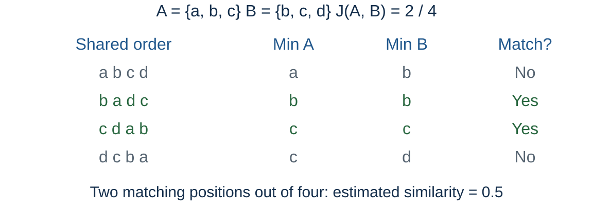

<p class="caption">Under a uniform random order, $P[\min(A)=\min(B)]=J(A,B)$.</p>

Note:
The first element of A union B in a uniform random permutation is equally likely to be any union element. The minima agree exactly when it lies in the intersection. This proves the ideal collision probability. The four displayed orders are hand-chosen, so their average need not equal Jaccard for arbitrary inputs. The notebook can enumerate all 24 orders to check this example. Real systems approximate permutations with hash functions. FineWeb documents its MinHash implementation and choices; https://huggingfacefw-blogpost-fineweb-v1.static.hf.space/index.html, Deduplicating the data.

---

<!-- .slide: id="lsh-candidates" -->

## Banding selects candidate pairs

With $b$ bands of $r$ independent MinHash rows:

$$P(\text{candidate}\mid J=s)=1-(1-s^r)^b.$$

- All $r$ rows must match within a band.
- A match in any of $b$ bands generates a candidate.
- The probability changes smoothly with similarity.

<p class="caption">A candidate is an algorithmic match, not a proof of semantic equivalence.</p>

Note:
Derive one band probability s^r, then probability all bands miss. The independence and ideal MinHash assumptions matter. Show b=2, r=2 as a tiny example. FineWeb uses 14 bands of 8 rows in the cited 2024 recipe, but this is not a universal best setting. Some pipelines directly merge candidates; others verify exact shingle overlap. Measure missed matches and false matches on a sample. The formula does not imply a hard 75 percent cutoff. Source: official FineWeb blog, Deduplicating the data.

---

<!-- .slide: class="exercise" id="data-exercise-02" -->

<p class="exercise-meta">Optional practice P03 · 5 minutes · Notebook P03</p>

## How does matching probability differ from similarity?

$A=\lbrace a,b,c\rbrace$ and $B=\lbrace b,c,d\rbrace$.

1. Calculate their Jaccard similarity.
2. Count matching signature positions in the four orders.
3. With two bands of two rows, compute the ideal candidate probability.

<div class="answer fragment"><p>$J=1/2$; 2/4 positions match; $1-(1-1/4)^2=7/16$.</p></div>

Note:
The last answer is a probability under independent random rows, not a count from these particular four hand-chosen rows. Students should distinguish document overlap, a finite signature estimate, and the chance of a band match. The optional exhaustive check averages all 24 uniform orders. No external corpus or model is required.

---

<!-- .slide: class="references" id="references" -->

## Reading: evaluation from answers to agents

- [GPT-1 through GPT-6/6.1 source map](optional-reading.md#evaluation-history).
- [HLE and Diamond](https://www.lastexam.ai/): question construction and versioning.
- [SWE-bench](https://www.swebench.com/): repository tasks and test contracts.
- [Terminal-Bench series](https://www.tbench.ai/benchmarks): environments and resources.
- [Agents’ Last Exam v4](https://arxiv.org/html/2606.05405v4): artifacts, models and harnesses.

<p class="caption">Primary sources checked November 11, 2026. <a href="optional-reading.md">Full benchmark and methods guide</a>.</p>

Note:
Read protocols before rankings. The new figures are locally bundled excerpts with exact versions and provenance in assets/papers/manifest.json and assets/README.md. Historical numbers are not current leaderboard claims. GPT-6.2 could not be verified in official documentation and has no invented results here. The classroom notebook needs no network, model download, external API or GPU. Course practices remain ungraded and common to all students.
