<!-- .slide: id="source-001" class="source-slide" -->

<h2 class="source-slide-title">Lecture 11 – Diffusion Language Models</h2>

Note:
<pre>Lecture 11 – Diffusion Language Models

Baojian Zhou

DATA130030.01 (自然语言处理)

School of Data Science Fudan University

11/18/2026

1</pre>

---

<!-- .slide: id="source-002" class="source-slide" -->

<h2 class="source-slide-title">Introduction</h2>

Note:
<pre>2

Introduction</pre>

---

<!-- .slide: id="source-003" class="source-slide" -->

<h2 class="source-slide-title">What is diffusion model?</h2>

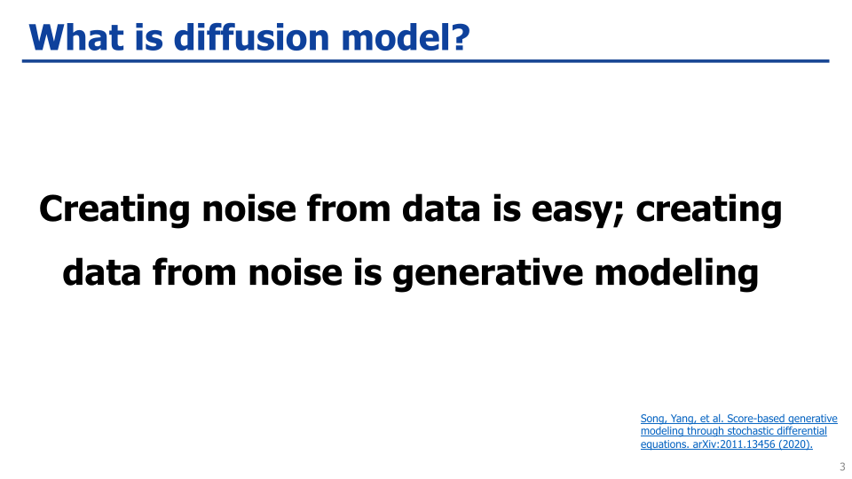

Note:
<pre>What is diffusion model?

Creating noise from data is easy; creating data from noise is generative modeling

3

Song, Yang, et al. Score-based generative modeling through stochastic differential equations. arXiv:2011.13456 (2020).</pre>

---

<!-- .slide: id="source-004" class="source-slide" -->

<h2 class="source-slide-title">Diffusion models in image world</h2>

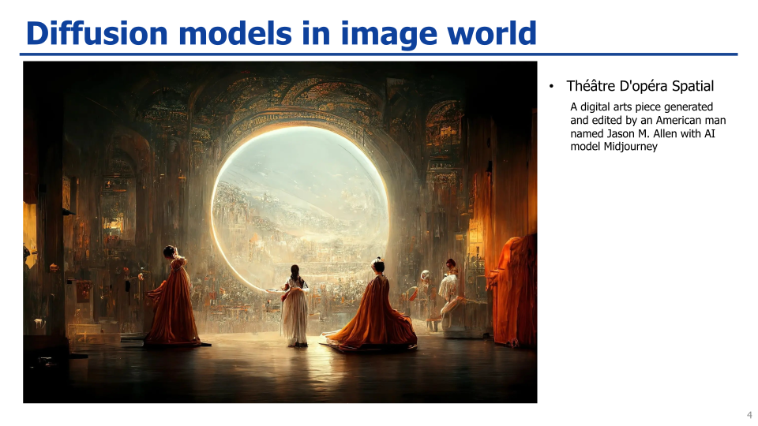

Note:
<pre>Diffusion models in image world

4

Théâtre D&#x27;opéra Spatial

A digital arts piece generated and edited by an American man named Jason M. Allen with AI model Midjourney</pre>

---

<!-- .slide: id="source-005" class="source-slide" -->

<h2 class="source-slide-title">Diffusion models in image world</h2>

Note:
<pre>Diffusion models in image world

5</pre>

---

<!-- .slide: id="source-006" class="source-slide" -->

<h2 class="source-slide-title">Diffusion models in image world</h2>

Note:
<pre>Diffusion models in image world

6</pre>

---

<!-- .slide: id="source-007" class="source-slide" -->

<h2 class="source-slide-title">Diffusion models in image world</h2>

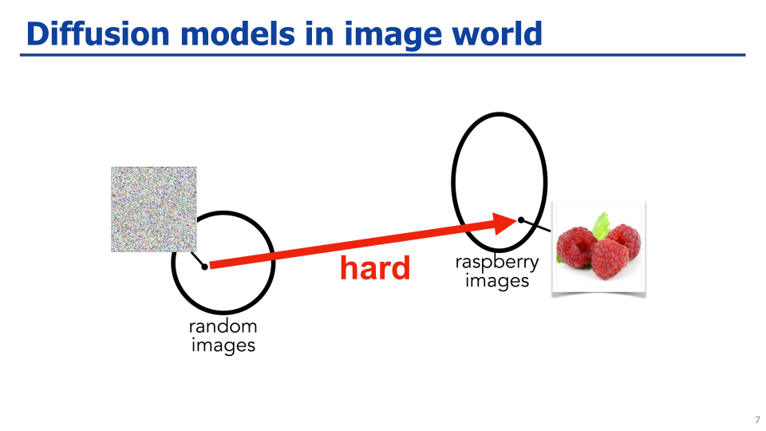

Note:
<pre>Diffusion models in image world

7</pre>

---

<!-- .slide: id="source-008" class="source-slide" -->

<h2 class="source-slide-title">Diffusion models in image world</h2>

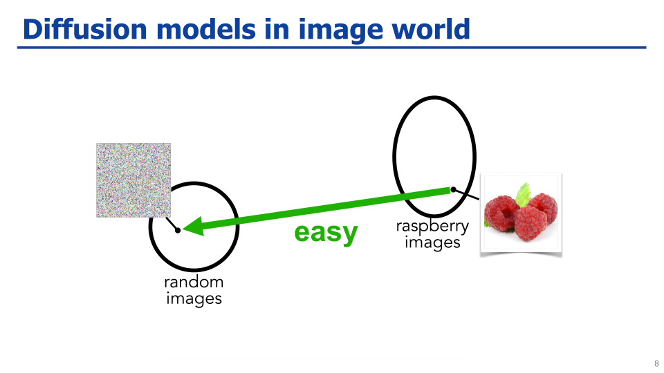

Note:
<pre>Diffusion models in image world

8</pre>

---

<!-- .slide: id="source-009" class="source-slide" -->

<h2 class="source-slide-title">Diffusion models in image world</h2>

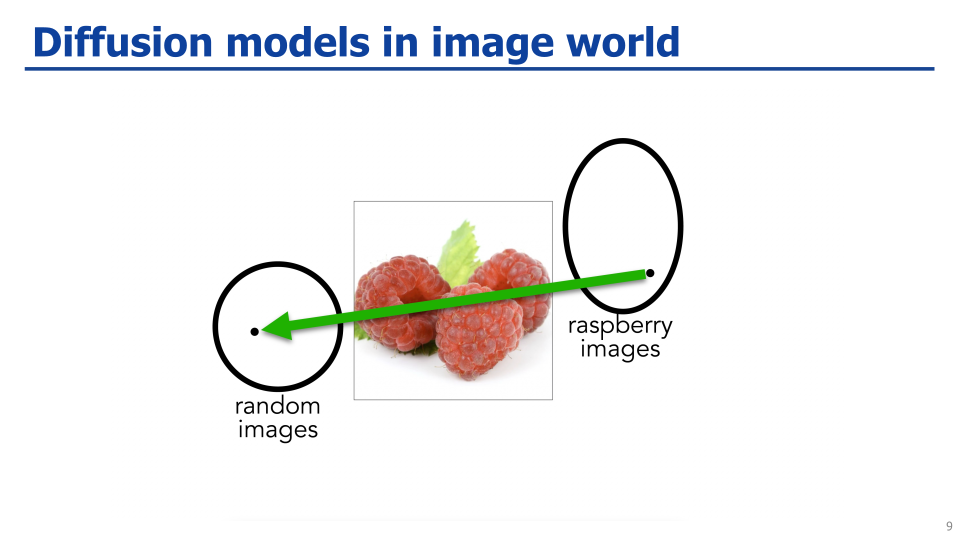

Note:
<pre>Diffusion models in image world

9</pre>

---

<!-- .slide: id="source-010" class="source-slide" -->

<h2 class="source-slide-title">Diffusion models in image world</h2>

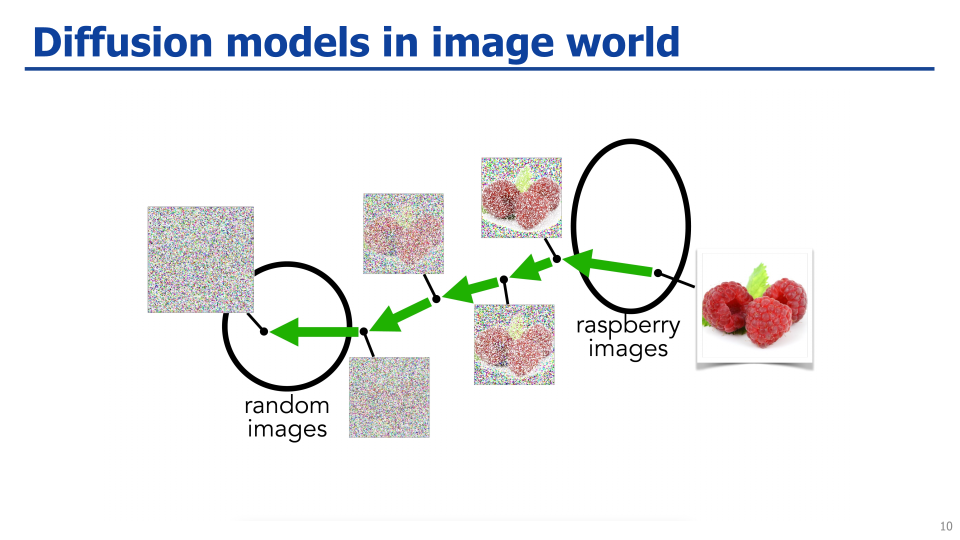

Note:
<pre>Diffusion models in image world

10</pre>

---

<!-- .slide: id="source-011" class="source-slide" -->

<h2 class="source-slide-title">Diffusion models in image world</h2>

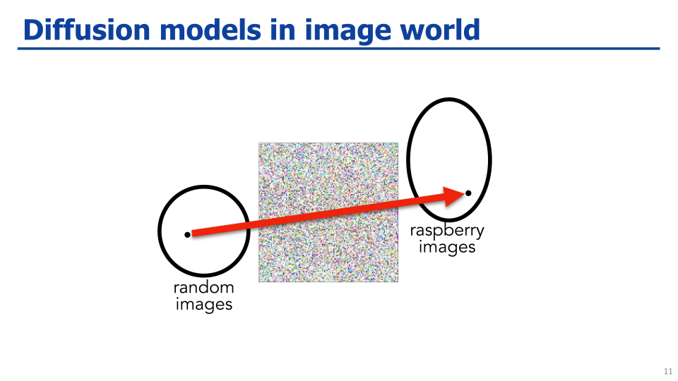

Note:
<pre>Diffusion models in image world

11</pre>

---

<!-- .slide: id="source-012" class="source-slide" -->

<h2 class="source-slide-title">Diffusion models in image world</h2>

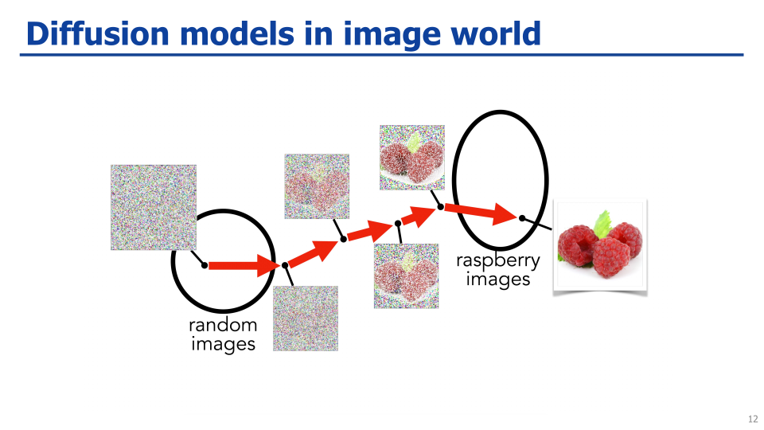

Note:
<pre>Diffusion models in image world

12</pre>

---

<!-- .slide: id="source-013" class="source-slide" -->

<h2 class="source-slide-title">Diffusion models in image world</h2>

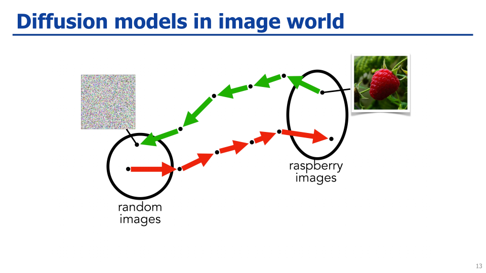

Note:
<pre>Diffusion models in image world

13</pre>

---

<!-- .slide: id="source-014" class="source-slide" -->

<h2 class="source-slide-title">Diffusion models in image world</h2>

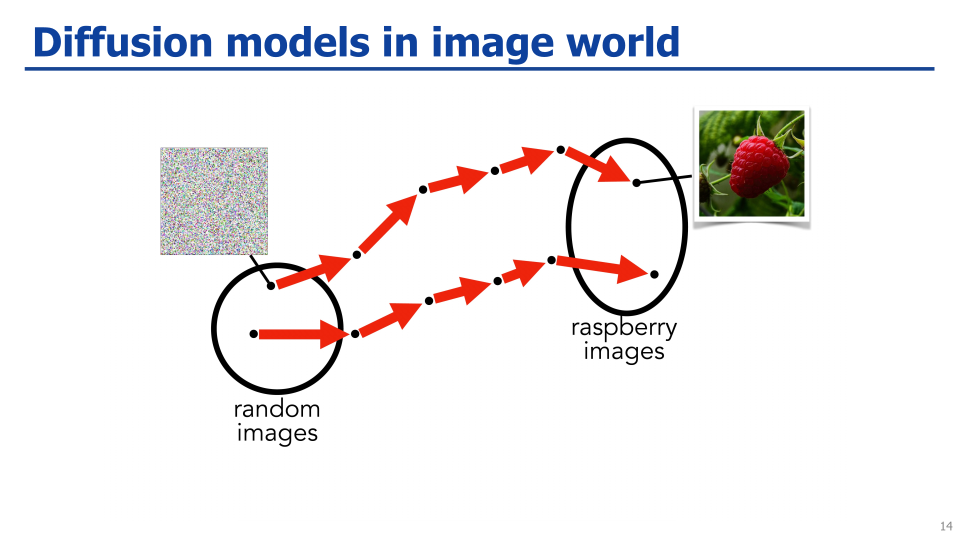

Note:
<pre>Diffusion models in image world

14</pre>

---

<!-- .slide: id="source-015" class="source-slide" -->

<h2 class="source-slide-title">Diffusion models in image world</h2>

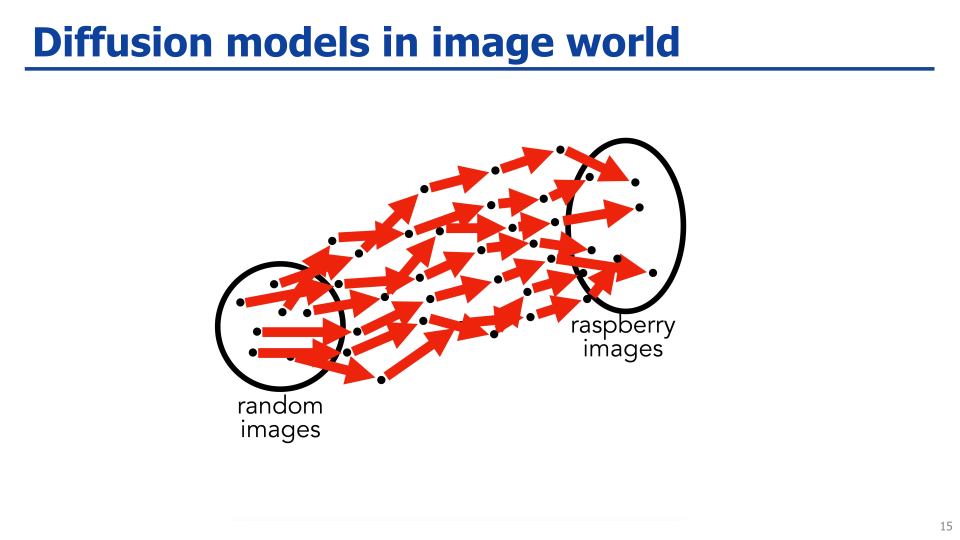

Note:
<pre>Diffusion models in image world

15</pre>

---

<!-- .slide: id="source-016" class="source-slide" -->

<h2 class="source-slide-title">Diffusion models in image world training</h2>

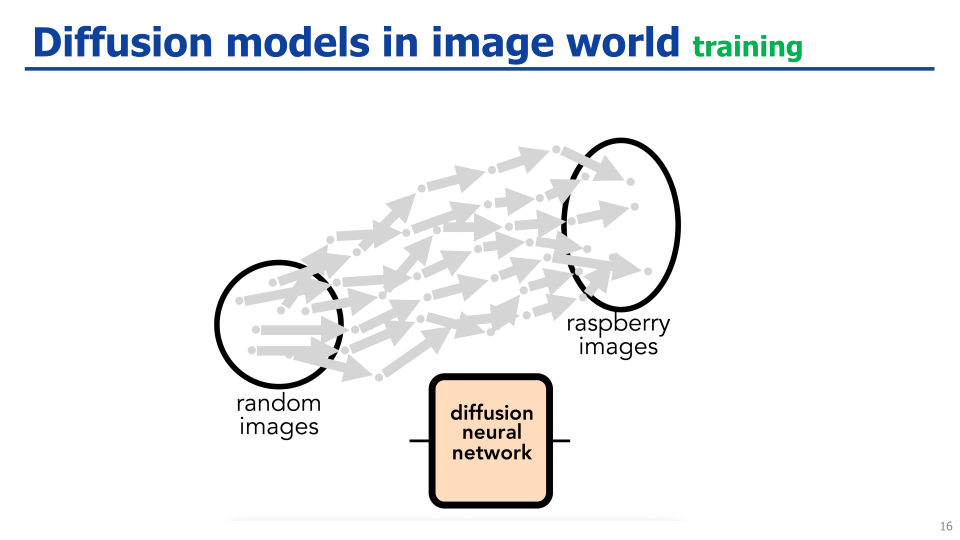

Note:
<pre>Diffusion models in image world training

16</pre>

---

<!-- .slide: id="source-017" class="source-slide" -->

<h2 class="source-slide-title">Diffusion models in image world training</h2>

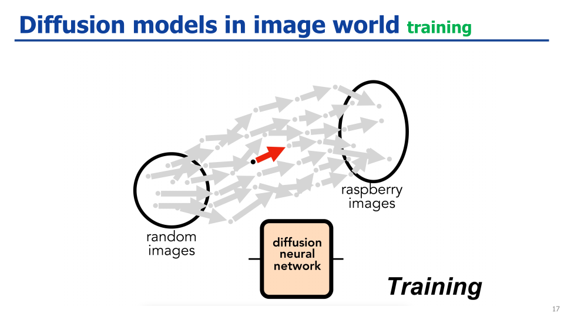

Note:
<pre>Diffusion models in image world training

17</pre>

---

<!-- .slide: id="source-018" class="source-slide" -->

<h2 class="source-slide-title">Diffusion models in image world training</h2>

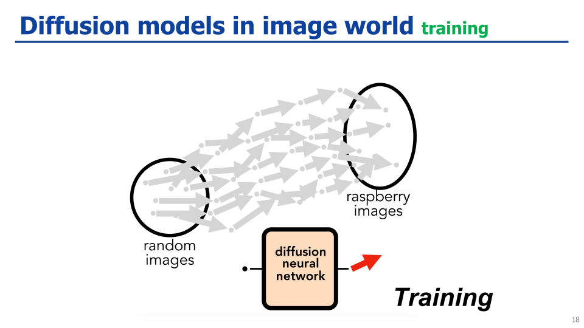

Note:
<pre>Diffusion models in image world training

18</pre>

---

<!-- .slide: id="source-019" class="source-slide" -->

<h2 class="source-slide-title">Diffusion models in image world training</h2>

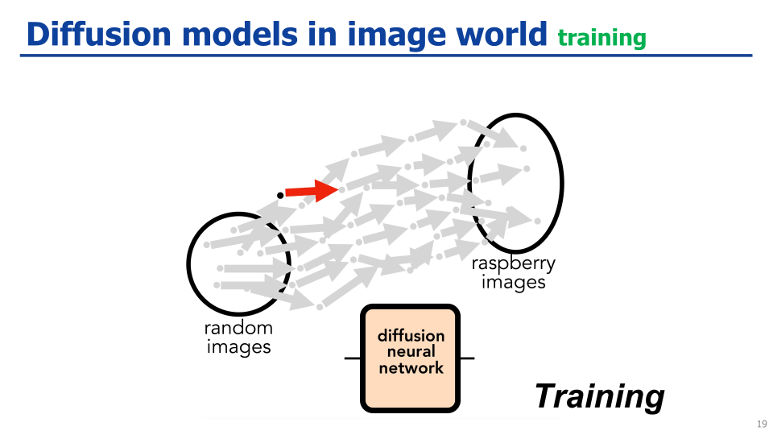

Note:
<pre>Diffusion models in image world training

19</pre>

---

<!-- .slide: id="source-020" class="source-slide" -->

<h2 class="source-slide-title">Diffusion models in image world training</h2>

Note:
<pre>Diffusion models in image world training

20</pre>

---

<!-- .slide: id="source-021" class="source-slide" -->

<h2 class="source-slide-title">Diffusion models in image world training</h2>

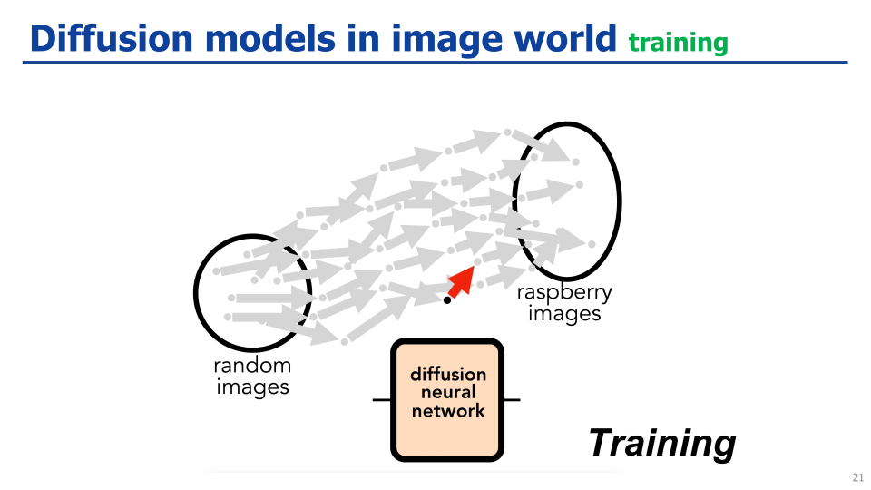

Note:
<pre>Diffusion models in image world training

21</pre>

---

<!-- .slide: id="source-022" class="source-slide" -->

<h2 class="source-slide-title">Diffusion models in image world training</h2>

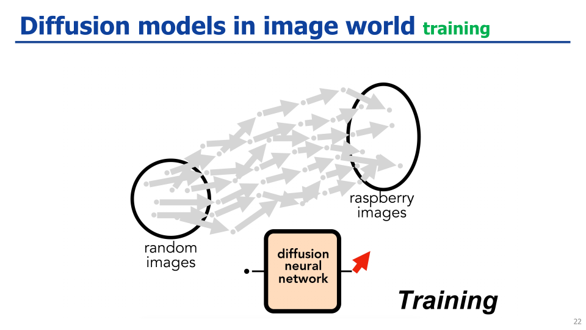

Note:
<pre>Diffusion models in image world training

22</pre>

---

<!-- .slide: id="source-023" class="source-slide" -->

<h2 class="source-slide-title">Diffusion models in image world</h2>

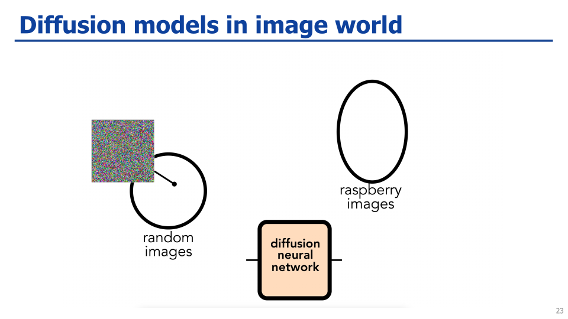

Note:
<pre>Diffusion models in image world

23</pre>

---

<!-- .slide: id="source-024" class="source-slide" -->

<h2 class="source-slide-title">Diffusion models in image world sampling</h2>

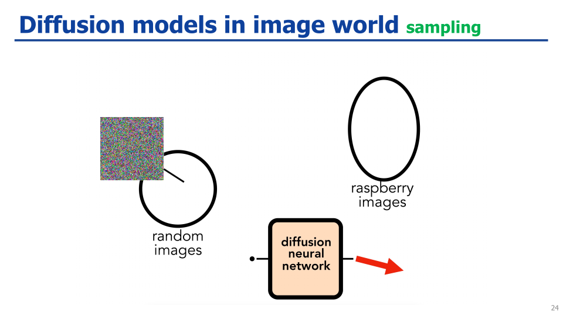

Note:
<pre>Diffusion models in image world sampling

24</pre>

---

<!-- .slide: id="source-025" class="source-slide" -->

<h2 class="source-slide-title">Diffusion models in image world sampling</h2>

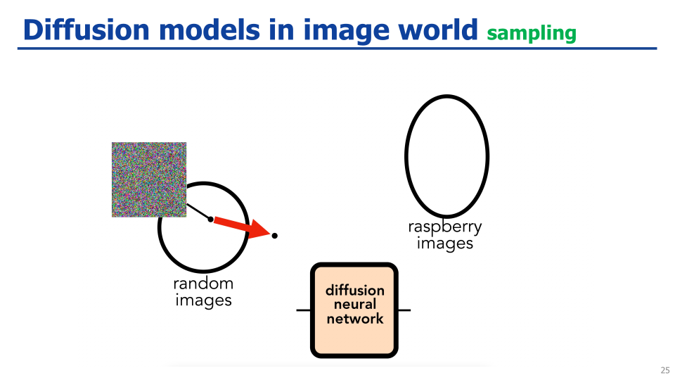

Note:
<pre>Diffusion models in image world sampling

25</pre>

---

<!-- .slide: id="source-026" class="source-slide" -->

<h2 class="source-slide-title">Diffusion models in image world sampling</h2>

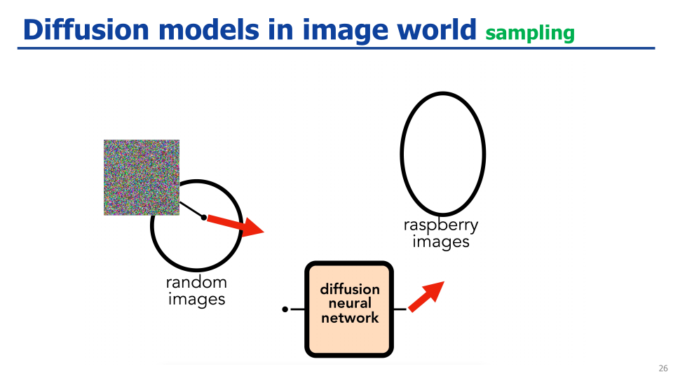

Note:
<pre>Diffusion models in image world sampling

26</pre>

---

<!-- .slide: id="source-027" class="source-slide" -->

<h2 class="source-slide-title">Diffusion models in image world sampling</h2>

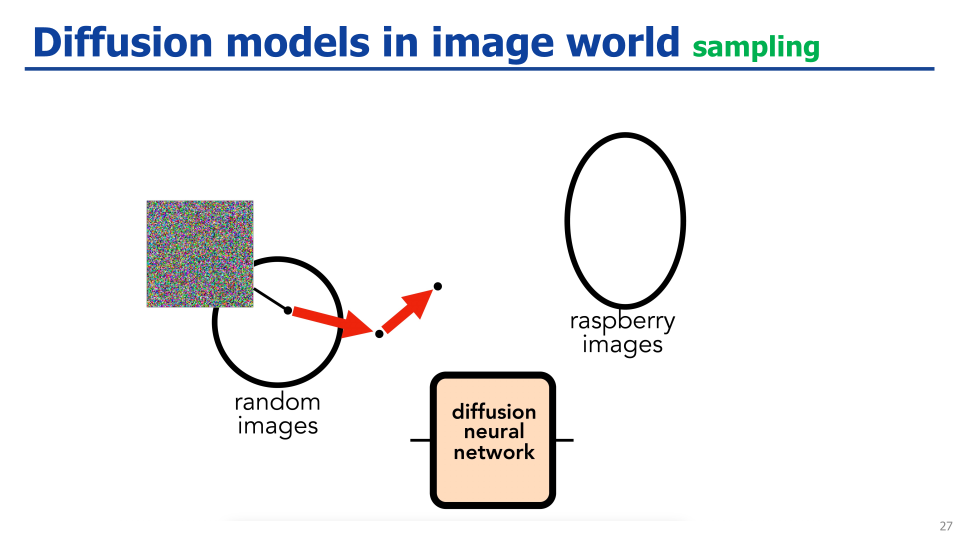

Note:
<pre>Diffusion models in image world sampling

27</pre>

---

<!-- .slide: id="source-028" class="source-slide" -->

<h2 class="source-slide-title">Diffusion models in image world sampling</h2>

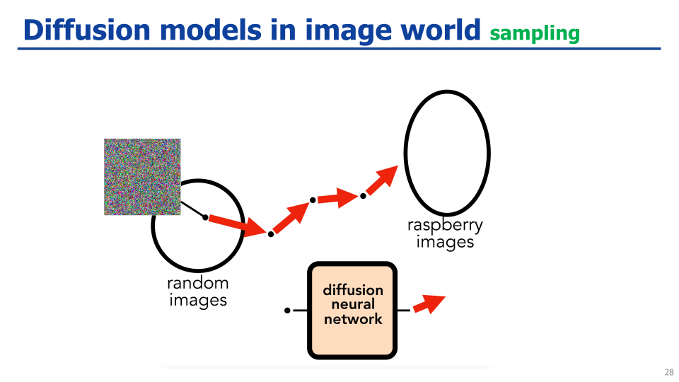

Note:
<pre>Diffusion models in image world sampling

28</pre>

---

<!-- .slide: id="source-029" class="source-slide" -->

<h2 class="source-slide-title">Diffusion models in image world sampling</h2>

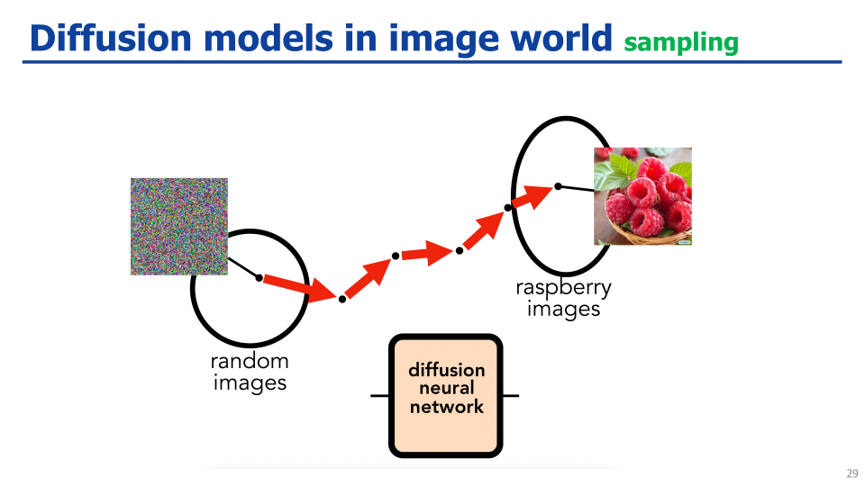

Note:
<pre>Diffusion models in image world sampling

29</pre>

---

<!-- .slide: id="source-030" class="source-slide" -->

<h2 class="source-slide-title">Diffusion models in image world</h2>

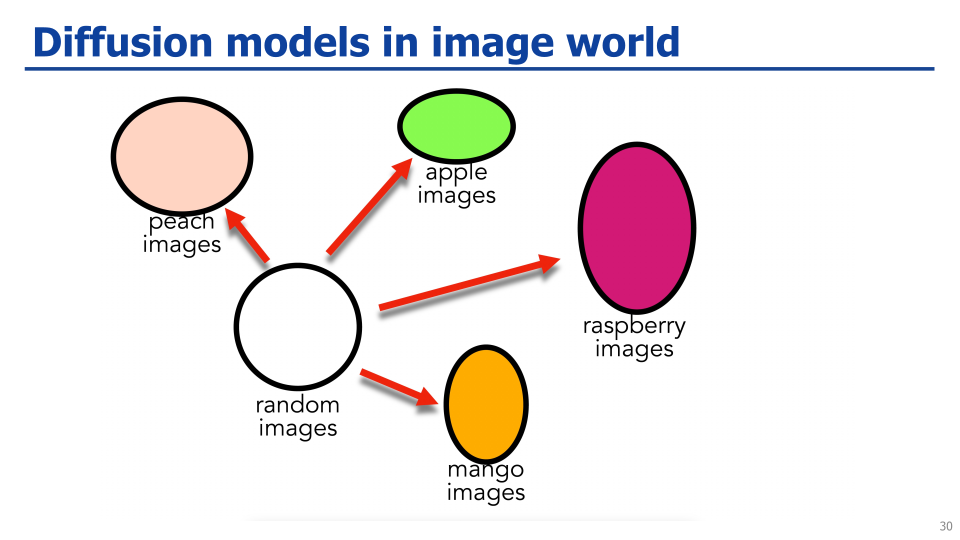

Note:
<pre>Diffusion models in image world

30</pre>

---

<!-- .slide: id="source-031" class="source-slide" -->

<h2 class="source-slide-title">Diffusion models in language</h2>

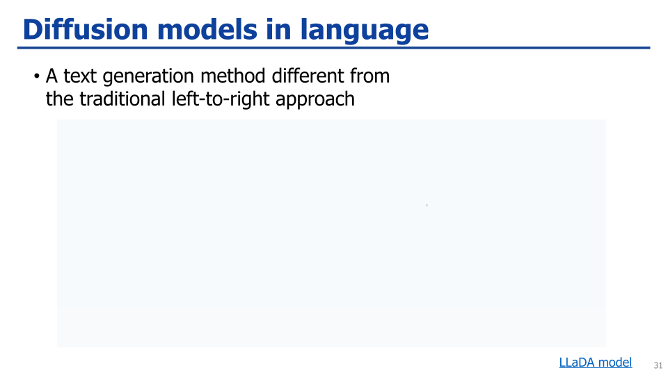

Note:
<pre>Diffusion models in language

A text generation method different from the traditional left-to-right approach

31

LLaDA model</pre>

---

<!-- .slide: id="source-032" class="source-slide" -->

<h2 class="source-slide-title">Diffusion models in language</h2>

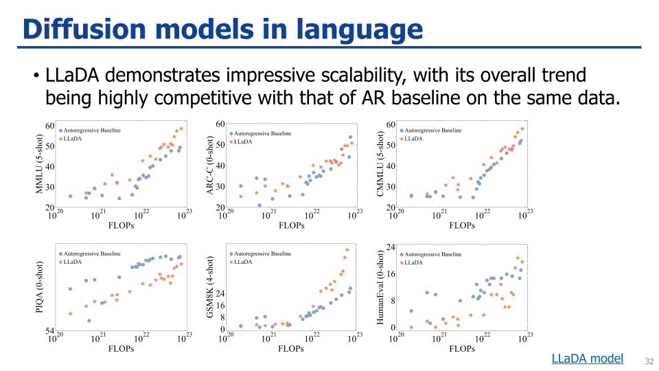

Note:
<pre>Diffusion models in language

32

LLaDA demonstrates impressive scalability, with its overall trend being highly competitive with that of AR baseline on the same data.

LLaDA model</pre>

---

<!-- .slide: id="source-033" class="source-slide" -->

<h2 class="source-slide-title">Diffusion models in language</h2>

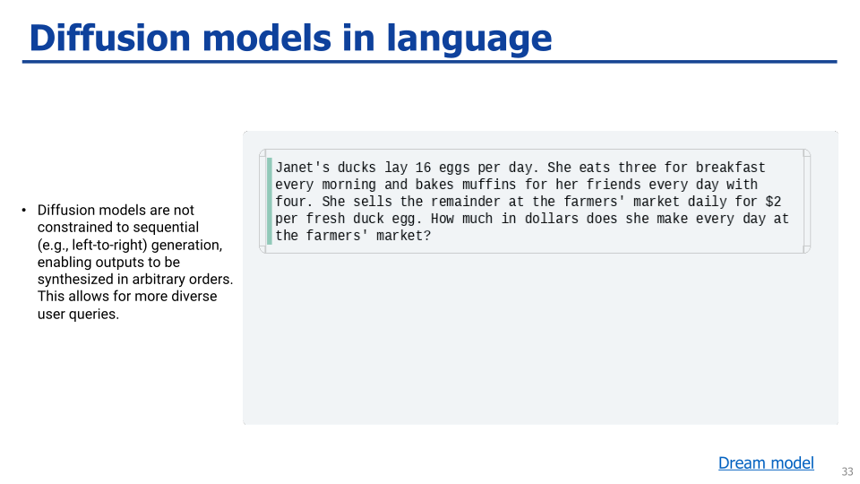

Note:
<pre>Diffusion models in language

Diffusion models are not constrained to sequential (e.g., left-to-right) generation, enabling outputs to be synthesized in arbitrary orders. This allows for more diverse user queries.

33

Dream model</pre>

---

<!-- .slide: id="source-034" class="source-slide" -->

<h2 class="source-slide-title">Diffusion models in language</h2>

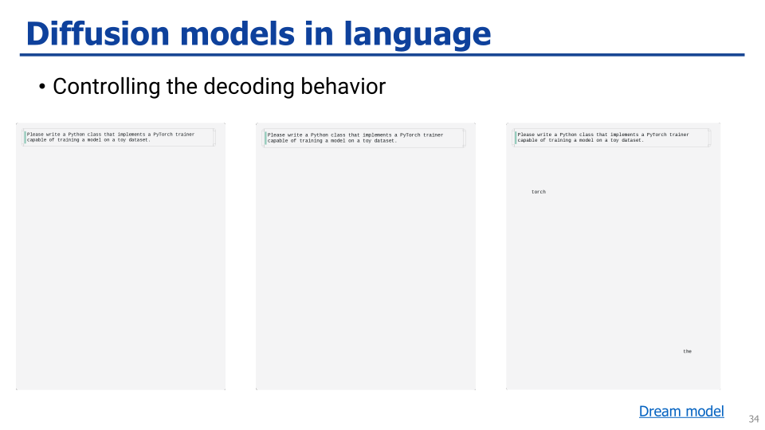

Note:
<pre>Diffusion models in language

Controlling the decoding behavior

34

Dream model</pre>

---

<!-- .slide: id="source-035" class="source-slide" -->

<h2 class="source-slide-title">Diffusion models in language</h2>

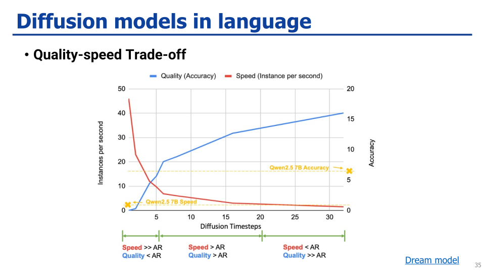

Note:
<pre>Diffusion models in language

35

Quality-speed Trade-off

Dream model</pre>

---

<!-- .slide: id="source-036" class="source-slide" -->

<h2 class="source-slide-title">Diffusion Models</h2>

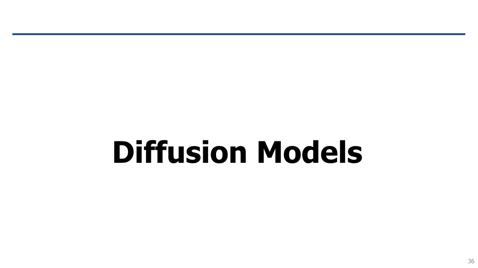

Note:
<pre>36

Diffusion Models</pre>

---

<!-- .slide: id="source-037" class="source-slide" -->

<h2 class="source-slide-title">Autoencoder</h2>

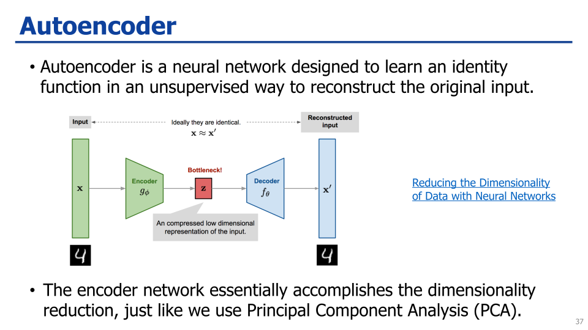

Note:
<pre>Autoencoder

37

Autoencoder is a neural network designed to learn an identity function in an unsupervised way to reconstruct the original input.

Reducing the Dimensionality of Data with Neural Networks

The encoder network essentially accomplishes the dimensionality reduction, just like we use Principal Component Analysis (PCA).</pre>

---

<!-- .slide: id="source-038" class="source-slide" -->

<h2 class="source-slide-title">Autoencoder</h2>

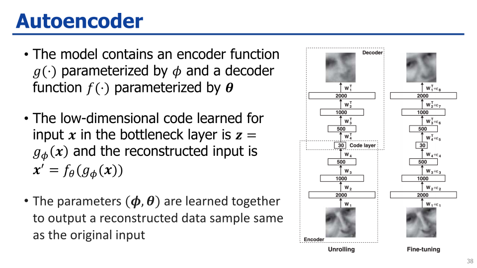

Note:
<pre>Autoencoder

The model contains an encoder function 𝑔(⋅) parameterized by 𝜙 and a decoder function 𝑓(⋅) parameterized by 𝜽

The low-dimensional code learned for input 𝒙 in the bottleneck layer is 𝒛=𝑔𝜙𝒙 and the reconstructed input is 𝒙′=𝑓𝜃(𝑔𝜙(𝒙))

The parameters (𝝓,𝜽) are learned together to output a reconstructed data sample same as the original input

38</pre>

---

<!-- .slide: id="source-039" class="source-slide" -->

<h2 class="source-slide-title">Autoencoder denoising version</h2>

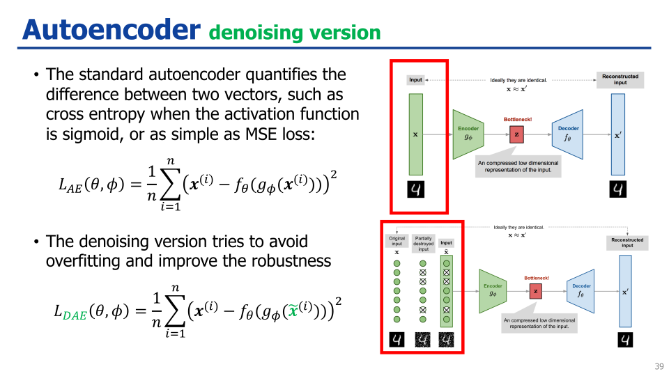

Note:
<pre>Autoencoder denoising version

The standard autoencoder quantifies the difference between two vectors, such as cross entropy when the activation function is sigmoid, or as simple as MSE loss:

𝐿𝐴𝐸𝜃,𝜙=1𝑛𝑖=1𝑛𝒙(𝑖)−𝑓𝜃(𝑔𝜙(𝒙(𝑖)))2

The denoising version tries to avoid overfitting and improve the robustness

𝐿𝐷𝐴𝐸𝜃,𝜙=1𝑛𝑖=1𝑛𝒙(𝑖)−𝑓𝜃(𝑔𝜙(𝒙(𝑖)))2

39</pre>

---

<!-- .slide: id="source-040" class="source-slide" -->

<h2 class="source-slide-title">Variational Autoencoder (VAE)</h2>

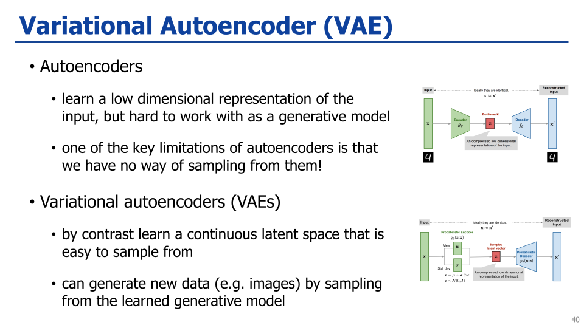

Note:
<pre>Variational Autoencoder (VAE)

Autoencoders

learn a low dimensional representation of the input, but hard to work with as a generative model

one of the key limitations of autoencoders is that we have no way of sampling from them!

Variational autoencoders (VAEs)

by contrast learn a continuous latent space that is easy to sample from

can generate new data (e.g. images) by sampling from the learned generative model

40</pre>

---

<!-- .slide: id="source-041" class="source-slide" -->

<h2 class="source-slide-title">Variational Autoencoder (VAE)</h2>

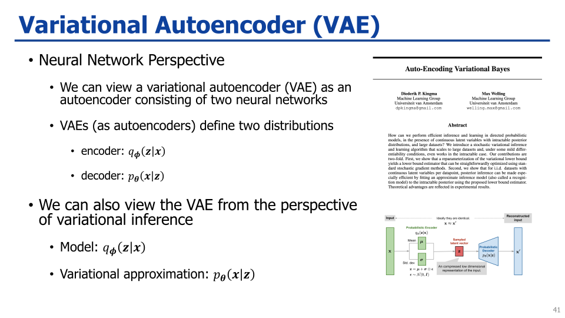

Note:
<pre>Variational Autoencoder (VAE)

Neural Network Perspective

We can view a variational autoencoder (VAE) as an autoencoder consisting of two neural networks

VAEs (as autoencoders) define two distributions

encoder: 𝑞𝝓𝒛𝒙

decoder: 𝑝𝜽𝒙𝒛

We can also view the VAE from the perspective of variational inference

Model: 𝑞𝝓𝒛𝒙

Variational approximation: 𝑝𝜽𝒙𝒛

41</pre>

---

<!-- .slide: id="source-042" class="source-slide" -->

<h2 class="source-slide-title">Variational Autoencoder (VAE)</h2>

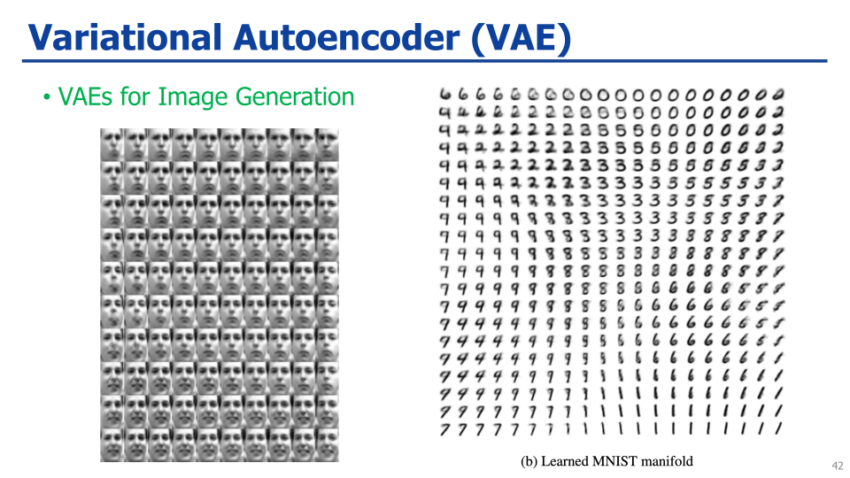

Note:
<pre>Variational Autoencoder (VAE)

VAEs for Image Generation

42</pre>

---

<!-- .slide: id="source-043" class="source-slide" -->

<h2 class="source-slide-title">Variational Autoencoder (VAE)</h2>

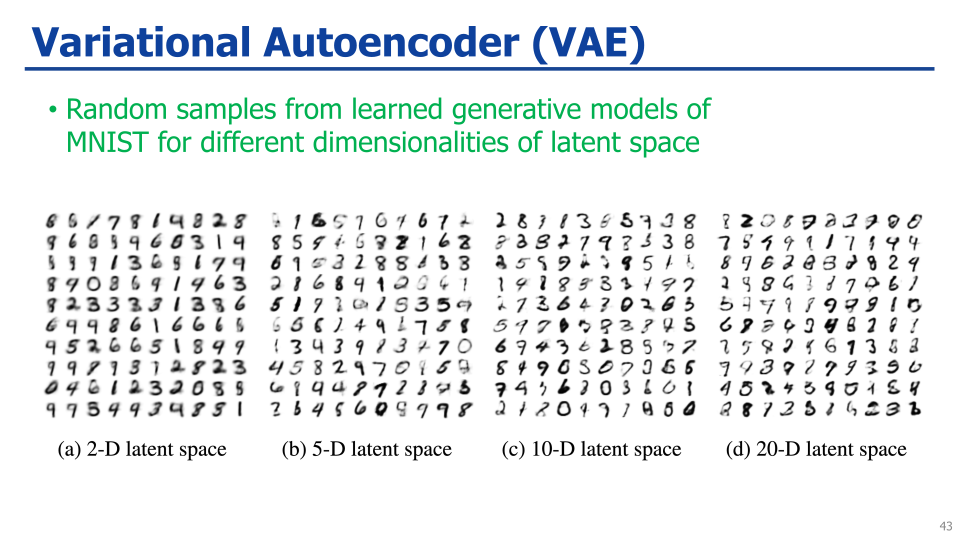

Note:
<pre>Variational Autoencoder (VAE)

Random samples from learned generative models of MNIST for different dimensionalities of latent space

43</pre>

---

<!-- .slide: id="source-044" class="source-slide" -->

<h2 class="source-slide-title">Discrete VAE</h2>

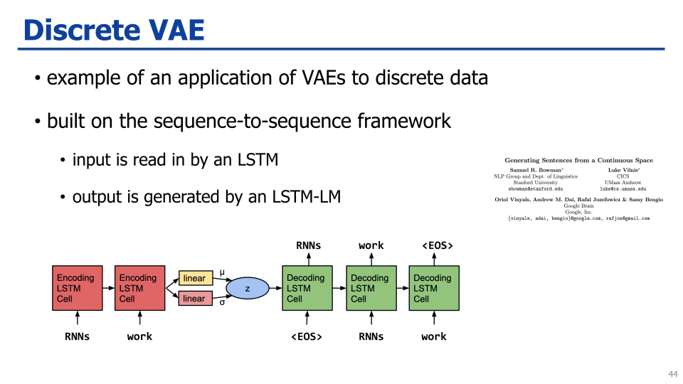

Note:
<pre>Discrete VAE

example of an application of VAEs to discrete data

built on the sequence-to-sequence framework

input is read in by an LSTM

output is generated by an LSTM-LM

44</pre>

---

<!-- .slide: id="source-045" class="source-slide" -->

<h2 class="source-slide-title">Discrete VAE</h2>

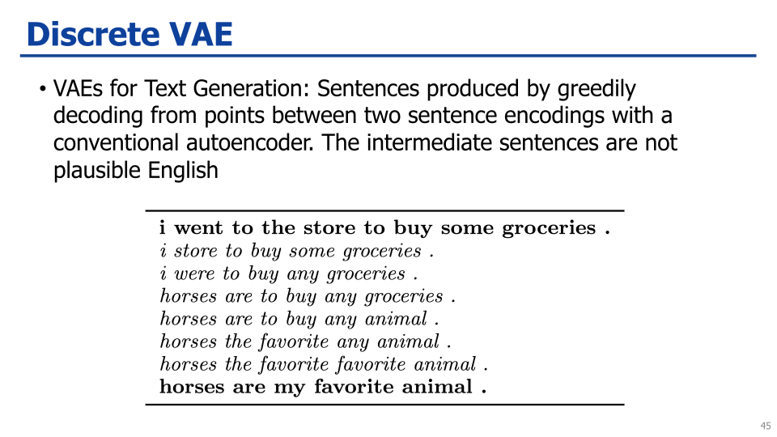

Note:
<pre>Discrete VAE

VAEs for Text Generation: Sentences produced by greedily decoding from points between two sentence encodings with a conventional autoencoder. The intermediate sentences are not plausible English

45</pre>

---

<!-- .slide: id="source-046" class="source-slide" -->

<h2 class="source-slide-title">Discrete VAE</h2>

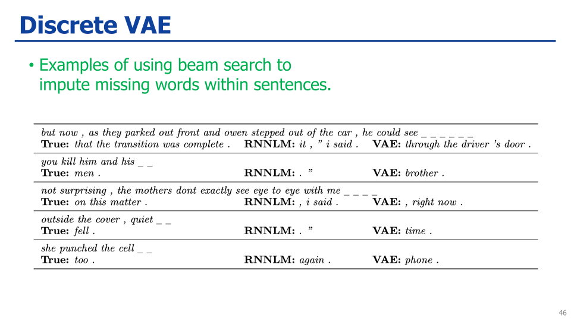

Note:
<pre>Discrete VAE

Examples of using beam search to impute missing words within sentences.

46</pre>

---

<!-- .slide: id="source-047" class="source-slide" -->

<h2 class="source-slide-title">VQ-VAE</h2>

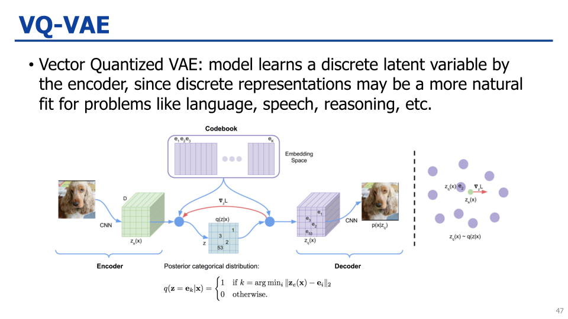

Note:
<pre>VQ-VAE

Vector Quantized VAE: model learns a discrete latent variable by the encoder, since discrete representations may be a more natural fit for problems like language, speech, reasoning, etc.

47</pre>

---

<!-- .slide: id="source-048" class="source-slide" -->

<h2 class="source-slide-title">VQ-VAE</h2>

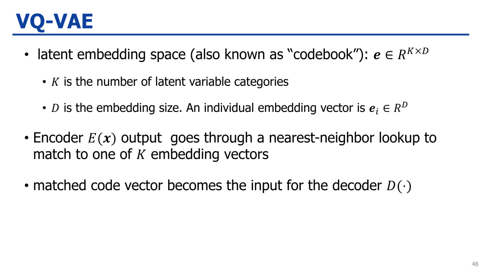

Note:
<pre>VQ-VAE

 latent embedding space (also known as “codebook”): 𝒆∈𝑅𝐾×𝐷

𝐾 is the number of latent variable categories

𝐷 is the embedding size. An individual embedding vector is 𝒆𝑖∈𝑅𝐷

Encoder 𝐸(𝒙) output  goes through a nearest-neighbor lookup to match to one of 𝐾 embedding vectors 

matched code vector becomes the input for the decoder 𝐷(⋅)

48</pre>

---

<!-- .slide: id="source-049" class="source-slide" -->

<h2 class="source-slide-title">DDPMs</h2>

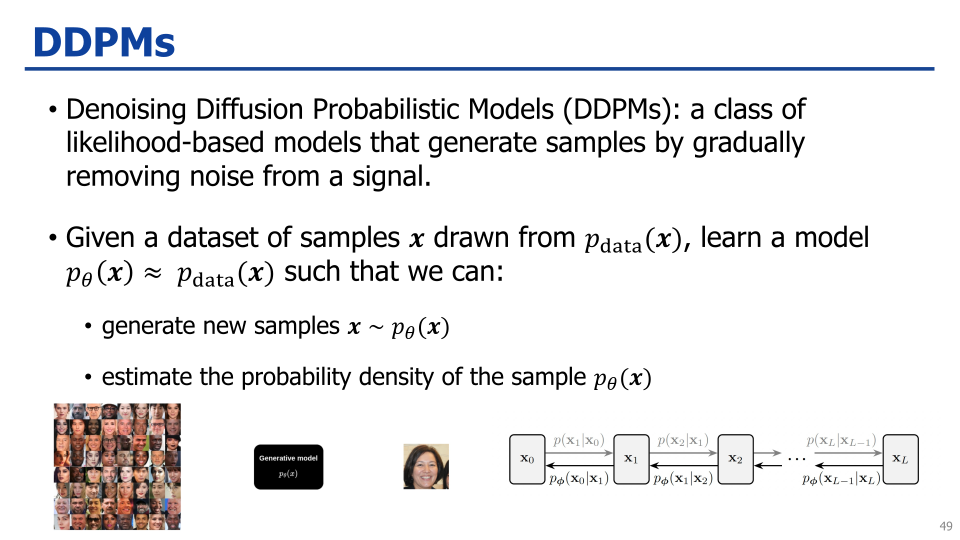

Note:
<pre>DDPMs

Denoising Diffusion Probabilistic Models (DDPMs): a class of likelihood-based models that generate samples by gradually removing noise from a signal.

Given a dataset of samples 𝒙 drawn from 𝑝data(𝒙), learn a model 𝑝𝜃𝒙≈ 𝑝data(𝒙) such that we can:

generate new samples 𝒙∼𝑝𝜃(𝒙)

estimate the probability density of the sample 𝑝𝜃(𝒙)

49</pre>

---

<!-- .slide: id="source-050" class="source-slide" -->

<h2 class="source-slide-title">DDPMs</h2>

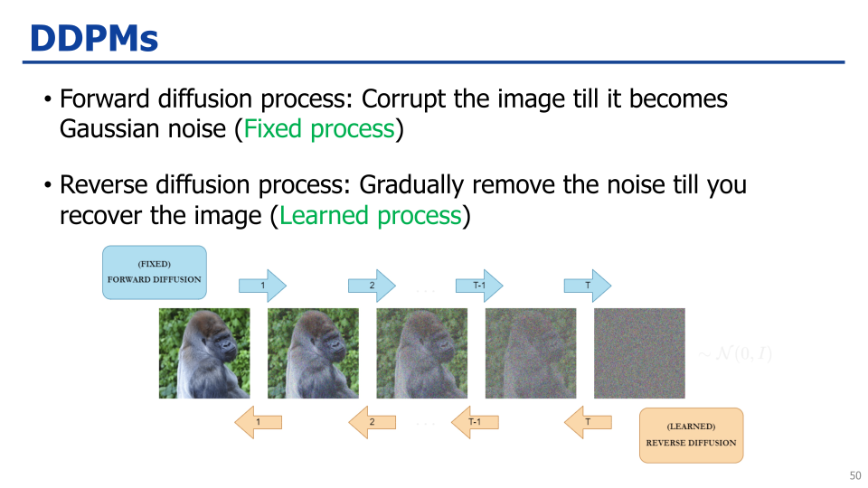

Note:
<pre>DDPMs

Forward diffusion process: Corrupt the image till it becomes Gaussian noise (Fixed process)

Reverse diffusion process: Gradually remove the noise till you recover the image (Learned process)

50</pre>

---

<!-- .slide: id="source-051" class="source-slide" -->

<h2 class="source-slide-title">DDPMs</h2>

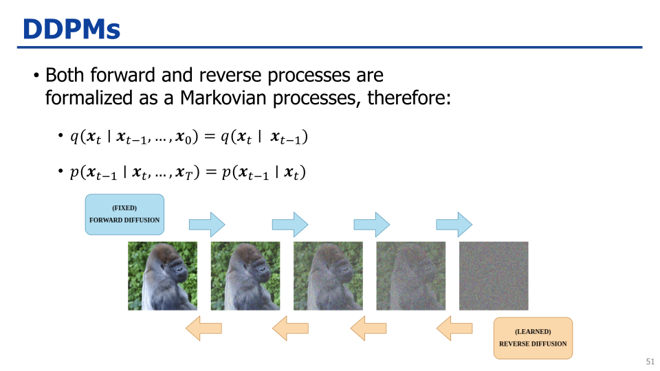

Note:
<pre>DDPMs

Both forward and reverse processes are formalized as a Markovian processes, therefore:

𝑞(𝒙𝑡∣𝒙𝑡−1, …, 𝒙0)=𝑞(𝒙𝑡∣ 𝒙𝑡−1)

𝑝(𝒙𝑡−1∣𝒙𝑡, …, 𝒙𝑇)=𝑝(𝒙𝑡−1∣𝒙𝑡)

51</pre>

---

<!-- .slide: id="source-052" class="source-slide" -->

<h2 class="source-slide-title">DDPMs</h2>

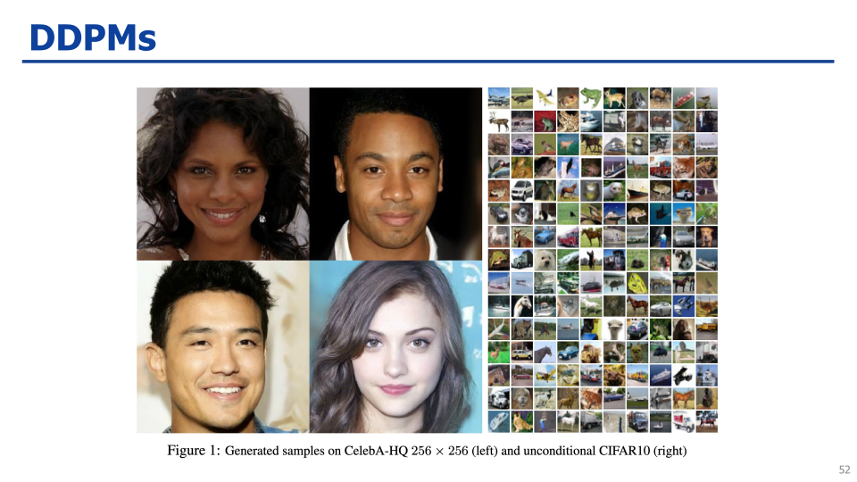

Note:
<pre>DDPMs

52</pre>

---

<!-- .slide: id="source-053" class="source-slide" -->

<h2 class="source-slide-title">DDPMs</h2>

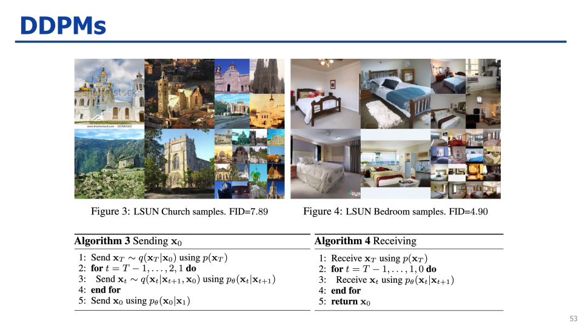

Note:
<pre>53

DDPMs</pre>

---

<!-- .slide: id="source-054" class="source-slide" -->

<h2 class="source-slide-title">D3PMs</h2>

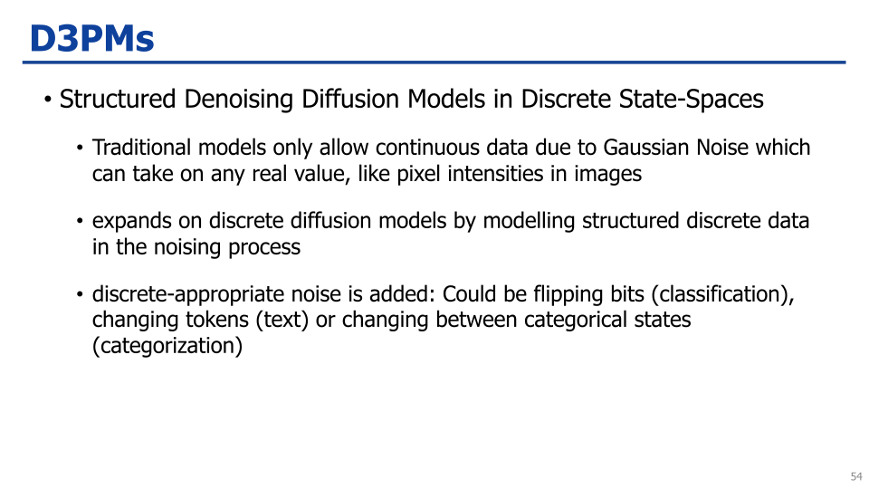

Note:
<pre>D3PMs

Structured Denoising Diffusion Models in Discrete State-Spaces

Traditional models only allow continuous data due to Gaussian Noise which can take on any real value, like pixel intensities in images

expands on discrete diffusion models by modelling structured discrete data in the noising process

discrete-appropriate noise is added: Could be flipping bits (classification), changing tokens (text) or changing between categorical states (categorization)

54</pre>

---

<!-- .slide: id="source-055" class="source-slide" -->

<h2 class="source-slide-title">D3PMs</h2>

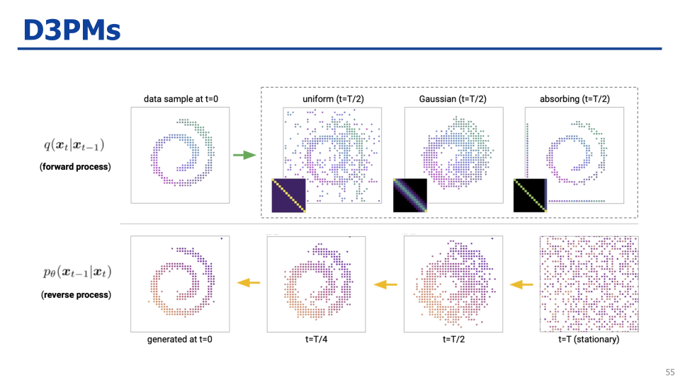

Note:
<pre>D3PMs

55</pre>

---

<!-- .slide: id="source-056" class="source-slide" -->

<h2 class="source-slide-title">D3PMs</h2>

Note:
<pre>D3PMs

Quantitative results on text8

56</pre>

---

<!-- .slide: id="source-057" class="source-slide" -->

<h2 class="source-slide-title">D3PMs</h2>

Note:
<pre>D3PMs

57

Left: perplexity v.s. sampling iterations for LM1B

Right: Using a trained D3PM absorbing model for LM1B to (top) generate new sentences and (bottom) reconstruct corrupted examples.</pre>

---

<!-- .slide: id="source-058" class="source-slide" -->

<h2 class="source-slide-title">D3PMs</h2>

Note:
<pre>D3PMs

Quantitative results on LM1B. Perplexity reported on the test set. Results are reported on two seeds. All models have context window length 128 and 12 layers

58</pre>

---

<!-- .slide: id="source-059" class="source-slide" -->

<h2 class="source-slide-title">Diffusion LLMs</h2>

Note:
<pre>59

Diffusion LLMs</pre>

---

<!-- .slide: id="source-060" class="source-slide" -->

<h2 class="source-slide-title">Mercury</h2>

Note:
<pre>Mercury

https://chat.inceptionlabs.ai/ 

60</pre>

---

<!-- .slide: id="source-061" class="source-slide" -->

<h2 class="source-slide-title">LLaDA</h2>

Note:
<pre>LLaDA

61</pre>

---

<!-- .slide: id="source-062" class="source-slide" -->

<h2 class="source-slide-title">LLaDA the big picture</h2>

Note:
<pre>LLaDA the big picture

LLaDA is a masked diffusion model that follows standard pretraining and SFT while sampling via diffusion. 

During pretraining, it masks all tokens randomly at ratio 𝑡∼𝑈[0,1] ; in SFT, only response tokens may be masked. 

The model simulates diffusion from full masking (𝑡=1) to unmasking (𝑡=0), predicting all masks simultaneously at each step with flexible remasking.

62</pre>

---

<!-- .slide: id="source-063" class="source-slide" -->

<h2 class="source-slide-title">LLaDA competitive performance</h2>

Note:
<pre>LLaDA competitive performance

63</pre>

---

<!-- .slide: id="source-064" class="source-slide" -->

<h2 class="source-slide-title">LLaDA competitive performance</h2>

Note:
<pre>LLaDA competitive performance

64</pre>

---

<!-- .slide: id="source-065" class="source-slide" -->

<h2 class="source-slide-title">LLaDA competitive performance</h2>

Note:
<pre>LLaDA competitive performance

Visualization of the Sampling Process and a Generated Multi-round Dialogue. In the response of LLaDA, darker colors indicate tokens predicted in the later stages of sampling, while lighter colors correspond to earlier predictions.

65</pre>

---

<!-- .slide: id="source-066" class="source-slide" -->

<h2 class="source-slide-title">Dream</h2>

Note:
<pre>Dream

66

Leveraging pre-trained weights from existing autoregressive (AR) models provides a non-trivial initialization strategy for diffusion language models</pre>

---

<!-- .slide: id="source-067" class="source-slide" -->

<h2 class="source-slide-title">Dream</h2>

Note:
<pre>Dream

Comparison of base models on standard evaluation benchmarks. * indicates Dream 7B, LLaDA 8B, Qwen2.5 7B and LLaMA3 8B are evaluated under the same protocol. The best results are bolded and the second best are underlined. 

67</pre>

---

<!-- .slide: id="source-068" class="source-slide" -->

<h2 class="source-slide-title">Dream</h2>

Note:
<pre>Dream

68</pre>

---

<!-- .slide: id="references" class="source-slide" -->

<h2 class="source-slide-title">References</h2>

Note:
<pre>References

[1] https://stanford.edu/class/ee367/slides/lecture12.pdf 

[2] https://lemuelpuglisi.github.io/rg2023-ddpm-slides/

[3] https://hkunlp.github.io/blog/2025/dream/ 

[4] https://ml-gsai.github.io/LLaDA-demo/ 

[5] https://deepmind.google/models/gemini-diffusion/

[6] https://chat.inceptionlabs.ai/  

69</pre>
